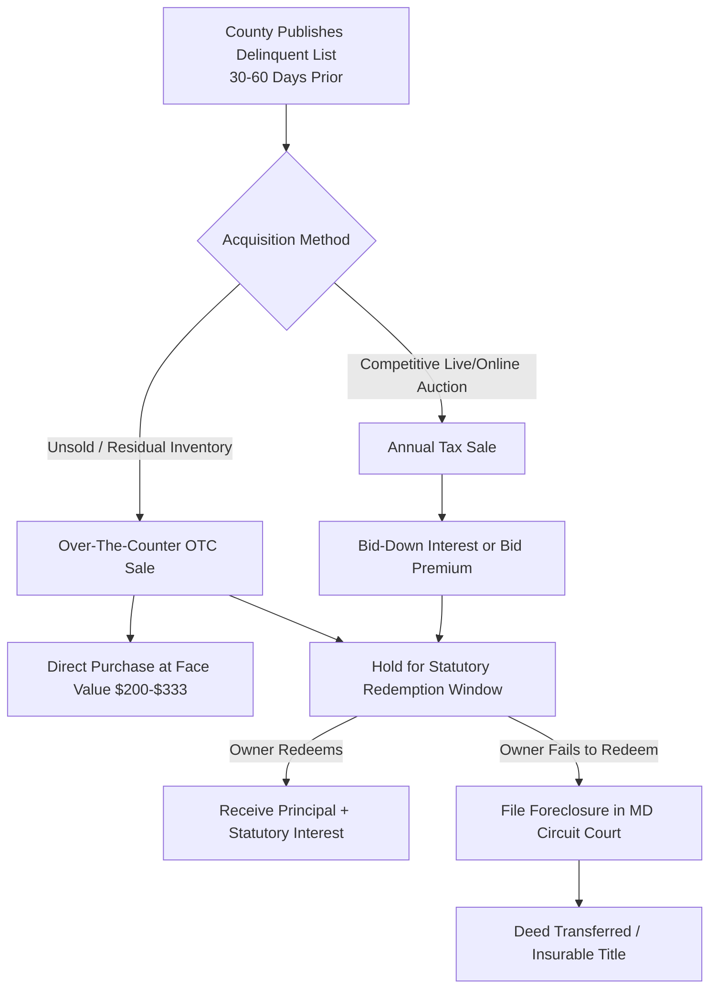

# Maryland Tax Lien Investing

A comprehensive guide to property tax lien investing, statutory redemption periods, over-the-counter (OTC) certificate acquisitions, and judicial circuit court foreclosure procedures across Maryland counties under Maryland's **Tax-Property Article**.

---

## ⚖️ Maryland Statutory Framework: Tax Lien Certificate State

> [!NOTE]
> **Maryland is a Tax Lien Certificate State, NOT a Direct Tax Deed State.**
> When property taxes or municipal utility assessments become delinquent in Maryland, the county or municipal taxing authority does not immediately sell the underlying real estate. Instead, the county auctions a **Tax Lien Certificate** representing the unpaid tax debt. 

### Core Legal Mechanics (Maryland Tax-Property Article)
1. **Certificate Purchase**: An investor purchases a certificate covering the delinquent taxes, penalties, and administrative fees.
2. **Interest Yield**: The investor earns statutory interest on the certificate amount while the delinquent property owner retains legal title and possession.
3. **Statutory Redemption Period**: Property owners have a legal window—typically ranging from **6 months to 2 years** depending on county and property classification—to redeem the certificate by repaying the full certificate face value plus accrued statutory interest and authorized legal expenses.
4. **Circuit Court Foreclosure**: If the owner fails to redeem prior to the expiration of the statutory redemption period, the certificate holder has the statutory right to file a foreclosure lawsuit in the Maryland Circuit Court for the county where the property sits to **extinguish the owner's equity of redemption**.
5. **Deed Issuance & Title Insurability**: Upon final judgment from the Circuit Court, the county executes and delivers a deed conveying fee-simple title to the certificate holder. The resulting title is generally insurable by standard title insurance underwriters once judicial proceedings are properly completed.

---

## 🔄 State-by-State Comparison: Maryland vs. Virginia

| Feature | Maryland (MD) | Virginia (VA) |
| :--- | :--- | :--- |
| **Legal Structure** | **Tax Lien Certificate** | **Judicial Tax Deed Commonwealth** |
| **What Investor Buys** | Unpaid tax certificate / lien debt | Fee-simple real estate via auction |
| **Primary Return Mechanism** | Statutory interest income upon redemption | Real estate equity / immediate ownership |
| **Redemption Window** | 6 months to 2 years post-sale | Ends at hammer fall / court confirmation |
| **Acquiring Ownership** | Foreclosure action filed in Circuit Court | Special Commissioner issues deed after judicial sale |
| **Governing Statute** | MD Code, Tax-Property Article | VA Code § 58.1-3965 et seq. |
| **Reference Wiki Page** | [[Maryland Tax Lien Investing]] | [[Virginia Tax Delinquent Sales and Judicial Auctions]] |

---

## 🏛️ Acquisition Channels in Maryland

Maryland offers two primary avenues for acquiring tax lien certificates:

### 1. Over-The-Counter (OTC) / Leftover Certificates
* **Description**: Certificates that did not receive bids during the annual county auction revert to the county or municipality and become available over-the-counter.
* **Key Advantages**:
  * **Zero Bidding Pressure**: Fixed purchase price at certificate face value ($200 to $333).
  * **Deliberate Due Diligence**: No fast-paced auction timer; investors can perform extensive parcel research prior to buying.
  * **Full Legal Rights**: Carries identical statutory interest rates and circuit court foreclosure rights as auction-bought liens.
* **Best Fit**: Ideal entry-level mechanism for beginners with limited liquid capital (such as a $1,000 deployment budget operating under a $333 per-deal guardrail).

### 2. Competitive Annual County Auctions
* **Description**: Primary sales held annually (frequently in late spring or summer across Maryland jurisdictions). Delinquent lists are published **30 to 60 days** in advance.
* **Bidding Mechanisms**:
  * **Bid-Down System**: In certain jurisdictions, investors bid down the interest rate they are willing to accept.
  * **Premium Bidding**: Investors bid a cash premium over the certificate face value to win high-demand residential or commercial parcels.
* **Capital Requirements**: Typically requires $500 to $3,000+ per certificate, along with registration deposits.

---

## 🔍 Due Diligence & Screening Protocol

Before acquiring any Maryland tax lien certificate (especially OTC inventory), conduct a rigorous five-point screening:

1. **Maryland SDAT Parcel Verification**:
   * Search the Maryland Department of Assessments and Taxation (SDAT) Real Property Database.
   * Verify parcel zoning, land acreage, assessed value, owner of record, and legal description.
2. **Municipal Utility Liens & Water Bills**:
   * Check for massive back-owed municipal water/sewer bills or environmental citations (common in older urban centers like Baltimore City) that could encumber or exceed the property's underlying land value.
3. **Condemnation & Structural Flags**:
   * Filter out condemned, uninhabitable shells or structural hazards unless the investment thesis is strictly based on underlying land value and clear demo costs.
4. **Physical & Virtual Scouting**:
   * Inspect the street-level surroundings using GIS/satellite imagery or in-person drive-bys. Confirm occupancy, neighborhood upkeep, and whether the parcel is landlocked.
5. **Redemption Probability vs. Foreclosure Feasibility**:
   * Distinguish between parcels likely to be redeemed (occupied single-family homes generating reliable interest income) and vacant/abandoned lots (potential deed acquisition plays requiring legal foreclosure budgets).

---

## 💰 Capital Guardrails & Deal Tiers

According to the strategic framework established by [[Tax Lien School]] in the [[Summary - Blueprint Chetan Thakur]], tax lien investing should be tiered strictly by available capital:

* **Tier 1 — OTC Certificates ($200 – $333)**: 
  * *Focus*: Urban residential lots or minor liens in [[Baltimore City Tax Sale Market]].
  * *Goal*: Learn redemption tracking and earn statutory yield with minimal liquid risk.
* **Tier 2 — Auction Certificates ($500 – $2,000)**: 
  * *Focus*: Moderate-value residential lots in [[Carroll County Land and Tax Sale Market]] or [[Prince Georges County Tax Sale Market]].
  * *Goal*: Scaled interest returns on higher-value collateral.
* **Tier 3 — Circuit Court Foreclosure ($5,000 – $15,000 Total Budget)**: 
  * *Focus*: Unredeemed vacant lots or parcels with strong equity spreads.
  * *Goal*: Fee-simple title acquisition via attorney-led foreclosure action (12 to 24-month execution window).

---

## 🔗 Related Wiki Pages
* [[Summary - Blueprint Chetan Thakur]]
* [[Maryland Tax Lien Deal Structuring - Budget and Guardrails]]
* [[Tax Lien School]]
* [[Baltimore City Tax Sale Market]]
* [[Prince Georges County Tax Sale Market]]
* [[Carroll County Land and Tax Sale Market]]
* [[Maryland Mind Map]]
* [[Land Banks and Cheap Maryland Lots]]
* [[Virginia Tax Delinquent Sales and Judicial Auctions]]
