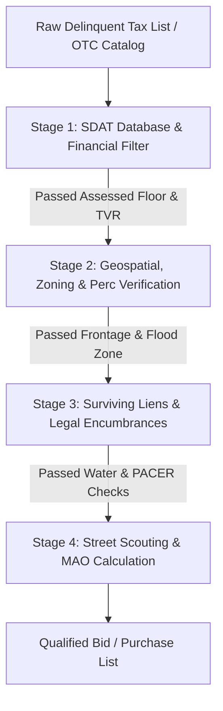
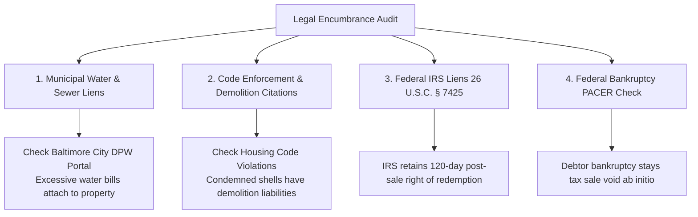

# Maryland Tax Sale Due Diligence and Parcel Screening

A comprehensive, step-by-step operational handbook for screening delinquent tax properties, conducting Maryland SDAT database searches, uncovering surviving municipal utility liens, and executing the 4-Stage Due Diligence Funnel across Maryland jurisdictions.

---

## 🎯 The Maryland Due Diligence Protocol

When evaluating delinquent tax lien lists or over-the-counter (OTC) catalogs in Maryland (e.g., Baltimore City, Prince George's County, Carroll County), follow this four-stage execution pipeline:

---

## 📋 Stage 1: Maryland SDAT Real Property Search & Desktop Filter

The **Maryland Department of Assessments and Taxation (SDAT)** is the primary public record database for all 24 Maryland jurisdictions.

### 1. Navigating SDAT Real Property Database
* **Portal**: [Maryland SDAT Real Property Search](https://dat.maryland.gov/realproperty/Pages/default.aspx)
* **Search By**: Select County → Search by **Street Address** or **Account Identifier** (District & 6-digit Account Number).
* **Key SDAT Data Fields to Extract**:
  * **Use Class**: Verify `Residential` (Townhouse, Single Family Detached) or `Commercial/Industrial`.
  * **Principal Residence**: If `Yes`, redemption probability is extremely high (strong interest-income play). If `No`, higher potential for tax deed default.
  * **Phase-in Assessment Values**:
    * **Land Value**: Baseline raw ground value.
    * **Improvement Value**: Structure value. If Improvement Value is **$0**, confirm if it is a vacant lot or a demolished/burned-out shell.
    * **Total Assessed Value**: Used for Tax-to-Value Ratio (TVR) calculation.
  * **Deed Reference / Transfer Date**: Identifies how long current owner has held title and prior sale prices.
  * **Legal Description**: Map, Parcel, Block, and Lot coordinates.

### 2. Algorithmic Screening Filters
* **Assessed Value Floor**: Eliminate properties with Total Assessed Value $< \$5,000$.
* **Tax-to-Value Ratio (TVR)**:
  $$\text{TVR} = \frac{\text{Lien Amount}}{\text{Total Assessed Value}} \times 100$$
  * $\text{TVR} \le 10\%$: **Prime candidate** (substantial equity cushion).
  * $\text{TVR} = 10\% - 20\%$: **Acceptable** (standard tax sale range).
  * $\text{TVR} > 20\%$: **High Risk** (requires deep comps check; taxes may exceed land value).

---

## 🗺️ Stage 2: Geospatial, Zoning & Soil/Utility Screening

### 1. Urban Infill vs. Rural County Dynamics

| Market Category | Example Counties | Infrastructure & Utility Rules | Key Screening Metric |
| :--- | :--- | :--- | :--- |
| **Urban Infill** | [[Baltimore City Tax Sale Market]] | Municipal Public Water & Sewer connected. **No perc test required**. | Check zoning density (R-7, R-8) and alley access. |
| **Suburban / Metro** | [[Prince Georges County Tax Sale Market]] | Public Water/Sewer in developed corridors; well/septic in rural tiers. | Verify Water & Sewer Category (S-1/W-1 vs S-5/W-5). |
| **Rural / Exurban** | [[Carroll County Land and Tax Sale Market]] | Private Well & On-site Septic Disposal Systems. | **Mandatory Perc Approval & Reserve Field** (see [[Maryland Mind Map]]). |

### 2. GIS Map Screening
* **County GIS Portals**: Use Baltimore City CityView, PGAtlas (Prince George's), or Carroll County GIS.
* **Frontage Check**: Confirm $\ge 25\text{–}30$ feet of dedicated public road frontage. Disqualify landlocked lots.
* **FEMA Flood Zone**: Verify on [FEMA Map Service Center](https://msc.fema.gov/). Disqualify parcels in **Flood Zone A, AE, or VE** unless on elevated ground.

---

## ⚖️ Stage 3: Surviving Liens & Legal Encumbrance Verification

In Maryland, tax lien certificates extinguish subordinate private mortgages upon Circuit Court foreclosure, but certain public/federal encumbrances survive:

### 1. Municipal Utility Liens (Baltimore City & Municipalities)
* Baltimore City Department of Public Works (DPW) utility charges attach as municipal super-priority liens.
* Verify total utility payoff balance prior to bidding to ensure unpaid water bills do not wipe out profit margins.

### 2. Housing Code Violations & Condemnation Notices
* Search Baltimore City Department of Housing and Community Development (DHCD) Code Enforcement database.
* Avoid properties with **active Vacant Building Notices (VBN)** or emergency demolition orders unless bidding strictly for nominal land value.

### 3. Federal Tax Liens (IRS 120-Day Rule)
* IRS tax liens do not block Maryland tax sales, but pursuant to **26 U.S.C. § 7425**, the Internal Revenue Service has a **120-day statutory window** post-foreclosure to redeem the property from the buyer at the purchase price plus 6% interest.

### 4. PACER Federal Bankruptcy Check (11 U.S.C. § 362)
* On auction morning (or before submitting OTC certificate funds), check the **U.S. Bankruptcy Court for the District of Maryland** via PACER.
* If the owner filed Chapter 7 or Chapter 13 bankruptcy, the **Automatic Stay** protects the estate; any tax sale purchase is **legally void *ab initio***.

---

## 🚗 Stage 4: Physical Scouting & Bidding Calculations

### 1. Street-Level Verification Checklist
* [ ] **Physical Existence**: Verify the structure actually exists (has not burned down or been leveled).
* [ ] **Roof & Envelope**: Check for roof sag, missing tarps, or boarded openings.
* [ ] **Occupancy**: Look for cars in driveway, electric meters spinning, lawn maintenance, or mail accumulation.
* [ ] **Neighborhood Trajectory**: Check for adjacent renovations vs. systemic block abandonment.

### 2. Maximum Allowable Bid (MAO) Formula for Maryland Tax Deeds
$$\text{MAO} = (\text{ARV} \times 0.70) - \text{Estimated Rehab} - \text{Title Certification / Quiet Title (\$2,500 - \$4,000)} - \text{Closing Costs}$$

### 3. Capital Guardrail Formula for Maryland Tax Liens
$$\text{Max Lien Investment Per Deal} \le \frac{\text{Liquid Cash Allocation}}{3}$$
*(For example: on a $1,000 liquid capital base, cap maximum single-certificate risk at **$333** as established in [[Summary - Blueprint Chetan Thakur]]).*

---

## 🚫 The 5 Instant Red-Flag Disqualification Rules

| Red Flag | Description | Maryland Specific Risk | Action |
| :--- | :--- | :--- | :--- |
| **1. Unbuildable Sliver** | Lot width $< 25$ ft or area $< 2,500$ sq ft | Cannot meet county minimum setback or septic reserve rules. | **DISQUALIFY** |
| **2. Structure Mismatch** | Improvement Value is $\$0$ on a residential street | Demolished or burned shell requiring $\$15\text{k}+$ debris removal. | **DISQUALIFY** |
| **3. Environmental Contamination** | Former gas station, dry cleaner, or auto shop | Strict **CERCLA strict liability** attaches to title holder. | **DISQUALIFY** |
| **4. Landlocked Lot** | No dedicated road frontage or easement | Requires expensive Chancery Court easement litigation. | **DISQUALIFY** |
| **5. 100% Floodway** | Sits entirely in FEMA Zone A/VE | Building permits rejected by Maryland Department of Environment. | **DISQUALIFY** |

---

## 🔗 Related Wiki Pages
* [[Property Due Diligence Funnel]]
* [[Maryland Tax Lien Investing]]
* [[Maryland Mind Map]]
* [[Land Banks and Cheap Maryland Lots]]
* [[Baltimore City Tax Sale Market]]
* [[Prince Georges County Tax Sale Market]]
* [[Carroll County Land and Tax Sale Market]]
* [[Summary - Blueprint Chetan Thakur]]
* [[Maryland Tax Lien Deal Structuring - Budget and Guardrails]]
* [[Tax Title Clearance and Quiet Title Actions]]
