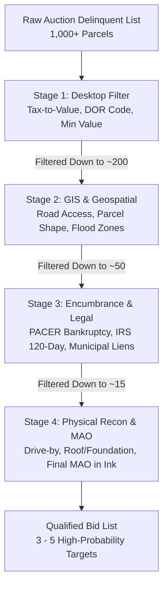

# Property Due Diligence Funnel

A systematic, four-stage due diligence filtration pipeline designed to eliminate toxic real estate assets, identify surviving municipal/federal liens, and calculate Maximum Allowable Bids (MAO) before committing auction capital.

---

## 🌪️ The 4-Stage Filtration Funnel

### Stage 1: Desktop Algorithmic Filter
* **Assessed Value Floor**: Disqualify properties with Total Assessed Value $< \$5,000$ (indicates drainage easements or unbuildable slivers).
* **Tax-to-Value Ratio (TVR)**: Calculate $\text{TVR} = \frac{\text{Opening Tax Bid}}{\text{Just Assessed Value}}$. If $\text{TVR} > 20\%$, flag as high-risk unless supported by strong land comps.
* **Property Use Code (DOR)**: Filter for Single Family Residential (DOR 0100/01) or platted buildable residential vacant land (DOR 0000).

### Stage 2: GIS & Geospatial Screening
* **Frontage & Dimension**: Verify minimum 25–30 feet of dedicated public road frontage. Disqualify landlocked parcels without recorded ingress/egress easements.
* **Shape & Topography**: Eliminate irregularly shaped retention ponds, pipeline right-of-ways, or steep ravines.
* **FEMA Flood Hazard**: Check FEMA Map Service Center. Eliminate parcels sitting 100% inside **Flood Zone A, AE, or VE** without elevated foundations.

### Stage 3: Encumbrance & Surviving Lien Clearance
* **IRS Federal Tax Liens (26 U.S.C. § 7425)**:
  * IRS liens do **not** prevent tax deed foreclosure, but the IRS retains a **120-day statutory right of redemption** post-sale to buy back the property at the bid price plus 6% interest.
* **Municipal Code Enforcement & Demolition Liens**:
  * Municipal water/sewer utility bills, code violation fines, and weed abatement liens survive tax sales in many jurisdictions (e.g., Baltimore City, Chicago).
* **Bankruptcy Automatic Stay (11 U.S.C. § 362)**:
  * Check federal bankruptcy records via **PACER** on auction morning. Bidding on a debtor's parcel with an active bankruptcy stay renders the sale **void *ab initio***.

### Stage 4: Physical Scouting & Maximum Allowable Bid (MAO)
* **Drive-by Verification**: Confirm structure is standing, check roof pitch/sag, foundation settling, and neighborhood comps.
* **MAO Calculation**: Never bid emotionally. Calculate ceiling bid in ink before auction starts.

---

## 🚫 5 Instant Disqualification ("Red Flag") Rules

| Red Flag | Description | Risk / Impact |
| :--- | :--- | :--- |
| **1. Sliver / Spite Strip** | Parcel width $< 25$ ft or area $< 2,500$ sq ft | Unbuildable; zero retail resale value. |
| **2. Land-to-Building Mismatch** | Improvement value is $\$0$ in a $\$250\text{k}+$ neighborhood | Burned down or demolished structure; debris cleanup liability. |
| **3. Environmental Hazard** | Former gas station, auto body, dry cleaner, or scrapyard | Strict federal **CERCLA liability** attaches to deed holder for toxic soil cleanup. |
| **4. Landlocked Status** | No deeded right-of-way or public street frontage | Costly ($5,000–$15,000) easement lawsuit required to gain access. |
| **5. 100% FEMA Flood Zone A/VE** | Wetland / floodway without buildable envelope | Uninsurable; severe construction bans from local zoning boards. |

---

## 🧮 Bidding Mathematics & MAO Formulas

### 1. For Tax Deed Wholesale / Flip Properties
$$\text{MAO} = (\text{After Repair Value (ARV)} \times 0.70) - \text{Estimated Rehab} - \text{Title Certification (\$2,500)} - \text{Holding/Closing Costs}$$

### 2. For Redeemable Tax Deeds (Texas / Georgia)
$$\text{Max Bid} \le \text{ARV} \times 0.50$$
*(Ensures a lucrative 25% penalty yield upon redemption, or a 50% equity discount upon deed default).*

### 3. For Tax Lien Certificates
* **Bid-Down States (FL, AZ)**: Florida has a statutory **5% minimum floor** guaranteeing a 5% yield regardless of how low the bid drops (bid down to 0.25%).
* **Premium Bidding States (CO, IN)**: Total bid (base lien + premium) must never exceed **15% of conservative property liquidation value**.

---

## 🔨 Renovation Cost Quick-Estimator (2026 Benchmarks)

| Component | Scope / Standard Condition | Rule-of-Thumb Benchmark |
| :--- | :--- | :--- |
| **Roof** | Architectural Shingle Tear-off & Replacement | $4.50–$7.00 / sq ft ($6,000–$12,000 per avg home) |
| **HVAC** | 3-Ton Complete System (Compressor + Air Handler) | $6,500–$9,500 |
| **Plumbing** | Full PEX Repipe (Replacing stripped copper) | $4,000–$7,500 |
| **Electrical** | New 200A Panel + Full House Rewire | $5,000–$10,000 |
| **Full Cosmetic** | Interior paint, LVP flooring, trim, light fixtures | $15–$22 / sq ft |
| **Kitchen Rehab** | Shaker cabinets, granite/quartz countertops, appliances | $8,000–$16,000 |
| **Bathroom Rehab** | Full gut, new vanity, tile surround, tub/toilet | $4,500–$8,000 per bathroom |

---

## 🔗 Related Wiki Pages
* [[Tax Lien and Deed Market Regimes]]
* [[50-State Statutory Tax Sale Matrix]]
* [[Tax Title Clearance and Quiet Title Actions]]
* [[Maryland Tax Lien Investing]]
* [[Virginia Tax Delinquent Sales and Judicial Auctions]]
* [[Tax Lien School]]
