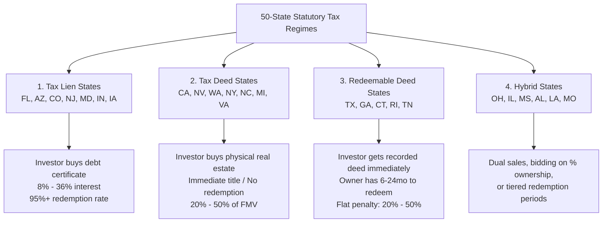

# Tax Lien and Deed Market Regimes

A foundational framework classifying all 50 U.S. states into four distinct statutory property tax foreclosure systems, governing investor yields, redemption mechanics, and property acquisition pathways.

---

## ⚖️ The Super-Priority Lien Rule

> [!NOTE]
> **Super-Priority Status**: Property tax liens are statutory super-priority liens. When assessed by a municipal or county taxing authority, they sit senior to all private mortgages, deeds of trust, mechanic's liens, and judgment liens.
> When foreclosed according to state statute with proper constitutional notice (*Mullane v. Central Hanover Bank & Trust Co.* and *Jones v. Flowers*), **all subordinate private mortgages and liens are extinguished by operation of law**.

---

## 🏛️ The Four Statutory Archetypes

### 1. Tax Lien States (e.g., FL, AZ, CO, NJ, MD, IN, IA)
* **Instrument**: Tax Lien Certificate representing delinquent tax debt.
* **Investor Objective**: Predictable high-yield passive interest income.
* **Redemption Period**: Typically **1 to 3 years** (Maryland has an accelerated 6-month window).
* **Yield Mechanics**: Statutory interest rates range from **8% to 36%**. Over 95% of liens are redeemed by owners or mortgage servicers.
* **Default Outcome**: If unredeemed, certificate holder applies for a tax deed or initiates judicial circuit court foreclosure (see [[Maryland Tax Lien Investing]]).

### 2. Tax Deed States (e.g., CA, NV, WA, NY, NC, MI, VA)
* **Instrument**: Fee-simple real estate deed.
* **Investor Objective**: Direct real property acquisition at 20% to 50% of Fair Market Value (FMV).
* **Redemption Period**: **None** post-sale (or limited to statutory upset-bid periods such as North Carolina's 10-day window).
* **Yield Mechanics**: Real estate equity capture upon resale, wholesale, or rental.

### 3. Redeemable Deed States (e.g., TX, GA, CT, RI, TN)
* **Instrument**: Recorded tax deed subject to a statutory right of redemption.
* **Investor Objective**: High-velocity penalty returns or rapid property ownership.
* **Redemption Period**: **6 to 24 months**.
* **Yield Mechanics**: Mandatory flat penalty applied to the entire purchase price regardless of redemption timing:
  * **Texas**: 25% flat penalty in Year 1; 50% in Year 2.
  * **Georgia**: 20% flat penalty in Year 1 (+10% for each subsequent year).

### 4. Hybrid States (e.g., OH, IL, MS, AL, LA, MO)
* Blend certificate auctions with accelerated deed forfeiture, dual-stage public sales (e.g., Missouri 1st/2nd sales vs. 3rd sales conveying instant title), or percentage-ownership bidding (e.g., Iowa, Mississippi).

---

## 🎯 Strategic Selection Matrix

| Investor Strategy | Target Jurisdictions | Core Mechanism | Target Return Benchmark |
| :--- | :--- | :--- | :--- |
| **Max Passive Cash Flow** | Florida, Illinois, Iowa, Maryland, New Jersey, Arizona | High statutory interest caps (16%–36%) | 12%–18% annualized |
| **Max Short-Term Penalty** | Texas, Georgia, Connecticut, Rhode Island | Mandatory flat redemption penalties | 20%–25% flat return |
| **Direct Property Acquisition** | California, Washington, Nevada, North Carolina, Virginia | Tax deeds with no post-sale redemption | 30%–60% equity spread |
| **Zero-Competition Purchases** | Florida, Pennsylvania, Texas, Maryland (OTC/Leftovers) | Over-the-counter / repository / struck-off lists | Buy at face value ($200–$1,000) |

---

## 🔗 Related Wiki Pages
* [[Regional Mid-Atlantic Tax Sale Master Directory - MD VA NJ DE]]
* [[Tax Lien State Directory - 14 Investor Certificate Jurisdictions]]
* [[50-State Statutory Tax Sale Matrix]]
* [[Delaware Monition and Tax Deed Market]]
* [[New Jersey Municipal Tax Sale Market]]
* [[Virginia Judicial Tax Deed and Independent Cities Market]]
* [[Maryland Tax Lien Investing]]
* [[Property Due Diligence Funnel]]
* [[Tax Title Clearance and Quiet Title Actions]]
* [[Seller Financing and Land Contracts]]
* [[Virginia Tax Delinquent Sales and Judicial Auctions]]
* [[Tax Lien School]]

