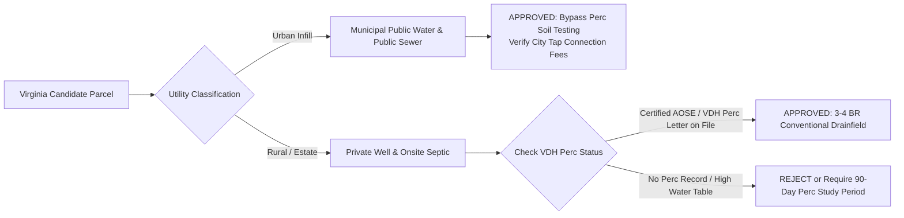
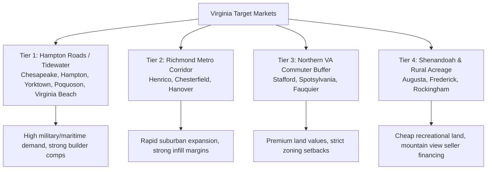

# Virginia Land and Tax Deed Buy Box

A standardized, quantifiable **Buy Box** and property qualification criteria for acquiring real estate, vacant land, and tax-foreclosed properties across the Commonwealth of Virginia under **Virginia Code § 58.1-3965 et seq.** and open-market builder flipping strategies.

---

## ⚖️ Virginia Statutory Context: Judicial Tax Deed Commonwealth

> [!NOTE]
> **Virginia is a Judicial Tax Deed Commonwealth, NOT a Tax Lien State.**
> Local cities and counties (e.g., Chesapeake, Hampton, Richmond, Norfolk) do not issue interest-bearing tax lien certificates. When property taxes are delinquent for $\ge 2\text{ to }3\text{ years}$, the municipality initiates a Circuit Court judicial foreclosure lawsuit to sell the **physical real estate fee-simple at public auction via Special Commissioners**.
> **Right of Redemption**: Extinguished when the hammer falls at auction (or upon judicial decree confirmation). Winning bidders receive a **Special Warranty Deed** with no post-sale redemption period.

---

## 🎯 The Virginia Dual Buy Box Framework

```mermaid
graph TD
    A[Virginia Acquisition Engine] --> B[Buy Box 1: Judicial Tax Deed & Surplus Auctions<br>Target: 50% - 70% Below Market Assessed Value]
    A --> C[Buy Box 2: Open-Market Land Flipping & Subdivision<br>Target: Build-Ready / Perc-Approved Acreage for Builders]

    B --> D[Source: TACS, Virginia Auction Co, Bid4Assets, GovDeals]
    C --> E[Source: REIN MLS, Bright MLS, LandSearch, Direct Mail]

    D --> F[Screening: 4-Stage Due Diligence Funnel]
    E --> F

    F --> G[Exit 1: Retail Builder Flip<br>Cash Spread $30k - $80k]
    F --> H[Exit 2: Seller Financing Note<br>$3k Down | 10% Int | 10-Yr Term]
    F --> I[Exit 3: Speculative Land Hold]
```

---

## 📋 Standardized Virginia Buy Box Criteria

### 1. Financial & Pricing Parameters

| Criterion | Tax Deed Auction Strategy | Open-Market Builder Flip Strategy |
| :--- | :--- | :--- |
| **Target Purchase Price** | **$5,000 – $40,000** (Cash / Certified Funds) | **$15,000 – $150,000** (Contract with contingencies) |
| **Discount to Fair Market Value** | Minimum **50% to 70% below ARV** | Minimum **30% to 50% below Builder Comps** |
| **Maximum Allowable Bid (MAO)** | $\text{MAO} = (\text{ARV} \times 0.70) - \text{Site Prep} - \$2,500\text{ (Title)} - \text{Closing}$ | $\text{Offer} \le \text{Resale Value} \times 0.60 - \text{Entitlement Costs}$ |
| **Holding & Legal Budget** | $2,500 – $3,500 for Tax Title Services (TTS) certification | $1,500 – $3,000 for perc tests, boundary survey, and perc engineering |

---

### 2. Zoning & Property Classification

* **Target Property Classes**:
  * **Single-Family Residential Infill Lots**: Zoned R-1, R-2, R-4, R-8, or R-15 (minimum lot size varies from 5,000 to 15,000 sq ft).
  * **Suburban / Exurban Acreage**: 1.0 to 10.0+ acres zoned Agricultural (A-1) or Rural Residential (RR) with subdivision by-right potential (e.g. [[Analysis - 1813 Shillelagh Road Chesapeake VA]] and [[Analysis - 1836 Mount Pleasant Road Chesapeake VA]]).
* **Instant Disqualifications (Red Flags)**:
  * ❌ Unbuildable slivers (lot width $< 30\text{ ft}$ or area $< 3,000\text{ sq ft}$).
  * ❌ Retention basins, drainage easements, or pipeline rights-of-way.
  * ❌ Commercial industrial yards with potential toxic soil cleanup liabilities under federal CERCLA rules.

---

### 3. Utilities, Soil & Perc Requirements (Critical in VA)

Virginia's coastal and Piedmont soil geology requires strict utility verification:



* **Tier 1 (Public Utility Connected)**:
  * Municipal public water and sanitary sewer available at the street boundary (e.g., Chesapeake, Hampton, Norfolk, Newport News infill lots). Eliminates septic risk.
* **Tier 2 (Well & Septic Lots)**:
  * **Mandatory Perc Approval**: Must possess an active **Virginia Department of Health (VDH)** certification or **Authorized Onsite Soil Evaluator (AOSE)** letter for a 3-to-4 bedroom conventional or engineered (alternative) septic system.
  * **100% Reserve Drainfield Area**: Virginia health regulations require a dedicated primary absorption field plus a 100% reserve area.
  * **Wetland / High Water Table Warning**: Avoid low-lying coastal tracts bordering the Great Dismal Swamp or tidal marshes where high water tables cause perc failure (see [[Hampton Roads Virginia Land Market]]).

---

### 4. Road Access & Geospatial Parameters

* **Road Frontage**: Minimum **30 to 50 feet** of direct, dedicated frontage on a state-maintained (VDOT) or municipal paved road.
* **Landlocked Status**: **STRICTLY REJECT** any parcel lacking deeded ingress/egress rights or dedicated public right-of-way.
* **FEMA Flood Hazard Screening**:
  * **Preferred**: **FEMA Flood Zone X** (minimal flood risk; no mandatory flood insurance).
  * **Acceptable with Caution**: Zone AE (100-year floodplain) *only* if neighboring homes are elevated and builder comps support elevated piling/crawlspace construction costs.
  * **Strictly Disqualify**: **Zone VE** (coastal high velocity velocity wave zones) or 100% designated floodways.
* **Chesapeake Bay Preservation Act (CBPA)**:
  * Parcels in Tidewater Virginia (Hampton Roads, Northern Neck, Middle Peninsula) must have a buildable footprint outside the **100-foot Resource Protection Area (RPA) buffer** surrounding tidal wetlands.

---

### 5. Encumbrance & Surviving Lien Clearances

* **Circuit Court Special Commissioner Decree**: Extinguishes delinquent real estate taxes, prior deeds of trust, mechanic's liens, and judgment liens against the prior owner.
* **Surviving Checks**:
  1. **PACER Bankruptcy Audit**: Verify record owner did not file Chapter 7/13 bankruptcy prior to the auction hammer fall (prevents violation of the 11 U.S.C. § 362 Automatic Stay).
  2. **IRS Federal Tax Liens**: The IRS retains a **120-day right of redemption** under 26 U.S.C. § 7425 (buyer gets bid amount refunded $+ 6\%$ interest if redeemed).
  3. **Municipal Code / Demolition Liens**: Confirm no unrecorded city nuisance abatement charges exist.

---

## 🗺️ Target Submarket Tiers in Virginia



---

## 🏛️ Sourcing Channels & Official Portals

1. **Taxing Authority Consulting Services (TACS)**:
   * Portal: [taxva.com](https://taxva.com)
   * Primary Special Commissioner for Virginia cities and counties; posts upcoming judicial auctions and online bidding catalogs.
2. **Virginia Auction Company**:
   * Portal: [vaauctionco.com](https://vaauctionco.com)
   * Conducts live and online municipal tax deed auctions throughout Hampton Roads and Central Virginia.
3. **Bid4Assets Virginia Tax Sale Portal**:
   * Portal: [bid4assets.com](https://bid4assets.com)
   * Hosts major Virginia online judicial tax deed sales.
4. **GovDeals Virginia Surplus Portal**:
   * Portal: [govdeals.com](https://govdeals.com)
   * Disposes of municipal and county surplus land at starting bids under $1,000.
5. **Regional MLS (REIN MLS & Bright MLS)**:
   * Sourcing motivated seller land listings with perc approvals or subdivision plays.

---

## 📊 Summary Quick-Reference Buy Box Matrix

| Filter Parameter | Target Specification | Hard Disqualification Ceiling |
| :--- | :--- | :--- |
| **Property Type** | Single-Family Lot (R-1/R-2/R-4) or Rural Acreage (A-1/RR) | Commercial Industrial, Unbuildable Slivers, Retention Ponds |
| **Max Purchase Price** | $\le 40\% - 60\%$ of Conservative Resale Value | $> 70\%$ of Fair Market Value |
| **Road Frontage** | $\ge 30\text{ ft}$ dedicated VDOT / paved municipal street | Landlocked / zero legal easement |
| **Utilities / Soil** | Public Water/Sewer **OR** Certified 3-4 BR VDH Perc Letter | Low swampy soil, failed perc test, no perc contingency |
| **Flood Hazard** | FEMA Zone X (or elevated Zone AE) | Zone VE (Coastal wave hazard) / 100% Floodway |
| **CBPA Environmental** | Building envelope $\ge 100\text{ ft}$ from tidal wetlands | Sits 100% inside Resource Protection Area (RPA) |
| **Title Clearance** | Special Commissioner Judicial Deed + TTS Title Certification | Active Bankruptcy automatic stay / defective court notice |

---

## 🔗 Related Wiki Pages
* [[Virginia Tax Delinquent Sales and Judicial Auctions]]
* [[Hampton Roads Virginia Land Market]]
* [[Active Land Listings - Chesapeake Hampton Yorktown Poquoson VA]]
* [[Analysis - 1813 Shillelagh Road Chesapeake VA]]
* [[Analysis - 1836 Mount Pleasant Road Chesapeake VA]]
* [[Property Due Diligence Funnel]]
* [[Tax Title Clearance and Quiet Title Actions]]
* [[Seller Financing and Land Contracts]]
* [[50-State Statutory Tax Sale Matrix]]
