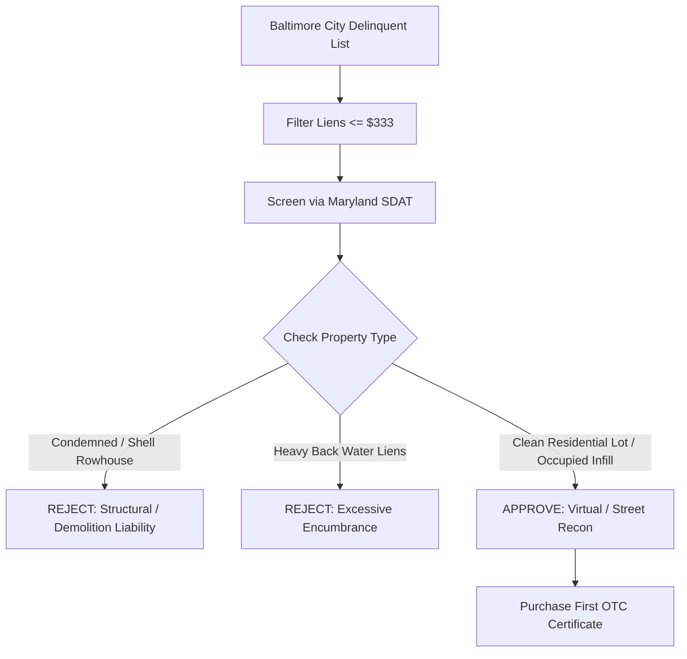

# Baltimore City Tax Sale Market

An operational analysis of the Baltimore City property tax sale market, over-the-counter (OTC) certificate availability, urban lot dynamics, and low-capital entry strategies under Maryland's Tax-Property statutes.

---

## 📊 Market Overview & Fit

* **Status in Safe Deed Framework**: **Best Fit** for novice investors and small liquid cash allocations ($1,000 total liquid cash).
* **Certificate Price Range**: **$200 – $1,000**
* **Auction Schedule**: Annual City Tax Sale (held in late spring), followed by an ongoing **Over-the-Counter (OTC)** unsold certificate inventory.
* **Per-Deal Guardrail Alignment**: Abundant inventory under the **$333 max-per-deal** risk threshold identified in [[Summary - Blueprint Chetan Thakur]].

---

## 🎯 Strategic Advantages for Entry-Level Investors

1. **Massive Low-Face-Value Inventory**:
   * Baltimore City consistently maintains Maryland's highest volume of low-denomination tax lien certificates (frequently priced between $200 and $500).
2. **Active Post-Sale OTC Catalog**:
   * Liens that do not sell at the annual auction enter the city's OTC inventory. Investors can purchase these certificates directly over the counter without competitive bidding pressure.
3. **No Perc Testing Constraints**:
   * As documented in [[Land Banks and Cheap Maryland Lots]], parcels in Baltimore City are urban infill properties connected to municipal public water and sewer, bypassing the expensive soil absorption risks of rural septic/perc testing.
4. **Ideal Skill-Building Environment**:
   * Allows investors to master Maryland SDAT parcel screening, lien record-keeping, statutory interest collection, and redemption tracking with minimal capital exposure.

---

## ⚠️ Due Diligence & Risk Factors

While Baltimore City offers low entry costs, investors must navigate specific urban tax sale risks:

1. **Back-Owed Water Bills**: Baltimore City properties can accumulate substantial delinquent municipal water bills that attach to the property. Verify total lien payoff amounts.
2. **Condemned Shells vs. Vacant Lots**: Avoid buying certificates on structurally compromised or condemned brick shells unless prepared for municipal citation enforcement. Prioritize occupied residential properties (for interest yield) or clean vacant infill lots.
3. **Redemption Timelines**: Most residential owners redeem within 6 to 12 months, yielding the statutory interest rate.

---

## 📝 Immediate Action Checklist
* [ ] Contact the **Baltimore City Tax Sale Administrator** to request the active OTC leftover lien catalog.
* [ ] Confirm approved payment methods, registration documentation, and certificate assignment forms.
* [ ] Filter candidate list for certificates $\le \$333$ and cross-reference on the Maryland SDAT database.

---

## 🔗 Related Wiki Pages
* [[Maryland Tax Lien Investing]]
* [[Summary - Blueprint Chetan Thakur]]
* [[Maryland Tax Lien Deal Structuring - Budget and Guardrails]]
* [[Land Banks and Cheap Maryland Lots]]
* [[Prince Georges County Tax Sale Market]]
* [[Carroll County Land and Tax Sale Market]]
* [[Maryland Mind Map]]
