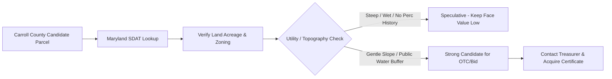

# Carroll County Land and Tax Sale Market

An evaluation of Carroll County's property tax sale dynamics, rural and semi-rural vacant land opportunities, **live FY 2026 Tax Sale Results (June 30, 2026)**, and county-held certificate status.

---

## 🏛️ Official 2026 Contacts & Statutory Rules

* **Tax Collector**: Jennifer D. Hobbs — Carroll County Collections Office (Department of the Comptroller)
* **Direct Tax Sale Contact Email**: **`bgesell@carrollcountymd.gov`** (per Item #10 of [2026 Terms of Sale](file:///c:/Obsedian/RealEstateResearch/RealEstateResearch/raw/Carroll_Terms_2026.pdf)) | General Collections Email: `collections@carrollcountymd.gov` / `cctaxoffice@carrollcountymd.gov`
* **Tax Sale Direct Phone**: **(410) 386-2965** | General Collections Phone: **(410) 386-2971**
* **Office Address**: 225 North Center Street, Westminster, MD 21157 (Hours: 8:00 AM – 5:00 PM)
* **Auction Portal**: [carroll.marylandtaxsale.com](https://carroll.marylandtaxsale.com/) (RealAuction — annual sale held late June; FY 2026 auction closed June 30, 2026)
* **Statutory Interest Rate**: **14.0% per annum** (non-owner occupied) | **10.0% per annum** (owner-occupied)
* **Redemption Window**: **6 Months** (non-owner occupied — FY 2026 foreclosure window opens **December 30, 2026**) | **9 Months** (owner-occupied — opens March 30, 2027)
* **OTC Policy Caveat**: Unlike Prince George's or Anne Arundel, Carroll County **does not publish a public OTC shopping catalog** (`0` struck off in FY 2025; only **3 parcels** went unsold to `Bidder #1: Carroll County` in FY 2026). Assignments must be requested directly from the Collections Office (`bgesell@carrollcountymd.gov`) or negotiated privately with winning bidders per Item #13 of the Terms of Sale.

---

## 📋 Live FY 2026 County-Held (`Bidder #1: Carroll County`) Parcels

Out of all properties auctioned on June 30, 2026 ([Carroll_FY26_Results.pdf](file:///c:/Obsedian/RealEstateResearch/RealEstateResearch/raw/Carroll_FY26_Results.pdf)), only **3 parcels** received no bids and were struck off to Carroll County:

| Parcel / Account # | Owner of Record | Premise Address / Legal | Zoning & Size | 2026 SDAT Value | FY26 Lien Bid | LTV % | Title Grade & Deed |
| :--- | :--- | :--- | :--- | :-: | :-: | :-: | :--- |
| **`04010914`** *(SDAT `0704010914`)* | **BEITLER JOHN** *(Severn, MD)* | Old Finksburg Rd, Finksburg 21048 (`W/S Old Finksburg Rd NW of Finksburg`) | `R-400` \| 1.76 Acres | **\$187,600** *(100% Land)* | **\$16,790.94** | **8.95%** | **Grade B (80/100)** \| `L.04785/F.0525` (`2006-03-06`) |
| **`04015517`** *(SDAT `0704015517`)* | **BUNDY REODGER W** *(Waynesboro, PA)* | 2235 Carrollton Rd, Westminster 21157 (`33,632 SF W/S Carrollton Rd`) | `Agric` \| 0.772 Acres | **\$136,900** *(100% Land)* | **\$13,422.28** | **9.80%** | **Grade B (75/100)** \| `L.01913/F.0897` (`1997-05-23`) |
| **`14430541`** *(SDAT `0714430541`)* | **KENNELL WALTER H & JULIE A** *(Woodbine, MD)* | Dorsey Ln, Sykesville 21784 (`PAR C - 0.694 AC Plat 52-128/132 Chimney Rock`) | `Agric` \| 0.694 Acres | **\$3,400** *(Residual Parcel)* | **\$1,168.93** | **34.38%** | **Grade B (82/100)** — *Plat Strip Caution* \| `L.03697/F.0638` |

---

## 📊 Market Overview & Fit

* **Status in Safe Deed Framework**: **Backup Target & Rural Contrast Market** to compare against urban lien dynamics.
* **Certificate Price Range**: **$300 – $2,000**
* **Auction Schedule**: Annual County Tax Sale with potential **OTC (Over-The-Counter)** unsold certificate availability.
* **Geographic Focus**: Semi-rural acreage, exurban residential lots, and small towns (Westminster, Eldersburg, Taneytown, Mount Airy).

---

## 🎯 Strategic Market Dynamics

1. **Reduced Institutional Competition**:
   * Located northwest of Baltimore, Carroll County experiences far less institutional wall-street bidder activity than major metropolitan counties, giving individual investors a viable opportunity to secure liens at or near **face value**.
2. **Rural & Semi-Rural Land Inventory**:
   * Vacant parcels, acreage slivers, and agricultural buffer lots regularly appear on Carroll County's delinquent roll at entry prices compatible with individual investor budgets ($300 to $2,000).
3. **Urban vs. Rural Dynamics**:
   * Unlike [[Baltimore City Tax Sale Market]] (which features urban infill lots connected to public utilities), Carroll County parcels typically require well and septic infrastructure (see [[Analysis - Glen Drive Westminster MD]] and [[Maryland Mind Map]]).
   * However, rural parcels carry zero risk of condemned rowhouse structures or massive urban municipal water bill encumbrances.
4. **OTC Leftover Availability**:
   * Leftover certificates not purchased during the primary annual auction may be acquired directly through the county treasurer without auction bidding wars.

---

## 🔍 Due Diligence Checklist for Carroll County Lots

* **Zoning & Subdivision Rules**: Verify whether the parcel is zoned Agricultural (A), Conservation (C), or Residential (R) to understand buildability potential.
* **Topography & Access**: Review Carroll County GIS mapping to confirm road frontage and verify the parcel is not a landlocked drainage easement.

---

## 📝 Immediate Action Checklist
* [ ] Contact the **Carroll County Treasurer's Office** (Westminster, MD) to confirm the annual tax sale date and inquire about post-sale OTC certificate lists.
* [ ] Review published delinquent rolls for vacant residential lots priced between $300 and $600.

---

## 🔗 Related Wiki Pages
* [[Maryland Tax Lien Investing]]
* [[Summary - Blueprint Chetan Thakur]]
* [[Maryland Tax Lien Deal Structuring - Budget and Guardrails]]
* [[Analysis - Glen Drive Westminster MD]]
* [[Baltimore City Tax Sale Market]]
* [[Prince Georges County Tax Sale Market]]
* [[Maryland Mind Map]]
