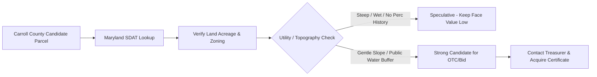

# Carroll County Land and Tax Sale Market

An evaluation of Carroll County's property tax sale dynamics, rural and semi-rural vacant land opportunities, low-competition auction mechanics, and over-the-counter (OTC) certificate availability.

---

## 📊 Market Overview & Fit

* **Status in Safe Deed Framework**: **Backup Target & Rural Contrast Market** to compare against urban lien dynamics.
* **Certificate Price Range**: **$300 – $2,000**
* **Auction Schedule**: Annual County Tax Sale with potential **OTC (Over-The-Counter)** unsold certificate availability.
* **Geographic Focus**: Semi-rural acreage, exurban residential lots, and small towns (Westminster, Eldersburg, Taneytown, Mount Airy).

---

## 🎯 Strategic Market Dynamics

1. **Reduced Institutional Competition**:
   * Located northwest of Baltimore, Carroll County experiences far less institutional wall-street bidder activity than major metropolitan counties, giving individual investors a viable opportunity to secure liens at or near **face value**.
2. **Rural & Semi-Rural Land Inventory**:
   * Vacant parcels, acreage slivers, and agricultural buffer lots regularly appear on Carroll County's delinquent roll at entry prices compatible with individual investor budgets ($300 to $2,000).
3. **Urban vs. Rural Dynamics**:
   * Unlike [[Baltimore City Tax Sale Market]] (which features urban infill lots connected to public utilities), Carroll County parcels typically require well and septic infrastructure (see [[Analysis - Glen Drive Westminster MD]] and [[Maryland Mind Map]]).
   * However, rural parcels carry zero risk of condemned rowhouse structures or massive urban municipal water bill encumbrances.
4. **OTC Leftover Availability**:
   * Leftover certificates not purchased during the primary annual auction may be acquired directly through the county treasurer without auction bidding wars.

---

## 🔍 Due Diligence Checklist for Carroll County Lots

* **Zoning & Subdivision Rules**: Verify whether the parcel is zoned Agricultural (A), Conservation (C), or Residential (R) to understand buildability potential.
* **Topography & Access**: Review Carroll County GIS mapping to confirm road frontage and verify the parcel is not a landlocked drainage easement.

---

## 📝 Immediate Action Checklist
* [ ] Contact the **Carroll County Treasurer's Office** (Westminster, MD) to confirm the annual tax sale date and inquire about post-sale OTC certificate lists.
* [ ] Review published delinquent rolls for vacant residential lots priced between $300 and $600.

---

## 🔗 Related Wiki Pages
* [[Maryland Tax Lien Investing]]
* [[Summary - Blueprint Chetan Thakur]]
* [[Maryland Tax Lien Deal Structuring - Budget and Guardrails]]
* [[Analysis - Glen Drive Westminster MD]]
* [[Baltimore City Tax Sale Market]]
* [[Prince Georges County Tax Sale Market]]
* [[Maryland Mind Map]]
