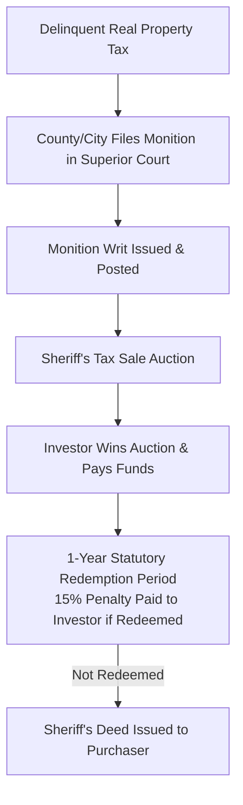
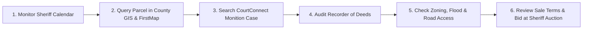

# Delaware Monition and Tax Deed Market

Delaware operates under a **tax deed / monition sale system** rather than a conventional investor tax-lien certificate model. When real property taxes or municipal assessments become delinquent, the county or municipality files a **monition action** in the Delaware Superior Court, leading directly to a **Sheriff's Sale** of the underlying real estate.

---

## ⚖️ Delaware Monition & Tax Sale Mechanics

* **Legal Archetype**: **Tax Deed via Judicial Monition Sale** (Del. Code Title 9, Chapter 87).
* **Instrument Conveyed**: **Sheriff’s Deed** conveying physical real estate title.
* **No Tax Lien Certificates**: Investors do not purchase passive interest certificates; bidders compete directly to acquire real property.
* **Redemption Window**: Delaware law generally provides a **1-year statutory right of redemption** for property sold at a monition tax sale, during which the owner may redeem by paying the purchase price plus a **15% penalty/interest** to the purchaser.
* **Judicial Oversight**: Every monition proceeding is docketed in Delaware Superior Court and executed by the County Sheriff.

---

## 🏛️ Statewide Intelligence & Research Tools

| Platform | URL / System | Investor Utility |
| :--- | :--- | :--- |
| **Delaware CourtConnect** | [courtconnect.courts.delaware.gov](https://courtconnect.courts.delaware.gov/) | Search Superior Court monition dockets, judgments, named parties, and writ status. |
| **Delaware FirstMap GIS** | [firstmap.delaware.gov](https://firstmap.delaware.gov/) | Centralized statewide GIS parcel viewer, zoning boundaries, wetlands, and aerial photography. |
| **Delaware Public Archives** | [archives.delaware.gov](https://archives.delaware.gov/) | Historical land grant, survey, and title research. |

---

## 📍 County-by-County Monition & Parcel Directory

Delaware contains 3 counties, each managing its own property tax assessments and Sheriff's monition sales:

| County | Seat / Major Hubs | Sheriff Monition Sale Route | Parcel & GIS Search | Recording & Title Office |
| :--- | :--- | :--- | :--- | :--- |
| **New Castle** | Wilmington, Newark | [New Castle Sheriff Sales](https://www.newcastlede.gov/172/Sheriff-Sales) | [New Castle Parcel Search](https://www3.newcastlede.gov/parcel/search/) · [FirstMap](https://firstmap.delaware.gov/) | New Castle Recorder of Deeds |
| **Kent** | Dover, Smyrna | [Kent County Sheriff's Office](https://www.kentcountyde.gov/My-Government/Departments/Sheriffs-Office) | [Kent Property Records](https://propertyrecords.kentcountyde.gov/) · [FirstMap](https://firstmap.delaware.gov/) | Kent County Recorder of Deeds |
| **Sussex** | Georgetown, Rehoboth Beach, Seaford | [Sussex County Sheriff Sales](https://sussexcountyde.gov/sheriff-sales) | [Sussex Parcel Search](https://property.sussexcountyde.gov/) · [FirstMap](https://firstmap.delaware.gov/) | Sussex Recorder of Deeds |

---

## 🔍 The 6-Step Delaware Due Diligence Workflow

1. **Monitor the County Sheriff / Monition Calendar**:
   * Review published legal notices and Sheriff sale schedules for New Castle, Kent, and Sussex counties.
2. **Parcel & Geospatial Inspection**:
   * Look up the parcel via APN in the county parcel database and **Delaware FirstMap GIS**.
   * Confirm road frontage, parcel dimensions, utility easements, and proximity to tidal wetlands (especially in Sussex and coastal Kent/New Castle).
3. **Court Case Audit on CourtConnect**:
   * Search Delaware CourtConnect using the defendant's name or parcel reference.
   * Verify proper service of process, writ issuance, and whether any federal bankruptcy stays are docketed.
4. **Title & Encumbrance Check**:
   * Inspect recorded instruments at the Recorder of Deeds.
   * Screen for federal IRS tax liens (subject to 28 U.S.C. § 2410 120-day right of redemption), municipal demolition liens, or surviving water/sewer assessments.
5. **Physical & Environmental Verification**:
   * Verify FEMA flood zones (FEMA Zone A/AE vs. Zone X), coastal storm risk, and physical structure condition via drive-by.
6. **Execution & Bidding**:
   * Deliver required deposit (certified funds) at the Sheriff's auction.
   * Factor in the 1-year redemption window (earning 15%) or subsequent confirmation and deed issuance.

---

## 🔗 Related Wiki Pages
* [[Tax Lien and Deed Market Regimes]]
* [[50-State Statutory Tax Sale Matrix]]
* [[Accessing County Parcel Databases and GIS Data]]
* [[Property Due Diligence Funnel]]
* [[Best Regional Lots - DC VA MD DE]]
* [[Maryland Tax Lien Investing]]
