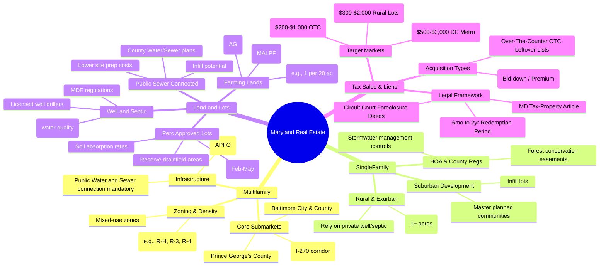

# Maryland Mind Map

This page presents a comprehensive mind map and structural overview of the Maryland real estate market, categorized by residential sectors, utility options, development approvals, agricultural land regulations, and municipal tax sale / tax lien acquisition channels.

---

## Visual Mind Map (Mermaid)

---

## Detailed Category Breakdown

### 1. Multifamily Housing
Multifamily properties in Maryland are subject to strict urban planning and environmental considerations:
* **Zoning & Density**: High-density zones (like R-H or R-3/R-4) allow multi-unit construction. Increasingly, Maryland counties use mixed-use zoning (MXD) to blend retail and residential.
* **Infrastructure Demands**: High-density developments require public water and sewer connections. Adequate Public Facilities Ordinances (APFO) in counties like Montgomery and Howard can delay approvals if local schools or roads are over capacity.
* **Critical Areas**: Projects within 1,000 feet of the Chesapeake Bay or its tidal tributaries face rigorous Maryland Critical Area Commission reviews.

### 2. Single-Family Housing
The single-family sector ranges from high-density suburban communities to rural estates:
* **Suburban Areas**: Characterized by public utility connections and storm-water management compliance (including Environmental Site Design, or ESD, rules).
* **Exurban/Rural Detached**: Single-family homes in counties like Carroll, Frederick, or the Eastern Shore often sit on lots of 1 to 5+ acres and rely on private wells and septic.
* **Environmental Restrictions**: Developments must comply with the Maryland Forest Conservation Act, which requires forest preservation or reforestation plans.

### 3. Land & Lots with Public Sewer
* **Water & Sewer Plans**: Each Maryland county maintains a 10-Year Water and Sewerage Plan. Land falls into specific categories (e.g., S-1 for currently connected, S-3 for planned connection in 1–3 years, S-5 for planned connection in 5–10 years, and W/S-6 for no public service planned).
* **Development Advantage**: Lots designated for public sewer bypass the soil limitations of perc testing, making them highly desirable for developers due to lower infrastructure failure risk.

### 4. Land & Lots with Wells
* **Permitting & Drilling**: Water wells must be drilled by a Maryland-licensed well driller. The process is governed by the Maryland Department of the Environment (MDE) and local health departments.
* **Certificate of Potability (COP)**: Once drilled, the well water must be tested for contaminants (e.g., bacteria, nitrates, arsenic, lead). Building permits or occupancy certificates require a COP from the health department.

### 5. Perc Approved Lots
* **The Percolation (Perc) Test**: A mandatory soil absorption test to design an on-site sewage disposal system (septic).
* **Wet Season Constraint**: Many counties restrict perc testing to the "wet season" (typically February to May) when the water table is highest. If you miss this window, testing must wait until the following year.
* **Reserve Areas**: Maryland health regulations require a designated primary septic field plus a 10,000-square-foot reserve area for replacement fields.
* **Nitrogen Reduction**: In the Chesapeake Bay Critical Area, septic systems must use Best Available Technology (BAT) to minimize nitrogen runoff.

### 6. Farming Lands
* **Agricultural Zoning (AG)**: Zoned to preserve farming and open space. Density is restricted; typically, only one dwelling unit is permitted per 20, 25, or 50 acres.
* **Preservation Easements**: Landowners can sell development rights to programs like the Maryland Agricultural Land Preservation Foundation (MALPF) or the Rural Legacy Program, permanently restricting the land to agricultural use.
* **Right-to-Farm Laws**: Maryland protects farmers from nuisance lawsuits by neighbors regarding standard agricultural operations (noise, dust, odors).

### 7. Tax Sale & Tax Lien Investment Channels (MD Tax-Property Article)
* **Certificate System**: Maryland operates on a tax lien certificate model governed by the **Maryland Tax-Property Article**. Investors purchase delinquent tax debt, not immediate fee-simple deeds.
* **Statutory Yield & Redemption**: Certificates earn statutory interest during a statutory redemption window of **6 months to 2 years** (varying by county).
* **Foreclosure Path to Title**: If unredeemed, certificate holders file a foreclosure lawsuit in Maryland Circuit Court to extinguish the owner's equity of redemption and obtain an insurable deed.
* **Acquisition Vectors**:
  * **[[Baltimore City Tax Sale Market]]**: Largest supply of sub-$333 OTC (over-the-counter) leftover certificates on urban parcels with municipal utilities.
  * **[[Prince Georges County Tax Sale Market]]**: High-demand D.C. commuter market with strong redemption yields and high property equity ($500–$3,000 range).
  * **[[Carroll County Land and Tax Sale Market]]**: Low-competition rural land and parcel certificates ($300–$2,000 range) purchased at or near face value.
* **Strategic Roadmap**: Detailed investor execution plan cataloged in [[Summary - Blueprint Chetan Thakur]] and [[Maryland Tax Lien Deal Structuring - Budget and Guardrails]].

---

## 🔗 Related Wiki Pages
* [[Maryland Tax Lien Investing]]
* [[Summary - Blueprint Chetan Thakur]]
* [[Maryland Tax Lien Deal Structuring - Budget and Guardrails]]
* [[Baltimore City Tax Sale Market]]
* [[Prince Georges County Tax Sale Market]]
* [[Carroll County Land and Tax Sale Market]]
* [[Land Banks and Cheap Maryland Lots]]
* [[Maryland Lots Under 30k]]

