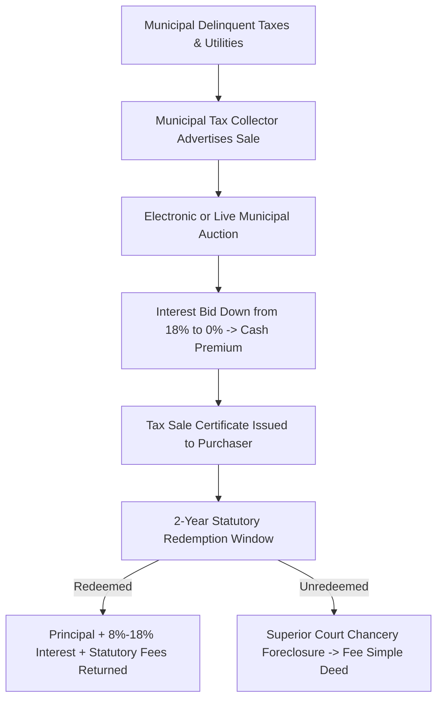

# New Jersey Municipal Tax Sale Market

New Jersey is a **Tax Sale Certificate** state governed by the **New Jersey Tax Sale Law** (N.J.S.A. 54:5-1 et seq.). Crucially, unlike states where sales are conducted by county treasurers, **New Jersey tax sales are administered individually by all 564 municipalities** across its 21 counties.

---

## ⚖️ New Jersey Statutory Rules & Auction Economics

* **Statutory Interest Caps**:
  * **8% Per Annum** on delinquent amounts up to **$1,500**.
  * **18% Per Annum** on delinquent balances exceeding **$1,500**.
  * **Year-End Penalty (YEP)**: Up to **2% - 6%** additional penalty on delinquencies exceeding $5,000–$10,000.
* **Bidding Auction Dynamics**:
  * **Bid-Down Interest to 0%**: Bidders start at 18% statutory interest and bid down in increments (17%, 16% ... down to 0%).
  * **Premium Bidding**: Once bidding reaches **0%**, bidders compete by offering a **cash premium** above the lien face value.
  * **Premium Rules**: The municipality holds the premium without paying interest. If the lien is redeemed within 5 years, the premium is returned dollar-for-dollar to the investor. If the investor forecloses, the premium is retained by the municipality.
* **Redemption Window**:
  * **2 Years** from the date of sale for third-party investor certificates.
  * **6 Months** for municipality-held certificates (enabling faster foreclosure if acquired via assignment).
* **Foreclosure Procedure**:
  * Action filed in the **Superior Court of New Jersey - Chancery Division** (judicial foreclosure in personam or in rem).
  * A final judgment of foreclosure extinguishes all subordinate mortgages and vests fee-simple title in the certificate holder.

---

## 🏛️ Statewide Intelligence & Research Tools

| Platform | URL / Portal | Investor Utility |
| :--- | :--- | :--- |
| **NJGIN Property Explorer** | [nj.gov/njgin/edata/parcels/](https://www.nj.gov/njgin/edata/parcels/) | Statewide GIS viewer with official Block/Lot cadastre, MOD-IV property tax data, and aerial imagery. |
| **NJ Municipal Directory** | [nj.gov/nj/gov/direct/municipality.shtml](https://www.nj.gov/nj/gov/direct/municipality.shtml) | Master directory of all 564 New Jersey municipal tax collector websites and tax sale notices. |
| **NJ County Government Portal** | [nj.gov/nj/gov/county/localgov.shtml](https://nj.gov/nj/gov/county/localgov.shtml) | County-level recording offices (County Clerk / Register of Deeds) for deed and mortgage searches. |

---

## 📍 The 21 New Jersey County & Municipal Directories

To research New Jersey tax liens, identify the county, locate the target municipality, and inspect the local **Tax Collector / Current Legal Notices** page:

| County | Seat / Core Municipalities | Tax Lien & Municipal Route | Parcel & GIS Cadastre |
| :--- | :--- | :--- | :--- |
| **Atlantic** | Atlantic City, Egg Harbor, Galloway | [Atlantic Municipalities](https://www.nj.gov/nj/gov/direct/municipality.shtml) → Tax Collector | [NJ Property Explorer](https://www.nj.gov/njgin/edata/parcels/) |
| **Bergen** | Hackensack, Paramus, Fort Lee | [Bergen Municipalities](https://www.nj.gov/nj/gov/direct/municipality.shtml) → Tax Collector | [NJ Property Explorer](https://www.nj.gov/njgin/edata/parcels/) |
| **Burlington** | Mount Holly, Evesham, Mount Laurel | [Burlington Municipalities](https://www.nj.gov/nj/gov/direct/municipality.shtml) → Tax Collector | [NJ Property Explorer](https://www.nj.gov/njgin/edata/parcels/) |
| **Camden** | Camden, Cherry Hill, Gloucester Twp | [Camden Municipalities](https://www.nj.gov/nj/gov/direct/municipality.shtml) → Tax Collector | [NJ Property Explorer](https://www.nj.gov/njgin/edata/parcels/) |
| **Cape May** | Cape May, Ocean City, Middle Twp | [Cape May Municipalities](https://www.nj.gov/nj/gov/direct/municipality.shtml) → Tax Collector | [NJ Property Explorer](https://www.nj.gov/njgin/edata/parcels/) |
| **Cumberland** | Bridgeton, Vineland, Millville | [Cumberland Municipalities](https://www.nj.gov/nj/gov/direct/municipality.shtml) → Tax Collector | [NJ Property Explorer](https://www.nj.gov/njgin/edata/parcels/) |
| **Essex** | Newark, East Orange, Montclair | [Essex Municipalities](https://www.nj.gov/nj/gov/direct/municipality.shtml) → Tax Collector | [NJ Property Explorer](https://www.nj.gov/njgin/edata/parcels/) |
| **Gloucester** | Woodbury, Washington Twp, Deptford | [Gloucester Municipalities](https://www.nj.gov/nj/gov/direct/municipality.shtml) → Tax Collector | [NJ Property Explorer](https://www.nj.gov/njgin/edata/parcels/) |
| **Hudson** | Jersey City, Hoboken, Bayonne | [Hudson Municipalities](https://www.nj.gov/nj/gov/direct/municipality.shtml) → Tax Collector | [NJ Property Explorer](https://www.nj.gov/njgin/edata/parcels/) |
| **Hunterdon** | Flemington, Raritan, Clinton | [Hunterdon Municipalities](https://www.nj.gov/nj/gov/direct/municipality.shtml) → Tax Collector | [NJ Property Explorer](https://www.nj.gov/njgin/edata/parcels/) |
| **Mercer** | Trenton, Princeton, Hamilton | [Mercer Municipalities](https://www.nj.gov/nj/gov/direct/municipality.shtml) → Tax Collector | [NJ Property Explorer](https://www.nj.gov/njgin/edata/parcels/) |
| **Middlesex** | New Brunswick, Edison, Woodbridge | [Middlesex Municipalities](https://www.nj.gov/nj/gov/direct/municipality.shtml) → Tax Collector | [NJ Property Explorer](https://www.nj.gov/njgin/edata/parcels/) |
| **Monmouth** | Freehold, Asbury Park, Middletown | [Monmouth Municipalities](https://www.nj.gov/nj/gov/direct/municipality.shtml) → Tax Collector | [NJ Property Explorer](https://www.nj.gov/njgin/edata/parcels/) |
| **Morris** | Morristown, Parsippany, Dover | [Morris Municipalities](https://www.nj.gov/nj/gov/direct/municipality.shtml) → Tax Collector | [NJ Property Explorer](https://www.nj.gov/njgin/edata/parcels/) |
| **Ocean** | Toms River, Lakewood, Brick | [Ocean Municipalities](https://www.nj.gov/nj/gov/direct/municipality.shtml) → Tax Collector | [NJ Property Explorer](https://www.nj.gov/njgin/edata/parcels/) |
| **Passaic** | Paterson, Clifton, Wayne | [Passaic Municipalities](https://www.nj.gov/nj/gov/direct/municipality.shtml) → Tax Collector | [NJ Property Explorer](https://www.nj.gov/njgin/edata/parcels/) |
| **Salem** | Salem, Pennsville, Carneys Point | [Salem Municipalities](https://www.nj.gov/nj/gov/direct/municipality.shtml) → Tax Collector | [NJ Property Explorer](https://www.nj.gov/njgin/edata/parcels/) |
| **Somerset** | Somerville, Franklin, Bridgewater | [Somerset Municipalities](https://www.nj.gov/nj/gov/direct/municipality.shtml) → Tax Collector | [NJ Property Explorer](https://www.nj.gov/njgin/edata/parcels/) |
| **Sussex** | Newton, Vernon, Sparta | [Sussex Municipalities](https://www.nj.gov/nj/gov/direct/municipality.shtml) → Tax Collector | [NJ Property Explorer](https://www.nj.gov/njgin/edata/parcels/) |
| **Union** | Elizabeth, Union Twp, Plainfield | [Union Municipalities](https://www.nj.gov/nj/gov/direct/municipality.shtml) → Tax Collector | [NJ Property Explorer](https://www.nj.gov/njgin/edata/parcels/) |
| **Warren** | Belvidere, Phillipsburg, Hackettstown | [Warren Municipalities](https://www.nj.gov/nj/gov/direct/municipality.shtml) → Tax Collector | [NJ Property Explorer](https://www.nj.gov/njgin/edata/parcels/) |

---

## 🎯 Over-The-Counter & Municipal Assignments

When a tax sale certificate is not purchased by private bidders, it is automatically struck off to the municipality (**Municipality-Held Certificate**). 

Investors can purchase these directly via:
1. **Private Assignment (N.J.S.A. 54:5-113)**: The municipal governing body may authorize the assignment of the certificate for full face value plus accrued interest to an investor.
2. **Public Assignment Auction (N.J.S.A. 54:5-114.1)**: Struck-off certificates offered in bulk or discounted public auctions.

> [!TIP]
> **Key Search Terms for Municipal Tax Collectors**: Request lists of *"Municipality-Held Tax Sale Certificates"*, *"Assignment of Municipal Certificates"*, *"Unsold Tax Sale Certificates"*, and *"Electronic Tax Lien Sale Notices"*.

---

## 🔍 The 6-Step New Jersey Due Diligence Workflow

1. **Identify Target Municipality**: Filter municipalities by county using the state directory.
2. **Review Tax Sale Lists**: Inspect electronic tax sale platforms (NJTaxMarket, RealAuction NJ) or published notices.
3. **MOD-IV & GIS Validation**: Look up the **Block, Lot, and Qualifier** on the **NJGIN Property Explorer** to review assessed valuations and boundaries.
4. **County Land Records Audit**: Query the County Clerk / Register of Deeds for recorded deeds, mortgages, and federal tax liens.
5. **Municipal Zoning & Environmental Clearance**: Check local zoning ordinances, Highlands / Pinelands environmental restrictions, and municipal utility liens.
6. **Subsequent Tax Payment Strategy**: Pay subsequent quarterly property taxes ("subs") as they become delinquent to earn the statutory **18% rate** on all newly advanced capital.

---

## 🔗 Related Wiki Pages
* [[Tax Lien and Deed Market Regimes]]
* [[50-State Statutory Tax Sale Matrix]]
* [[Accessing County Parcel Databases and GIS Data]]
* [[Property Due Diligence Funnel]]
* [[Maryland Tax Lien Investing]]
