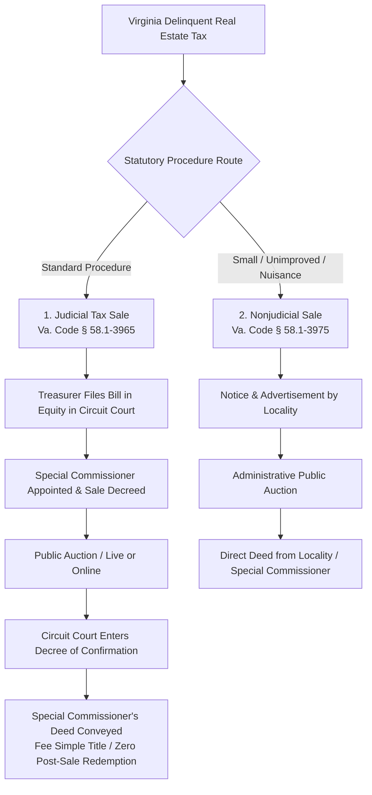

# Virginia Judicial Tax Deed and Independent Cities Market

The Commonwealth of Virginia operates as a pure **Tax Deed State**. Virginia **does not sell tax lien certificates** to private investors. Delinquent property taxes are enforced through judicial foreclosure auctions or qualifying nonjudicial special commissioner sales, conveying direct fee-simple ownership of real estate with **no post-sale redemption period**.

---

## ⚖️ Virginia Statutory Tax Sale Regimes

### 1. Judicial Tax Sales (Va. Code § 58.1-3965)
* **Trigger**: Real estate taxes delinquent on December 31 following the second anniversary of the delinquency date (or 1 year for abandoned/blighted property).
* **Legal Proceeding**: The local Treasurer files a **Bill in Equity** in the local **Circuit Court**.
* **Court Confirmation**: Following the public auction, the Circuit Court Judge reviews the proceeding and enters a **Decree of Confirmation**.
* **Deed Issued**: **Special Commissioner's Deed**. All subordinate private liens, mortgages, and deeds of trust named in the lawsuit are extinguished.
* **Redemption**: Right of redemption terminates upon entry of the confirmation decree.

### 2. Nonjudicial Tax Sales (Va. Code § 58.1-3975)
* **Scope**: Qualifying low-value, unimproved, or blighted parcels.
* **Statutory Criteria**:
  * Assessed value under **$100,000** with taxes delinquent for **3+ years**, OR
  * Assessed value between **$100,000 and $150,000** with unimproved structure value under $10,000, OR
  * Real estate declared a derelict or nuisance building.
* **Mechanics**: Allows the locality to sell the real estate at public auction without filing a full Circuit Court chancery lawsuit, following statutory registered notice and 30-day advertisement.

---

## 🏛️ The Independent Cities Governance Structure

A unique institutional feature of Virginia real estate is that its **38 Independent Cities** are politically and administratively independent of surrounding counties:
* Independent Cities operate their own autonomous **Treasurers, Real Estate Assessors, Circuit Courts, and GIS systems**.
* Investors must search city-level portals (e.g., Virginia Beach, Norfolk, Chesapeake, Richmond, Alexandria) separately from adjacent counties.

---

## 📍 Master Jurisdictional Directory (133 Localities)

### 1. The 38 Autonomous Independent Cities

| Independent City | Regional Hub | Official Tax Sale Route | Parcel & GIS Cadastre |
| :--- | :--- | :--- | :--- |
| **Alexandria** | Northern VA / DC | [Virginia.gov Directory](https://www.virginia.gov/local-government/) → Alexandria | [Alexandria GIS](https://www.google.com/search?q=Alexandria+Virginia+GIS+parcel+official) |
| **Bristol** | Southwest VA | [Virginia.gov Directory](https://www.virginia.gov/local-government/) → Bristol | [Bristol GIS](https://www.google.com/search?q=Bristol+Virginia+GIS+parcel+official) |
| **Buena Vista** | Shenandoah Valley | [Virginia.gov Directory](https://www.virginia.gov/local-government/) → Buena Vista | [Buena Vista GIS](https://www.google.com/search?q=Buena+Vista+Virginia+GIS+parcel+official) |
| **Charlottesville** | Central VA | [Virginia.gov Directory](https://www.virginia.gov/local-government/) → Charlottesville | [Charlottesville GIS](https://www.google.com/search?q=Charlottesville+Virginia+GIS+parcel+official) |
| **Chesapeake** | Hampton Roads | [Virginia.gov Directory](https://www.virginia.gov/local-government/) → Chesapeake | [Chesapeake GIS](https://www.google.com/search?q=Chesapeake+Virginia+GIS+parcel+official) |
| **Colonial Heights** | Greater Richmond | [Virginia.gov Directory](https://www.virginia.gov/local-government/) → Colonial Heights | [Colonial Heights GIS](https://www.google.com/search?q=Colonial+Heights+Virginia+GIS+parcel+official) |
| **Covington** | Alleghany Highlands | [Virginia.gov Directory](https://www.virginia.gov/local-government/) → Covington | [Covington GIS](https://www.google.com/search?q=Covington+Virginia+GIS+parcel+official) |
| **Danville** | Southern VA | [Virginia.gov Directory](https://www.virginia.gov/local-government/) → Danville | [Danville GIS](https://www.google.com/search?q=Danville+Virginia+GIS+parcel+official) |
| **Emporia** | Southside VA | [Virginia.gov Directory](https://www.virginia.gov/local-government/) → Emporia | [Emporia GIS](https://www.google.com/search?q=Emporia+Virginia+GIS+parcel+official) |
| **Fairfax City** | Northern VA | [Virginia.gov Directory](https://www.virginia.gov/local-government/) → Fairfax City | [Fairfax City GIS](https://www.google.com/search?q=Fairfax+City+Virginia+GIS+parcel+official) |
| **Falls Church** | Northern VA | [Virginia.gov Directory](https://www.virginia.gov/local-government/) → Falls Church | [Falls Church GIS](https://www.google.com/search?q=Falls+Church+Virginia+GIS+parcel+official) |
| **Franklin City** | Western Tidewater | [Virginia.gov Directory](https://www.virginia.gov/local-government/) → Franklin City | [Franklin City GIS](https://www.google.com/search?q=Franklin+City+Virginia+GIS+parcel+official) |
| **Fredericksburg** | Northern/Central VA | [Virginia.gov Directory](https://www.virginia.gov/local-government/) → Fredericksburg | [Fredericksburg GIS](https://www.google.com/search?q=Fredericksburg+Virginia+GIS+parcel+official) |
| **Galax** | Blue Ridge / SW | [Virginia.gov Directory](https://www.virginia.gov/local-government/) → Galax | [Galax GIS](https://www.google.com/search?q=Galax+Virginia+GIS+parcel+official) |
| **Hampton** | Hampton Roads | [Virginia.gov Directory](https://www.virginia.gov/local-government/) → Hampton | [Hampton GIS](https://www.google.com/search?q=Hampton+Virginia+GIS+parcel+official) |
| **Harrisonburg** | Shenandoah Valley | [Virginia.gov Directory](https://www.virginia.gov/local-government/) → Harrisonburg | [Harrisonburg GIS](https://www.google.com/search?q=Harrisonburg+Virginia+GIS+parcel+official) |
| **Hopewell** | Greater Richmond | [Virginia.gov Directory](https://www.virginia.gov/local-government/) → Hopewell | [Hopewell GIS](https://www.google.com/search?q=Hopewell+Virginia+GIS+parcel+official) |
| **Lexington** | Shenandoah Valley | [Virginia.gov Directory](https://www.virginia.gov/local-government/) → Lexington | [Lexington GIS](https://www.google.com/search?q=Lexington+Virginia+GIS+parcel+official) |
| **Lynchburg** | Central VA | [Virginia.gov Directory](https://www.virginia.gov/local-government/) → Lynchburg | [Lynchburg GIS](https://www.google.com/search?q=Lynchburg+Virginia+GIS+parcel+official) |
| **Manassas** | Northern VA | [Virginia.gov Directory](https://www.virginia.gov/local-government/) → Manassas | [Manassas GIS](https://www.google.com/search?q=Manassas+Virginia+GIS+parcel+official) |
| **Manassas Park** | Northern VA | [Virginia.gov Directory](https://www.virginia.gov/local-government/) → Manassas Park | [Manassas Park GIS](https://www.google.com/search?q=Manassas+Park+Virginia+GIS+parcel+official) |
| **Martinsville** | Southern VA | [Virginia.gov Directory](https://www.virginia.gov/local-government/) → Martinsville | [Martinsville GIS](https://www.google.com/search?q=Martinsville+Virginia+GIS+parcel+official) |
| **Newport News** | Hampton Roads | [Virginia.gov Directory](https://www.virginia.gov/local-government/) → Newport News | [Newport News GIS](https://www.google.com/search?q=Newport+News+Virginia+GIS+parcel+official) |
| **Norfolk** | Hampton Roads | [Virginia.gov Directory](https://www.virginia.gov/local-government/) → Norfolk | [Norfolk GIS](https://www.google.com/search?q=Norfolk+Virginia+GIS+parcel+official) |
| **Norton** | Far Southwest VA | [Virginia.gov Directory](https://www.virginia.gov/local-government/) → Norton | [Norton GIS](https://www.google.com/search?q=Norton+Virginia+GIS+parcel+official) |
| **Petersburg** | Greater Richmond | [Virginia.gov Directory](https://www.virginia.gov/local-government/) → Petersburg | [Petersburg GIS](https://www.google.com/search?q=Petersburg+Virginia+GIS+parcel+official) |
| **Poquoson** | Hampton Roads / Peninsula | [Virginia.gov Directory](https://www.virginia.gov/local-government/) → Poquoson | [Poquoson GIS](https://www.google.com/search?q=Poquoson+Virginia+GIS+parcel+official) |
| **Portsmouth** | Hampton Roads | [Virginia.gov Directory](https://www.virginia.gov/local-government/) → Portsmouth | [Portsmouth GIS](https://www.google.com/search?q=Portsmouth+Virginia+GIS+parcel+official) |
| **Radford** | New River Valley | [Virginia.gov Directory](https://www.virginia.gov/local-government/) → Radford | [Radford GIS](https://www.google.com/search?q=Radford+Virginia+GIS+parcel+official) |
| **Richmond City** | State Capital | [Virginia.gov Directory](https://www.virginia.gov/local-government/) → Richmond City | [Richmond City GIS](https://www.google.com/search?q=Richmond+City+Virginia+GIS+parcel+official) |
| **Roanoke City** | Roanoke Valley | [Virginia.gov Directory](https://www.virginia.gov/local-government/) → Roanoke City | [Roanoke City GIS](https://www.google.com/search?q=Roanoke+City+Virginia+GIS+parcel+official) |
| **Salem** | Roanoke Valley | [Virginia.gov Directory](https://www.virginia.gov/local-government/) → Salem | [Salem GIS](https://www.google.com/search?q=Salem+Virginia+GIS+parcel+official) |
| **Staunton** | Shenandoah Valley | [Virginia.gov Directory](https://www.virginia.gov/local-government/) → Staunton | [Staunton GIS](https://www.google.com/search?q=Staunton+Virginia+GIS+parcel+official) |
| **Suffolk** | Hampton Roads | [Virginia.gov Directory](https://www.virginia.gov/local-government/) → Suffolk | [Suffolk GIS](https://www.google.com/search?q=Suffolk+Virginia+GIS+parcel+official) |
| **Virginia Beach** | Hampton Roads | [Virginia.gov Directory](https://www.virginia.gov/local-government/) → Virginia Beach | [Virginia Beach GIS](https://www.google.com/search?q=Virginia+Beach+Virginia+GIS+parcel+official) |
| **Waynesboro** | Shenandoah Valley | [Virginia.gov Directory](https://www.virginia.gov/local-government/) → Waynesboro | [Waynesboro GIS](https://www.google.com/search?q=Waynesboro+Virginia+GIS+parcel+official) |
| **Williamsburg** | Historic Triangle | [Virginia.gov Directory](https://www.virginia.gov/local-government/) → Williamsburg | [Williamsburg GIS](https://www.google.com/search?q=Williamsburg+Virginia+GIS+parcel+official) |
| **Winchester** | Northern Shenandoah | [Virginia.gov Directory](https://www.virginia.gov/local-government/) → Winchester | [Winchester GIS](https://www.google.com/search?q=Winchester+Virginia+GIS+parcel+official) |

---

### 2. High-Demand Virginia Investment Counties

| Region | Major Counties | Primary Sale Platforms & Special Commissioners |
| :--- | :--- | :--- |
| **Northern Virginia** | Fairfax, Loudoun, Prince William, Stafford, Fauquier, Arlington | Judicial Sales via Circuit Court / Special Commissioner Law Firms (e.g., Taxing Authority Consulting Services - TACS, Sands Anderson) |
| **Hampton Roads / Coastal** | York, Isle of Wight, James City, Gloucester, Southampton, Surry, Northampton, Accomack | Live / Online auctions via ForSaleAtAuction.biz, Motley's, and local Special Commissioners |
| **Central / Richmond** | Henrico, Chesterfield, Hanover, Goochland, Powhatan, Spotsylvania | Circuit Court Judicial auctions / TACS |
| **Shenandoah Valley / West** | Frederick, Rockingham, Augusta, Shenandoah, Warren, Page, Rockbridge | Special Commissioner auctions / County Treasurers |

---

## 🔍 The 6-Step Virginia Tax Deed Due Diligence Workflow

1. **Identify Locality & Sale Archetype**: Determine whether the auction is a judicial chancery sale (§ 58.1-3965) or an administrative nonjudicial sale (§ 58.1-3975).
2. **Locality GIS Cadastre Audit**: Inspect parcel boundaries, road frontage (> 30 ft), wetlands (Chesapeake Bay Resource Protection Area - RPA), and topography on the local GIS.
3. **Circuit Court Case Review**: Audit the judicial chancery docket in the local Circuit Court to verify all lienholders, heirs, and mortgagees were properly served with process.
4. **Encumbrance Check**: Search Circuit Court land records for IRS tax liens (subject to 120-day federal redemption) and local utility/weed liens.
5. **Physical Inspection**: Inspect the parcel in person; determine occupancy status (cash for keys or unlawful detainer) and structural soundness.
6. **Confirmation & Title Clearing**: After the auction, wait for the Circuit Court decree of confirmation, record the Special Commissioner's Deed, and initiate a **Title Certification (TTS)** or **Quiet Title Action** for marketable insurable title.

---

## 🔗 Related Wiki Pages
* [[Virginia Tax Delinquent Sales and Judicial Auctions]]
* [[Virginia Land and Tax Deed Buy Box]]
* [[Hampton Roads Virginia Land Market]]
* [[Hampton Roads Off-Market Campaign Playbook and GIS Query Pack]]
* [[Tax Title Clearance and Quiet Title Actions]]
* [[Property Due Diligence Funnel]]
