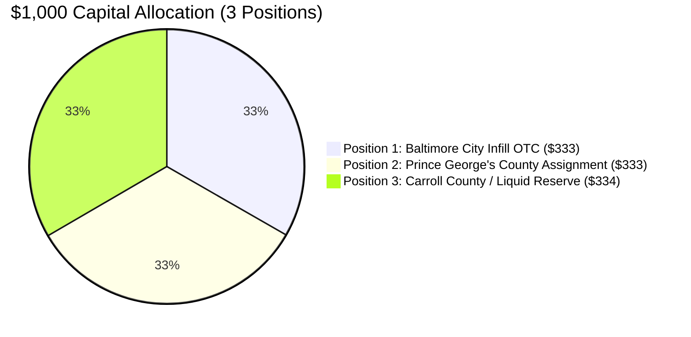
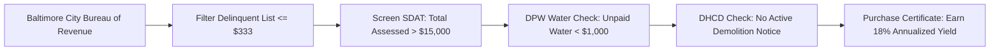
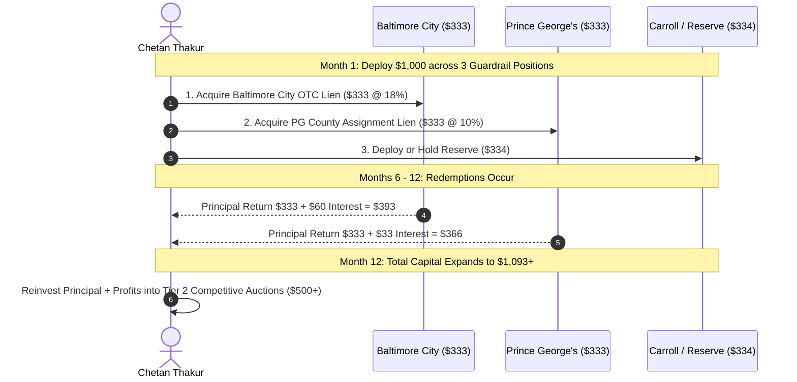

# $1,000 Maryland Investment Plan - Deal Sourcing and Allocation

A tactical capital allocation plan, deal sourcing roadmap, and multi-county execution guide for deploying an initial **$1,000 liquid capital budget** across Maryland property tax lien certificates and government surplus channels while strictly enforcing the **$333 per-deal capital guardrail**.

---

## 💰 The $1,000 Portfolio Allocation Model

| Portfolio Position | Allocation | Target County / Jurisdiction | Acquisition Method | Target Asset Profile | Primary Expected Return |
| :--- | :--- | :--- | :--- | :--- | :--- |
| **Position 1** | **$333** | **[[Baltimore City Tax Sale Market]]** | OTC Leftover / Direct Purchase | Urban Infill Residential Parcel | **18% Statutory Interest** (or title-insurable deed) |
| **Position 2** | **$333** | **[[Prince Georges County Tax Sale Market]]** | County Assignment Sale (Email) | DC Commuter Suburban Lot/Home | **10%–12% Statutory Yield** on high-equity collateral |
| **Position 3** | **$334** | **[[Carroll County Land and Tax Sale Market]]** | Annual Auction Residual / Reserve | Semi-Rural Land / Liquid Buffer | Face-value acquisition & compounding reinvestment |

---

## 🎯 Three Specific Deal Candidates & Sourcing Channels

---

### Deal 1: Baltimore City Urban Infill Tax Lien Certificate ($200 – $333)

* **Target Market**: Baltimore City, Maryland
* **Sourcing Vector**: Baltimore City Department of Finance / Bureau of Revenue Collections.
* **Target Purchase Price**: **$200 – $333** (Face value of unpaid property tax certificate).
* **Infrastructure Profile**: **100% Public Municipal Water & Sewer Connected** (zero soil perc risk).
* **4-Stage Funnel Due Diligence Audit**:
  * **Stage 1 (SDAT)**: Filter for residential rowhouse or buildable infill lot with Assessed Value $\ge \$15,000$. Tax-to-Value Ratio ($\text{TVR}$) $< 2.2\%$.
  * **Stage 2 (GIS)**: Use Baltimore CityView GIS to confirm street frontage and non-flood Zone X.
  * **Stage 3 (Encumbrances)**: Audit Baltimore City DPW utility portal to ensure water lien balance is minimal. Confirm no active Vacant Building Notice (VBN).
  * **Stage 4 (Recon)**: Verify neighboring rowhomes are occupied and maintained.
* **Investment Thesis**:
  * If owner redeems: Collect **18.0% statutory interest** ($333 principal returns $393 in 12 months).
  * If owner defaults: Initiate Circuit Court foreclosure to extinguish equity of redemption and take fee-simple deed.
* **How to Execute**:
  1. Contact Baltimore City Tax Sale Administrator ([baltimorecity.gov](https://finance.baltimorecity.gov)).
  2. Request the active list of unsold/residual certificates.
  3. Submit certificate purchase request and certified funds.

---

### Deal 2: Prince George's County Over-the-Counter "Assignment Sale" ($250 – $333)

* **Target Market**: Prince George's County, Maryland (DC Metro Corridor)
* **Sourcing Vector**: Prince George's County Treasury Division — **Assignment Tax Certificate Sale**.
* **Target Purchase Price**: **$250 – $333** (Sold over-the-counter via email request at exact advertised tax price).
* **Infrastructure Profile**: Suburban residential parcel in high-density DC commuter submarkets (e.g., Capitol Heights, District Heights, Upper Marlboro).
* **4-Stage Funnel Due Diligence Audit**:
  * **Stage 1 (SDAT)**: SDAT search confirms single-family residential parcel assessed between $\$30,000$ and $\$80,000$. $\text{TVR} < 1.0\%$.
  * **Stage 2 (GIS)**: PGAtlas GIS confirms $\ge 30\text{ ft}$ road frontage and standard utility access.
  * **Stage 3 (Legal)**: Check PACER bankruptcy database to verify debtor has no active Chapter 7/13 automatic stay.
  * **Stage 4 (MAO)**: Underlying equity provides massive collateral safety margin.
* **Investment Thesis**:
  * DC metro demand and high home equity create an exceptional **95%+ redemption rate**, delivering a safe **10%–12% statutory cash return** on capital.
* **How to Execute**:
  1. Visit the official [Prince George's County Tax Sale Portal](https://taxsale.princegeorgescountymd.gov).
  2. Download the published **"Assignment List"** of unsold county-held certificates.
  3. Email the Treasury Division with selected Parcel IDs.
  4. Pay the county invoice within the required 3-day settlement window.

---

### Deal 3: Carroll County Rural Land Tax Lien / Liquid Reinvestment Reserve ($250 – $334)

* **Target Market**: Carroll County, Maryland (Northwest of Baltimore)
* **Sourcing Vector**: Carroll County Collections/Tax Office (225 N Center St, Westminster, MD / [cctaxoffice@carrollcountymd.gov](mailto:cctaxoffice@carrollcountymd.gov)).
* **Target Purchase Price**: **$250 – $334** (Face-value lien on rural acreage sliver, residential lot, or held as liquid buffer).
* **Infrastructure Profile**: Semi-rural parcel (well/septic environment; see [[Analysis - Glen Drive Westminster MD]]).
* **4-Stage Funnel Due Diligence Audit**:
  * **Stage 1 (SDAT)**: Confirm clean agricultural (A) or residential (R) classification with zero municipal demo citations.
  * **Stage 2 (GIS)**: Carroll County GIS confirms legal access road and gentle topography.
  * **Stage 3 (Encumbrances)**: Confirm zero EPA/CERCLA commercial hazards.
  * **Stage 4 (MAO)**: Low entry cost ($334) completely protects against rural perc failure risk.
* **Investment Thesis**:
  * Zero institutional bidding competition enables securing liens at pure face value.
  * If foreclosed, converts into a **Seller Financing Land Contract** note ($3,000 down, $350/mo cash flow; see [[Seller Financing and Land Contracts]]).
* **How to Execute**:
  1. Contact the Carroll County Collections Office (410-386-2971).
  2. Inquire about post-auction unsold lien certificates and upcoming summer auction registration on RealAuction.
  3. Deploy remaining $334 or hold as liquid reserve for second-lien compounding.

---

## 📈 Compounding & Scaling Roadmap

---

## 🔗 Related Wiki Pages
* [[Summary - Blueprint Chetan Thakur]]
* [[Maryland Tax Lien Deal Structuring - Budget and Guardrails]]
* [[Maryland Tax Sale Due Diligence and Parcel Screening]]
* [[Property Due Diligence Funnel]]
* [[Maryland Tax Lien Investing]]
* [[Baltimore City Tax Sale Market]]
* [[Prince Georges County Tax Sale Market]]
* [[Carroll County Land and Tax Sale Market]]
* [[Seller Financing and Land Contracts]]
* [[50-State Statutory Tax Sale Matrix]]
