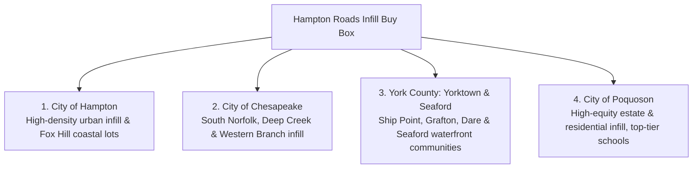
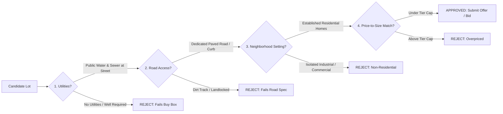

# Buy Box - Hampton Roads Infill Land and Lots

An exact operational **Buy Box** specification and deal underwriting framework for acquiring residential infill building lots across **Hampton, Chesapeake, Yorktown, Seaford, and Poquoson, Virginia**.

---

## 🎯 Target Geographic Markets

* **Core Municipalities**:
  * **City of Hampton**: Urban infill, Buckroe Beach, Fox Hill, Phoebus.
  * **City of Chesapeake**: Deep Creek, South Norfolk, Western Branch, Great Bridge.
  * **York County**: Yorktown, Seaford, Grafton, Dare.
  * **City of Poquoson**: High-demand Peninsula coastal submarket with top school rankings.

---

## 💰 The 3-Tier Price & Lot Size Matrix

All target properties must fit strictly within these three price-to-size tiers:

| Tier | Lot Size Range | Maximum Purchase Price | Target Zoning Classifications | Typical Neighborhood Profile |
| :--- | :--- | :--- | :--- | :--- |
| **Tier 1 (Compact Infill)** | **3,000 – 5,000 sq ft** | **$\le \$30,000$** | Hampton R-4 / Chesapeake R-6 | Urban residential infill, historic grid neighborhoods, single-family cottage lots. |
| **Tier 2 (Standard Suburban)** | **5,000 – 10,000 sq ft** | **$\le \$60,000$** | Hampton R-8 / York R-7 / Chesapeake R-8 | Established subdivisions, single-family detached homes, mature tree lines. |
| **Tier 3 (Estate / Large Lot)** | **10,000 sq ft – 0.50 Acres** *(up to 21,780 sq ft)* | **$\le \$90,000$** | Poquoson R-1/R-2, York R-13, Chesapeake R-10/R-15 | Premium suburban neighborhoods, custom homebuilder tracts, executive residential parcels. |

---

## 🛠️ Mandatory Infrastructure & Environmental Criteria

Every deal passing this Buy Box must satisfy these four non-negotiable physical requirements:

1. **Public Utilities**:
   * **Municipal Public Water**: Service main must run directly in front of the lot along the street right-of-way.
   * **Municipal Public Sewer**: Public sewer main must be accessible for direct lateral connection (eliminates the cost, soil risk, and time delays of health department percolation testing).
2. **Paved Road Frontage**:
   * Direct frontage on a paved, dedicated public street maintained by the municipality or the Virginia Department of Transportation (VDOT).
   * Minimum **$25\text{ to }30\text{ feet}$ of continuous street frontage** (accommodating standard residential driveway access).
3. **Neighborhood Setting**:
   * Located inside an established residential subdivision or residential street surrounded by occupied, well-maintained single-family homes.
   * Eliminates isolated industrial buffers, scrapyards, or high-crime blighted commercial corridors.
4. **Flood & Environmental Boundaries**:
   * **FEMA Flood Zone X** preferred (minimal flood risk; no mandatory flood insurance).
   * If in Zone AE (100-year flood zone), the buildable envelope must allow construction on crawlspace/pilings supported by neighboring builder comps.
   * Must sit outside the **100-foot Chesapeake Bay Preservation Act (CBPA) Resource Protection Area (RPA)** tidal wetland buffer.

---

## 🏛️ Local Zoning & Minimum Lot Size Reference

| City / County | Zoning Code | Minimum Lot Area | Minimum Lot Width | Buy Box Fit |
| :--- | :--- | :--- | :--- | :--- |
| **Hampton** | **R-4** (Single-Family) | 4,000 sq ft | 40 ft | **Tier 1** ($\le \$30\text{k}$) |
| **Hampton** | **R-8** (Single-Family) | 8,000 sq ft | 60 ft | **Tier 2** ($\le \$60\text{k}$) |
| **Hampton** | **R-11 / R-13** | 11,000–13,000 sq ft | 75–80 ft | **Tier 3** ($\le \$90\text{k}$) |
| **Chesapeake** | **R-6 / R-8** | 6,000–8,000 sq ft | 50–60 ft | **Tier 2** ($\le \$60\text{k}$) |
| **Chesapeake** | **R-10 / R-15** | 10,000–15,000 sq ft | 75–80 ft | **Tier 3** ($\le \$90\text{k}$) |
| **York County** | **R-7** (Single-Family) | 7,000 sq ft | 60 ft | **Tier 2** ($\le \$60\text{k}$) |
| **York County** | **R-13 / R-20** | 13,000–20,000 sq ft | 80–100 ft | **Tier 3** ($\le \$90\text{k}$) |
| **Poquoson** | **R-1 / R-2** | 10,000–15,000 sq ft | 75–100 ft | **Tier 3** ($\le \$90\text{k}$) |

---

## 📈 Underwriting & Monetization Economics

```mermaid
flowchart TD
    subgraph Tier2_Example ["Tier 2 Deal Example (7,500 sq ft Lot in Hampton/Chesapeake)"]
        A[Acquisition Price: $45,000] --> B[Due Diligence & Title Closing: $3,000]
        B --> C[Total Capital Invested: $48,000]
        C --> D[Resale to Local Custom Homebuilder: $85,000]
        D --> E["Net Cash Profit: $37,000 (77% ROI)"]
    end
    
    subgraph Tier3_Example ["Tier 3 Deal Example (0.35 Acre Lot in Yorktown/Poquoson)"]
        F[Acquisition Price: $75,000] --> G[Due Diligence & Title Closing: $3,500]
        G --> H[Total Capital Invested: $78,500]
        H --> I[Resale to Builder / Retail Buyer: $135,000]
        I --> J["Net Cash Profit: $56,500 (72% ROI)"]
    end
```

### Exit Strategy Channels:
1. **Cash Wholesale / Flip to Builders**: Local spec builders in Hampton Roads actively pay **$75,000 – $140,000+** for shovel-ready infill lots connected to city water/sewer to build $350k–$600k new construction homes.
2. **Seller Financing Note (Contract for Deed)**:
   * Sell a Tier 2 lot on a Land Contract for **$65,000** with **$5,000 down payment**, financing $60,000 at **10.0% interest** over a **10-year term** $\to$ Generates **~$792/mo net passive cashflow** (buyer covers all taxes and maintenance; see [[Seller Financing and Land Contracts]]).

---

## 🔍 Sourcing Channels for this Buy Box

1. **Regional MLS Search Strings (REIN MLS & Bright MLS)**:
   * Filter: `Property Type = Land / Vacant Residential`
   * Cities: `Hampton, Chesapeake, Yorktown, Seaford, Poquoson`
   * Price Caps: Max `$30k` (under 5k sq ft), `$60k` (5k–10k sq ft), `$90k` (10k+ sq ft).
   * Keywords: `"public sewer" OR "city water" OR "paved"`
2. **Special Commissioner Judicial Tax Auctions (TACS)**:
   * Monitor upcoming judicial sales on [taxva.com](https://taxva.com) for City of Hampton, Chesapeake, and York County.
3. **Virginia Auction Company**:
   * Review Hampton Roads municipal auction rolls on [vaauctionco.com](https://vaauctionco.com).
4. **Direct-to-Owner Off-Market Sourcing**:
   * Pull county GIS parcel lists for out-of-state owners of vacant residential lots in target subdivisions and send direct mail offers at 40%–50% of assessed value.

---

## 🔗 Related Wiki Pages
* [[Virginia Land and Tax Deed Buy Box]]
* [[Virginia Tax Delinquent Sales and Judicial Auctions]]
* [[Hampton Roads Virginia Land Market]]
* [[Active Land Listings - Chesapeake Hampton Yorktown Poquoson VA]]
* [[Analysis - 231 Benthall Road Hampton VA]]
* [[Analysis - 713 Ship Point Road Yorktown VA]]
* [[Analysis - 0 Yorktown Road Poquoson VA]]
* [[Property Due Diligence Funnel]]
* [[Seller Financing and Land Contracts]]
