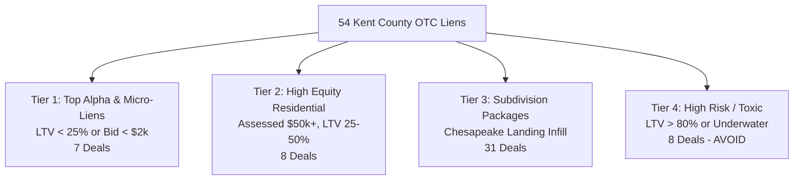
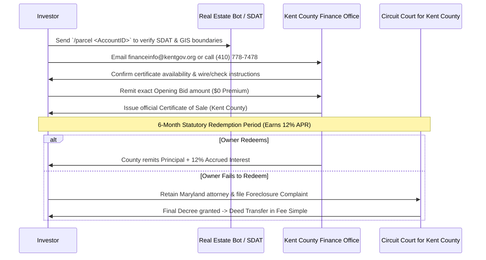

# Deal Analysis: Kent County 2026 Over-The-Counter (OTC) Tax Liens

This report delivers an exhaustive investment evaluation, risk-ranking, and decision-making framework for the **54 Over-The-Counter (OTC) Tax Lien Certificates** released by the **Kent County Tax Office** (updated as of June 9, 2026).

---

## 1. Executive Summary & Market Mechanics

Kent County operates on the Eastern Shore of Maryland with an established tax sale redemption structure under the Maryland Tax-Property Code Ann. § 14-820. 

### Key Statutory & OTC Rules:
* **Statutory Interest Rate:** **12.0% Annual** (accruing at **1.0% per month** simple interest).
* **Statutory Redemption Window:** **6 Months** from the tax sale date before the lien certificate holder can file a *Complaint to Foreclose the Right of Redemption* in the Circuit Court for Kent County.
* **Over-The-Counter (OTC) Acquisition Advantage:** Unlike live/online competitive auctions where bidders drive up bids with non-interest-bearing premiums, OTC certificates are purchased directly at **Opening Bid (Face Value)** with **$0 Premium**. 100% of invested capital accrues the 12% statutory rate from day one.
* **County Contact for Acquisition:** Kent County Finance Office: `financeinfo@kentgov.org` | Phone: (410) 778-7478. Sold on a **first-come, first-served** basis.

```
Total Available Certificates: 54 Parcels
Total Opening Bid (Capital Required): $1,247,941.34
Total Assessed Property Value: $2,500,567.00
Average Portfolio LTV: 49.9%
```

---

## 2. Decision Matrix & Risk-Adjusted Tiers

The 54 parcels are categorized into four distinct strategic tiers based on **LTV (Lien-To-Value)**, **Equity Spread**, **Acreage**, and **Redemption Likelihood**:



---

## 3. Tier 1: Top Alpha & Micro-Liens (Ultra-Low LTV & High Margin)

These 7 liens offer the highest margin of safety in the entire county list. They represent **extreme equity cushions** (sub-25% LTV) or **sub-$2,000 capital outlays** where downside risk is virtually zero.

| Account ID | Owner of Record | Assessed Value | Opening Bid | LTV (%) | Equity Cushion | Location / Description |
| :--- | :--- | :--- | :--- | :--- | :--- | :--- |
| **`06008011`** | LOMAX GEORGE B & SHELIA E | **$19,600** | **$666.92** | **3.4%** | **+$18,933.08** | **2.00 Acres** W/S Caulks Field Rd, W of Chestertown |
| **`04010574`** | HAMILTON JAMES H | **$30,700** | **$1,180.51** | **3.8%** | **+$29,519.49** | **108 Prospect St, Chestertown** (41x120 Lot) |
| **`02011549`** | TAYLOR THELMA & ULYSSES C JOHNSON | **$5,900** | **$407.31** | **6.9%** | **+$5,492.69** | **0.25 Acres** S/S River Rd, E of Chestertown |
| **`06023282`** | DHUE NOBLE J & JANE R | **$1,600** | **$330.62** | **20.7%** | **+$1,269.38** | Lots 22-28 Bk 6L Pl 1 Texas Ave, Tolchester Estates |
| **`03006492`** | CHURN CREEK LAND ASSOCIATES LLC | **$45,000** | **$10,327.15** | **22.9%** | **+$34,672.85** | Lots 533 & 534 Lenapah Rd, Chesapeake Landing |
| **`03028941`** | REED CHARLES D JR & ROGER L | **$3,000** | **$1,527.97** | **50.9%** | **+$1,472.03** | Lots 119 & 120 Macomb Rd, Chesapeake Landing |
| **`06011845`** | CHURN CREEK LAND ASSOCIATES LLC | **$3,300** | **$1,643.89** | **49.8%** | **+$1,656.11** | Lots 26 & 27 Towhee Rd, Chesapeake Landing |

### Deep-Dive on Top Tier 1 Picks:
1. **Acct `06008011` (George & Shelia Lomax) — 2.00 Acres on Caulks Field Rd:**
   * **Opening Bid:** **$666.92** against a **$19,600** assessed value (**3.4% LTV**).
   * **Scenario A (Redemption):** 12% statutory interest on low capital.
   * **Scenario B (Foreclosure):** Opportunity to acquire 2 full rural acres outside Chestertown for under $1,000 in total certificate capital.
2. **Acct `04010574` (James H Hamilton) — 108 Prospect St, Chestertown:**
   * **Opening Bid:** **$1,180.51** against **$30,700** assessment (**3.8% LTV**).
   * **Location:** In-town Chestertown residential parcel. Exceptional equity cushion ($29,519 spread).

---

## 4. Tier 2: High Equity Residential Deals (Assessed $50k+, LTV 25%–50%)

These 8 liens represent prime single-family and residential acreage lots where property values exceed $50,000 and equity spreads range between **$39,000 and $77,000**.

| Account ID | Owner of Record | Assessed Value | Opening Bid | LTV (%) | Equity Cushion | Location / Description |
| :--- | :--- | :--- | :--- | :--- | :--- | :--- |
| **`01019856`** | DUCKERY GWENDOLYN N et al | **$141,800** | **$64,433.81** | **45.4%** | **+$77,366.19** | 319 West St, S of Millington (0.25 AC Lot) |
| **`06016731`** | JONES THERESA A | **$117,200** | **$45,192.47** | **38.6%** | **+$72,007.53** | 8669 Georgetown Rd, W of Chestertown (**2.51 AC**) |
| **`03020126`** | DORSEY-WARREN TERRI L et al | **$80,300** | **$29,657.90** | **36.9%** | **+$50,642.10** | 25646 Charlestown Court, Colemans (0.18 AC) |
| **`03017478`** | STERRETT ANNA D et al | **$76,500** | **$27,361.83** | **35.8%** | **+$49,138.17** | 13073 Charlestown Rd, Colemans (**1.32 AC**) |
| **`05007674`** | BLAKE ARETHA L | **$78,700** | **$34,735.92** | **44.1%** | **+$43,964.08** | 21415 Berryman Rd, S of Rock Hall (0.25 AC) |
| **`03018954`** | WALLEY JOYCE O | **$72,800** | **$29,147.95** | **40.0%** | **+$43,652.05** | 13158 Clark Rd, Colemans (**1.00 AC**) |
| **`03010295`** | POTTS BARBARA HELENA | **$74,800** | **$31,239.65** | **41.8%** | **+$43,560.35** | 11168 Potts Rd, Butlertown (**1.00 AC**) |
| **`02011522`** | TAYLOR THELMA & ULYSSES C JOHNSON | **$56,500** | **$17,358.67** | **30.7%** | **+$39,141.33** | 27920 Old Morgnec Rd, E of Chestertown (0.50 AC) |

### Deep-Dive on Top Tier 2 Picks:
* **Acct `06016731` (8669 Georgetown Rd) — 2.51 Acres:**
  * Assessed at **$117,200** with an opening bid of **$45,192.47** (**38.6% LTV**). Generates **$5,423.10/year in statutory interest** if held for 12 months, or provides a **$72,000+ equity position** upon foreclosure decree.
* **Acct `03017478` (13073 Charlestown Rd) — 1.32 Acres:**
  * Assessed at **$76,500** with an opening bid of **$27,361.83** (**35.8% LTV**). Excellent 1+ acre building lot in Colemans.

---

## 5. Tier 3: Chesapeake Landing Subdivision Packages (31 Parcels)

The single largest geographical cluster on the Kent County OTC list is **Chesapeake Landing** (near Rock Hall & Tolchester). A major portion of these liens belong to **DUCHKA LLC**, a single entity holding 9 delinquent subdivision parcels:

### The DUCHKA LLC Chesapeake Landing Portfolio (9 Lots):
All 9 DUCHKA LLC lots are assessed uniformly at **$45,000 to $46,800** with opening bids of **$22,662 to $23,512** (~50.2% LTV).

| Account ID | Legal Description | Assessed Value | Opening Bid | LTV (%) |
| :--- | :--- | :--- | :--- | :--- |
| `03006077` | Lot 71 & 72 N/S Redfield Rd | $45,500 | $22,875.36 | 50.3% |
| `03006085` | Lot 69 & 70 N/S Redfield Rd | $45,000 | $22,662.29 | 50.4% |
| `03012883` | Lot 40 & 41 S/S Redfield Rd | $45,000 | $22,662.29 | 50.4% |
| `03030725` | Lot 38 & 39 S/S Redfield Rd | $45,000 | $22,662.29 | 50.4% |
| `03014002` | Lot 141 & 142 S/S Sheldrake Dr | $45,000 | $22,662.29 | 50.4% |
| `03017346` | Lot 210 & 211 N/S Buckneck Ldg Rd | $45,000 | $22,662.29 | 50.4% |
| `03018032` | Lot 307 & 308 W/S Tonopah Rd | $45,000 | $22,662.29 | 50.4% |
| `03018725` | Lot 104 & 105 N/S Owasso Rd | $45,000 | $22,662.29 | 50.4% |
| `03022382` | Lots 230-231-232 S/S Cloquet Rd | $46,800 | $23,512.57 | 50.2% |

> [!TIP]
> **Subdivision Assemblage Strategy:** Notice that `03006077`, `03006085`, `03012883`, and `03030725` are contiguous/adjacent pairs on **Redfield Road** in Chesapeake Landing. Purchasing all 4 certificates allows an investor to control a multi-lot development assemblage.

---

## 6. Tier 4: High Risk / Underwater / Toxic Liens (DO NOT BUY)

These 8 parcels exhibit **LTVs exceeding 75%** or are **completely underwater** where delinquent taxes exceed total assessed property value:

| Account ID | Owner of Record | Assessed Value | Opening Bid | LTV (%) | Issue / Risk Factor |
| :--- | :--- | :--- | :--- | :--- | :--- |
| **`01014862`** | STARKEY GEORGE T IV & HEIDI | **$31,900** | **$50,476.46** | **158.2%** | **🔴 UNDERWATER (-$18,576 equity). Never buy.** |
| **`06027415`** | REED CHARLES D JR & ROGER L | **$17,300** | **$16,400.54** | **94.8%** | 🔴 Zero equity spread ($899). Capital at risk. |
| **`01001574`** | DUCKERY FLORENCE | **$29,700** | **$27,618.58** | **93.0%** | 🔴 93% LTV; negative return if property declines. |
| **`06020895`** | REED CHARLES D JR & ROGER L | **$17,300** | **$15,678.17** | **90.6%** | 🔴 90% LTV; unviable margin. |
| **`01006843`** | KEENEY AARON P & ANN M | **$23,967** | **$18,967.63** | **79.1%** | 🟡 Insufficient equity buffer ($5k spread). |
| **`06028071`** | JOHNSON LANCE K & TULANI A | **$41,200** | **$32,140.86** | **78.0%** | 🟡 High lien load on small lot in Tolchester. |
| **`03014053`** | GEE EDWARD & BARBARA | **$67,900** | **$52,176.33** | **76.8%** | 🟡 $52k capital commitment for $15k spread. |
| **`03019616`** | WHYE BESSIE LEE ET AL | **$84,000** | **$64,200.18** | **76.4%** | 🟡 High capital outlay ($64k) with high LTV. |

---

## 7. Operational Step-by-Step Purchasing Guide

To acquire any of these OTC certificates from the Kent County Tax Office:



### Action Checklist:
1. **Target Selection:** Focus initial capital on **Tier 1** (`06008011` for $666, `04010574` for $1,180, `02011549` for $407) and top **Tier 2** parcels (`06016731`, `03017478`).
2. **Title Verification:** Run a preliminary lien search to ensure no federal IRS liens (which require 120-day notice) or municipal utility liens exist.
3. **Contact Kent County:**
   * **Email:** `financeinfo@kentgov.org`
   * **Phone:** (410) 778-7478
   * **Office Address:** Kent County Government Center, 400 High Street, Chestertown, MD 21620.
4. **Track Redemption Date:** Log the 6-month deadline from the date of the certificate purchase.

---

## Related Wiki Pages
* [[Maryland Tax Lien Investing]]
* [[Maryland Tax Lien OTC and Surplus Directory - 24 Jurisdictions]]
* [[Deal Analysis - Anne Arundel County Tax Liens 2026]]
* [[Property Due Diligence Funnel]]
* [[Tax Title Clearance and Quiet Title Actions]]
