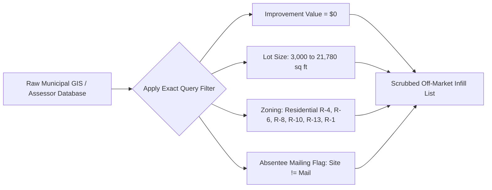

# Hampton Roads Off-Market Campaign Playbook and GIS Query Pack

A comprehensive, operational execution pack containing **GIS parcel scraping queries**, **skip-trace mailing list data schemas**, **customized direct mail offer templates**, **inbound phone intake scripts**, and a **standard Virginia Vacant Land Purchase Agreement** tailored to the **Hampton Roads Infill Buy Box**.

---

## 🗺️ Part 1: GIS Parcel Scraping Query Pack



---

### 1. City of Chesapeake GIS / Assessor Portal
* **GIS URL**: [gis.cityofchesapeake.net](https://gis.cityofchesapeake.net) / Chesapeake Real Estate Assessor
* **Database / REST Query**:
  ```sql
  SELECT 
      PARCEL_ID, 
      OWNER_NAME, 
      PROPERTY_ADDRESS, 
      MAILING_ADDRESS, 
      MAILING_CITY, 
      MAILING_STATE, 
      MAILING_ZIP, 
      ZONING, 
      LOT_AREA_SQFT, 
      ASSESSED_LAND_VALUE, 
      ASSESSED_IMPROVEMENT_VALUE
  FROM CHESAPEAKE_PARCELS
  WHERE ASSESSED_IMPROVEMENT_VALUE = 0
    AND LOT_AREA_SQFT BETWEEN 3000 AND 21780
    AND ZONING IN ('R-6', 'R-8', 'R-10', 'R-15')
    AND PROPERTY_ADDRESS != MAILING_ADDRESS
    AND (SUBDIVISION LIKE '%SOUTH NORFOLK%' 
         OR SUBDIVISION LIKE '%DEEP CREEK%' 
         OR SUBDIVISION LIKE '%WESTERN BRANCH%');
  ```

---

### 2. City of Hampton GIS (CityView Portal)
* **GIS URL**: [hampton.gov/cityview](https://www.hampton.gov)
* **Database / Search Parameters**:
  ```sql
  SELECT 
      PIN, 
      OWNER1, 
      SITE_ADDR, 
      MAIL_ADDR, 
      MAIL_CITY_ST_ZIP, 
      ZONE_DESC, 
      SQFT, 
      LAND_VAL, 
      BLDG_VAL
  FROM HAMPTON_ASSESSMENT_ROLL
  WHERE BLDG_VAL = 0
    AND SQFT BETWEEN 3000 AND 21780
    AND ZONE_DESC IN ('R-4', 'R-8', 'R-11', 'R-13')
    AND SITE_ADDR != MAIL_ADDR
    AND (NEIGHBORHOOD IN ('PHOEBUS', 'BUCKROE BEACH', 'FOX HILL', 'ABERDEEN'));
  ```

---

### 3. York County Property Info (VPIN Portal)
* **GIS URL**: [yorkcounty.gov](https://www.yorkcounty.gov)
* **Search Filters**:
  * **Property Class**: `100 - Vacant Residential Land`
  * **Zoning**: `R-7 (Single-Family Residential)` / `R-13` / `R-20`
  * **Size**: `0.07 Acres (3,000 sq ft)` to `0.50 Acres (21,780 sq ft)`
  * **Target Corridors**: `Grafton`, `Dare`, `Seaford`, `Ship Point`
  * **Owner Status**: Out-of-County / Out-of-State Mailing Addresses

---

### 4. City of Poquoson GIS
* **GIS URL**: [poquoson.gov](https://www.poquoson.gov)
* **Search Filters**:
  * **Class**: `Vacant Single-Family Lot` (Improvement Value = `$0`)
  * **Zoning**: `R-1` or `R-2` (Single-Family)
  * **Size**: `10,000 sq ft` to `21,780 sq ft (0.50 Acre)`
  * **Owner Status**: Absentee / Inherited Estates ($\ge 10\text{ years}$ of ownership)

---

## 📋 Part 2: Mailing List & Skip-Trace CSV Data Schema

When pulling records into Excel/Google Sheets before uploading to **BatchSkipTracing** or **PropStream**, use this standardized schema:

| Column Header | Description / Data Format | Example Value |
| :--- | :--- | :--- |
| `PARCEL_ID` | County Parcel / PIN Number | `0123-456-7890` |
| `OWNER_FIRST` | First Name of Record Owner | `Robert` |
| `OWNER_LAST` | Last Name / Estate Name | `Smith` |
| `SITE_ADDRESS` | Physical Property Address | `124 Guerriere St` |
| `SITE_CITY_ST` | City, State, Zip | `Chesapeake, VA 23324` |
| `MAIL_ADDRESS` | Owner Forwarding Address | `4500 Oceanfront Ave` |
| `MAIL_CITY_ST` | Owner Forwarding City/State | `Virginia Beach, VA 23451` |
| `ZONING` | Municipal Zoning Code | `R-6 (Residential)` |
| `LOT_SQFT` | Lot Area in Square Feet | `6,250 sq ft` |
| `ASSESSED_LAND` | Current Assessed Land Value | `$48,000` |
| `BUY_BOX_TIER` | Target Tier (1, 2, or 3) | `Tier 2` |
| `BLIND_OFFER` | Target Cash Offer (40%–55% of Assessed) | `$26,500` |
| `PHONE_NUMBER` | Skip-Traced Mobile Phone | `(757) 555-0192` |

---

## ✉️ Part 3: Customized Direct Mail Blind Offer Templates

---

### Template A: Tier 1 Compact Infill (3,000 – 5,000 sq ft) — $30k Cap
*Used for Phoebus (Hampton) & South Norfolk (Chesapeake)*

```text
[Date]

RE: Cash Offer for Vacant Lot on [SITE_ADDRESS], [SITE_CITY_ST]
Parcel ID: [PARCEL_ID]

Dear [OWNER_FIRST] [OWNER_LAST],

I am writing to make you a direct, all-cash offer to purchase your vacant residential parcel located on [SITE_ADDRESS]. 

I am a local private real estate investor in Hampton Roads and am currently acquiring infill lots for single-family residential construction.

      CASH OFFER AMOUNT: $[BLIND_OFFER] CASH

Why this offer is hassle-free for you:
1. 100% Cash Purchase — No bank approvals, lender contingencies, or appraisal delays.
2. I Pay All Closing Costs — I cover all deed preparation fees, title examination costs, and settlement fees.
3. Zero Commissions — No 6% real estate broker commissions deducted from your proceeds.
4. Flexible Closing Date — We can close in 14 to 30 days through a local licensed Virginia title company.

If you accept this offer, please sign the enclosed Purchase Agreement and return it in the prepaid envelope, or call/text me directly at [Your Phone Number].

Sincerely,

Chetan Thakur
Phone: [Your Phone Number]
Email: [Your Email]
```

---

### Template B: Tier 2 & Tier 3 Suburban / Estate (5,000 sq ft – 0.50 Acre)
*Used for Buckroe Beach, Deep Creek, Grafton, Seaford & Poquoson*

```text
[Date]

RE: Purchase Inquiry for [SITE_ADDRESS], [SITE_CITY_ST]
Parcel ID: [PARCEL_ID] | Lot Size: [LOT_SQFT]

Dear [OWNER_FIRST],

According to county records, you are the owner of the residential parcel on [SITE_ADDRESS]. 

I am actively acquiring buildable lots with public utilities in [SITE_CITY_ST] and would like to present an all-cash offer of:

      OFFER PRICE: $[BLIND_OFFER] (Certified Funds at Closing)

As the buyer, I agree to:
• Purchase the property in its "as-is, where-is" condition.
• Pay all transfer taxes, recording fees, and standard settlement expenses.
• Handle all county utility verifications and title search procedures.

If you are ready to sell this parcel and avoid future property tax bills, please call or text me at [Your Phone Number] or email [Your Email].

Warm regards,

Chetan Thakur
[Your Phone Number] | [Your Email]
```

---

## 📞 Part 4: Inbound Seller Phone Intake & Negotiation Script

When an absentee owner calls in response to your mailer, use this script to qualify the deal:

```text
"Hello! Thanks for calling. My name is Chetan. Are you calling regarding the letter I sent about the vacant lot on [Street Name]?"

[Seller responds: "Yes, I got your letter / offer."]

"Great! I appreciate you reaching out. Just to make sure we're looking at the exact same parcel:
1. Are you the sole owner on title, or are there other family members/heirs on the deed?
2. How long have you owned this lot?
3. To your knowledge, are city water and sewer lines connected or right out front on the street?
4. Is there any outstanding property tax balance, or are current taxes paid up to date?
5. If we can close in 20 to 30 days and I cover all the closing costs, does the $[Offer Amount] work for you, or did you have another figure in mind?"
```

---

## 📄 Part 5: Virginia Vacant Land Purchase and Sale Agreement (Standard Cash Contract)

```text
                     VIRGINIA REAL ESTATE PURCHASE AND SALE AGREEMENT
                                      (VACANT LAND)

1. PARTIES: This Agreement is made between _________________________________________ ("Seller"), 
   and CHETAN THAKUR and/or assigns ("Buyer").

2. PROPERTY: Seller agrees to sell and Buyer agrees to buy the real property located at:
   Street Address: ____________________________________________________________________
   City/County: ___________________________, Virginia | Parcel ID (PIN): _________________
   Legal Description: _________________________________________________________________

3. PURCHASE PRICE: The total purchase price to be paid by Buyer is: $____________________ (USD).
   (a) Earnest Money Deposit (held by Settlement Agent): $500.00
   (b) Balance of Purchase Price due at Closing in certified funds: $____________________

4. CLOSING & SETTLEMENT: Closing shall take place on or before ______________________, 2026, 
   at a licensed Virginia title company or settlement agent chosen by Buyer.

5. TITLE & CONVEYANCE: Seller shall convey good, marketable, and insurable fee-simple title to 
   the Property by General Warranty Deed (or Special Warranty Deed for Estates), free of all 
   liens, encumbrances, and unpaid real estate taxes.

6. CLOSING COSTS: Buyer agrees to pay all standard settlement fees, deed preparation fees, 
   title examination, and recording fees. Real estate taxes shall be prorated to the date of closing.

7. FEASIBILITY & STUDY PERIOD (30 DAYS): Buyer's obligation to close is contingent upon a thirty 
   (30) day study period from the Effective Date to verify zoning compliance, public utility (water/sewer) 
   availability, soil/environmental suitability, and road frontage. If Buyer determines the property is 
   unsatisfactory for any reason during this period, Buyer may terminate this Agreement in writing 
   and receive a full refund of the Earnest Money Deposit.

8. "AS-IS" CONDITION: Buyer agrees to accept the Property in its current physical condition.

SELLER(S):                                      BUYER:

________________________________________        ________________________________________
Signature                         Date          Signature (Chetan Thakur)         Date
```

---

## 🔗 Related Wiki Pages
* [[Off-Market Deal Sourcing and Candidate Parcels - Hampton Roads VA]]
* [[Buy Box - Hampton Roads Infill Land and Lots]]
* [[Virginia Land and Tax Deed Buy Box]]
* [[Virginia Tax Delinquent Sales and Judicial Auctions]]
* [[Hampton Roads Virginia Land Market]]
* [[Land Search Platforms and Deal Sourcing]]
* [[Property Due Diligence Funnel]]
* [[Seller Financing and Land Contracts]]
