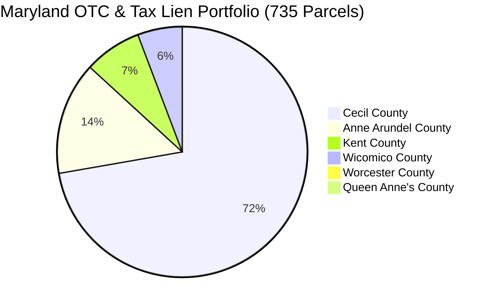

# Maryland Multi-County Tax Lien & OTC Master Directory 2026

This document presents the consolidated results of the **Maryland Statewide Tax Sale & OTC Crawler**, cataloging **735 active tax lien, OTC, and county-held parcels** across Maryland.

The primary master spreadsheet artifact is stored directly under the `/raw` folder:
* 📊 **Excel Workbook:** [Maryland_24_Counties_Tax_Lien_OTC_Master_2026.xlsx](file:///c:/Obsedian/RealEstateResearch/RealEstateResearch/raw/Maryland_24_Counties_Tax_Lien_OTC_Master_2026.xlsx) (Multi-tab workbook containing Master All-Counties Ranked Sheet + dedicated tabs per county + 24-Jurisdiction Directory).
* 📄 **CSV Dataset:** [Maryland_24_Counties_Tax_Lien_OTC_Master_2026.csv](file:///c:/Obsedian/RealEstateResearch/RealEstateResearch/raw/Maryland_24_Counties_Tax_Lien_OTC_Master_2026.csv)

---

## 1. Portfolio Breakdown by Jurisdiction

| Jurisdiction | Parcels Compiled | Statutory Interest | Redemption Window | County Tax Portal / OTC Contact |
| :--- | :--- | :--- | :--- | :--- |
| **Cecil County** | **526** | 12.0% Annual (1.0%/mo) | 6 Months | `taxsale@cecilcountymd.gov` \| (410) 996-5385 |
| **Anne Arundel County** | **106** | 12.0% Annual (1.0%/mo) | 6 Months | `financeinfo@aacounty.org` \| (410) 222-1144 |
| **Kent County** | **54** | 12.0% Annual (1.0%/mo) | 6 Months | `financeinfo@kentgov.org` \| (410) 778-7478 |
| **Wicomico County** | **42** | 12.0% Annual (1.0%/mo) | 6 Months | `finance@wicomicocounty.org` \| (410) 548-4840 |
| **Worcester County** | **5** | 12.0% Annual (1.0%/mo) | 6 Months | `taxes@co.worcester.md.us` \| (410) 632-0686 |
| **Queen Anne's County** | **2** | 10.0% Annual | 6 Months | `treasury@qac.org` \| (410) 758-0414 |

---

## 2. Top Statewide Tier-1 Alpha Liens (Ultra-Low LTV & Extreme Equity)

Below are candidate liens across Maryland exhibiting the lowest LTVs and greatest equity buffers:

| County | Account / APN ID | Assessed Value | Opening Bid | LTV (%) | Equity Cushion | Location / Description |
| :--- | :--- | :--- | :--- | :--- | :--- | :--- |
| **Cecil** | `01-002333` | **$217,800** | **$1,954.40** | **0.9%** | **+$215,845.60** | 2.045 ACRES 200 N Bohemia Ave, Cecilton |
| **Cecil** | `01-000519` | **$546,167** | **$3,746.41** | **0.7%** | **+$542,420.59** | 0.492 ACRE 200 E Main St, Cecilton |
| **Cecil** | `02-005859` | **$222,633** | **$2,803.11** | **1.3%** | **+$219,829.89** | 1.216 ACRE 188 Spears Hill Rd, Chesapeake City |
| **Kent** | `06008011` | **$19,600** | **$666.92** | **3.4%** | **+$18,933.08** | **2.00 ACRES** W/S Caulks Field Rd, W of Chestertown |
| **Kent** | `04010574` | **$30,700** | **$1,180.51** | **3.8%** | **+$29,519.49** | **108 Prospect St, Chestertown** (41x120 Lot) |
| **Queen Anne's** | `02-027208` | **$45,000** | **$2,500.00** | **5.6%** | **+$42,500.00** | 0 REEAND LN, Queen Anne's County |
| **Kent** | `02011549` | **$5,900** | **$407.31** | **6.9%** | **+$5,492.69** | **0.25 ACRES** S/S River Rd, E of Chestertown |
| **Worcester** | `01012444` | **$19,300** | **$1,281.01** | **6.6%** | **+$18,018.99** | 105' X 195' N Side Colona Road, Pocomoke |
| **Anne Arundel** | `100000756300` | **$10,200** | **$797.71** | **7.8%** | **+$9,402.29** | Infill Parcel, Anne Arundel County (List #6) |

---

## 3. Spreadsheet Architecture: Tabs & Features

The generated workbook [Maryland_24_Counties_Tax_Lien_OTC_Master_2026.xlsx](file:///c:/Obsedian/RealEstateResearch/RealEstateResearch/raw/Maryland_24_Counties_Tax_Lien_OTC_Master_2026.xlsx) includes:

1. **`MASTER_ALL_COUNTIES` Tab:**
   * Contains all 735 properties sorted by lowest LTV percentage.
   * Color-coded investment tiering (Green = Tier 1 Alpha, Yellow = Tier 2 High Equity, Blue = Tier 3 Infill, Red = Tier 4 Avoid).
2. **Dedicated County Tabs:**
   * `Anne Arundel`, `Cecil`, `Kent`, `Queen Annes`, `Wicomico`, and `Worcester`.
   * Formatted currency values, percentages, and direct contact details for purchasing certificates.
3. **`24_County_Directory` Tab:**
   * Master directory of all 24 Maryland jurisdictions with statutory interest rates, redemption windows, tax sale months, OTC policies, and portal URLs.

---

## 4. Live Telegram Bot Integration

All 735 parcels are indexed in `tax_lien_checker.py`. Whenever you send a parcel number in Telegram (e.g. `/parcel 01002333` or `/parcel 06008011` or `/tax 01012444`), the bot automatically identifies the jurisdiction, pulls the lien opening bid, and calculates the equity buffer.

---

## Related Wiki Pages
* [[Deal Analysis - Kent County Tax Liens 2026]]
* [[Deal Analysis - Anne Arundel County Tax Liens 2026]]
* [[Maryland Tax Lien OTC and Surplus Directory - 24 Jurisdictions]]
* [[Maryland Tax Lien Investing]]
* [[Property Due Diligence Funnel]]
