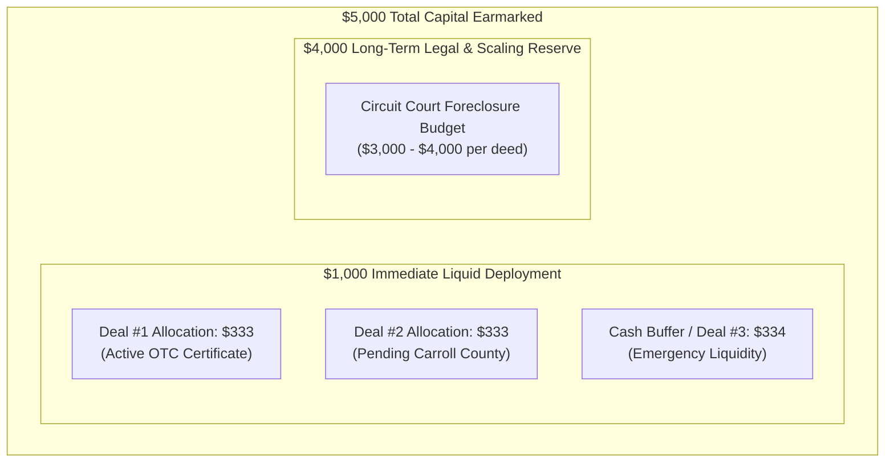
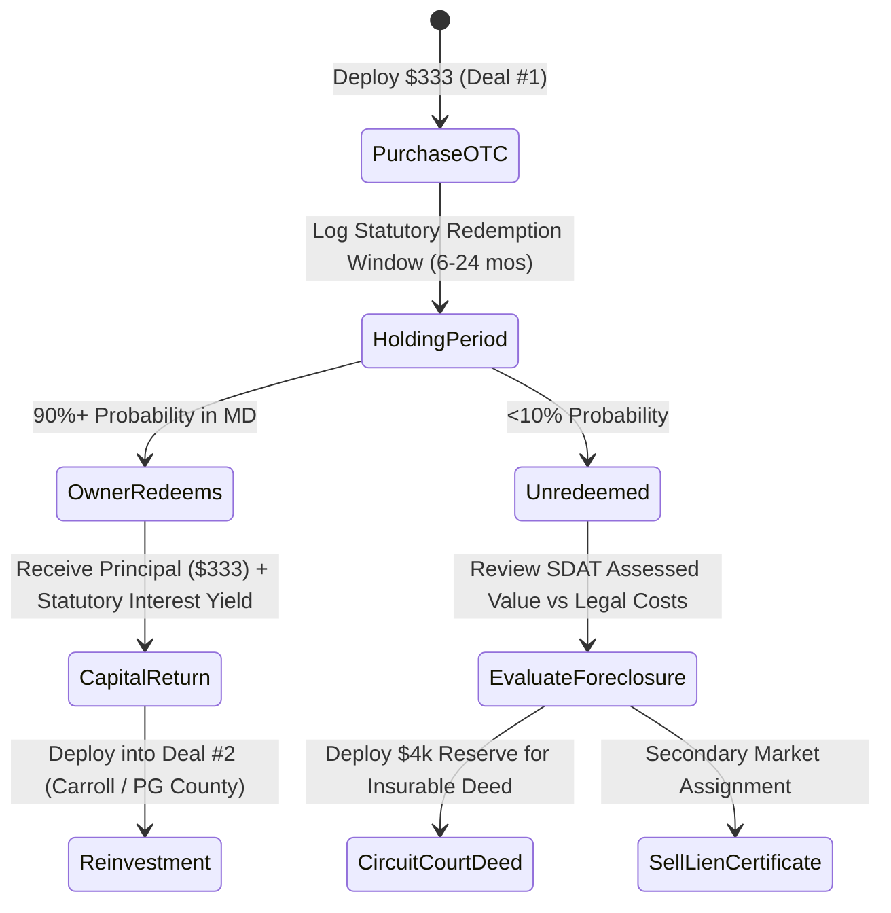
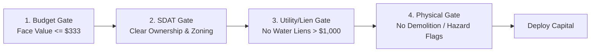

# Maryland Tax Lien Deal Structuring - Budget and Guardrails

A quantitative guide to capital deployment, deal structuring, and reinvestment strategies for Maryland tax lien investors operating under strict liquid capital guardrails ($1,000 total liquid cash, $333 maximum per deal).

---

## 💰 Capital Guardrail Architecture

The core tenet of the **Safe Deed Methodology** established in [[Summary - Blueprint Chetan Thakur]] is capital preservation:

$$\text{Max Risk Per Deal} = \frac{\text{Liquid Cash Deployment}}{3} = \frac{\$1,000}{3} \approx \$333.33$$

### Strategic Benefits of the 33.3% Rule
1. **Zero Blowup Risk**: If an initial certificate runs into an unforeseen title defect or administrative delay, $667 (66.7%) of liquid capital remains untouched.
2. **Asymmetric Learning Curve**: Allows the investor to execute the full lifecycle (purchase, recording, interest collection, redemption) for under $333.
3. **Continuous Pipeline**: Enables parallel sourcing in multiple counties without exhausting cash.

---

## 📊 Three-Tier Deal Structure Breakdown

| Tier | Deal Type | Target Capital Range | Sourcing Channel | Primary Target County | Strategy & Expected Outcome |
| :--- | :--- | :--- | :--- | :--- | :--- |
| **Tier 1** | **OTC / Leftover Lien** | **$200 – $333** | Direct County OTC List | [[Baltimore City Tax Sale Market]] | Buy leftover certificates at face value with zero auction competition. Collect statutory interest yield upon redemption or learn record-keeping with zero stress. |
| **Tier 2** | **Competitive Auction** | **$500 – $2,000** | Live / Online County Auction | [[Prince Georges County Tax Sale Market]] & [[Carroll County Land and Tax Sale Market]] | Bid on higher-assessed residential lots/homes. Benefits from DC commuter demand and high redemption certainty. |
| **Tier 3** | **Circuit Court Foreclosure** | **$5,000 – $15,000** | Legal Chancery Proceeding | Maryland Circuit Courts | Retain attorney after statutory redemption window (6mo–2yr) expires. Extinguish owner equity to acquire fee-simple deed for fraction of assessed value. |

---

## 📈 Compounding & Reinvestment Cycle

### Reinvestment Mechanics
* **Scenario A: Standard Redemption (Interest Income)**:
  * Principal ($333) is returned with statutory interest (ranging from 6% to 24% annual equivalent depending on local county code and timing).
  * Returned capital plus accrued yield is rolled into the next candidate identified in [[Carroll County Land and Tax Sale Market]] or [[Prince Georges County Tax Sale Market]].
* **Scenario B: Non-Redemption (Deed Acquisition)**:
  * When a certificate on a vetted residential lot goes unredeemed, the investor taps the earmarked **$4,000 long-term legal reserve** to hire a Maryland real estate attorney to file in Circuit Court, acquiring property equity worth multiples of the total cash invested.

---

## 🛡️ Due Diligence Filter Pipeline

Before any capital is released from the $333 guardrail allocation, candidate parcels must pass four mandatory gates:

1. **Budget Gate**: Face value of certificate must not exceed $333.
2. **SDAT Assessment Gate**: Confirm legal description, residential classification, and assessed value exceeds lien amount by at least $10\times$.
3. **Municipal Encumbrance Gate**: Confirm the parcel does not carry massive delinquent municipal water/sewer bills or environmental cleanup liens.
4. **Physical Recon Gate**: Verify street access and confirm there is no structural hazard citation from city/county housing inspection departments.

---

## 🔗 Related Wiki Pages
* [[Summary - Blueprint Chetan Thakur]]
* [[Maryland Tax Lien Investing]]
* [[Tax Lien School]]
* [[Baltimore City Tax Sale Market]]
* [[Prince Georges County Tax Sale Market]]
* [[Carroll County Land and Tax Sale Market]]
* [[Maryland Mind Map]]
