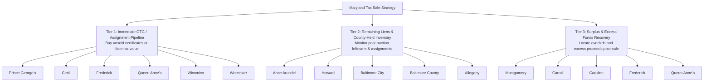

# Maryland Tax Lien OTC and Surplus Directory - 24 Jurisdictions

A comprehensive, operational master directory and investor strategy guide cataloging all **24 local jurisdictions** across the State of Maryland (23 counties plus Baltimore City) for **Tax-Sale Liens**, **Over-The-Counter (OTC) / Assignment Certificates**, and **Tax Sale Surplus / Excess Funds**.

---

## ⚖️ Maryland Statutory Framework: Tax Lien vs Deed Distinction

> [!IMPORTANT]
> **Maryland is a Tax Lien State, NOT an Immediate Tax Deed State.**
> * **Certificate of Sale**: When bidding at a Maryland tax sale, you are purchasing a **Tax Sale Certificate (Lien)** representing the delinquent tax balance plus fees—**not immediate ownership of the real estate**.
> * **Statutory Redemption Window**: Property owners have a minimum **6-month statutory redemption period** (extended in some circumstances) to redeem the property by paying the delinquent taxes plus statutory interest (ranging from **6% to 24% annually**, set by each county).
> * **Foreclosure of Right of Redemption**: If unredeemed after 6 months, the certificate holder must file a complaint in the **Circuit Court** to foreclose the owner's equity of redemption and obtain a fee-simple judicial deed.
> * **OTC & Assignment Mechanism**: In Maryland, post-sale unsold certificates become **County-Held Liens**. Many jurisdictions offer these over-the-counter or via direct **Assignment Sales** at face tax value (first-come, first-served) without competitive bidding.

---

## 🗺️ Master Directory: 24 Maryland Jurisdictions

The State of Maryland consists of 23 counties plus the independent City of Baltimore. Below is the master reference matrix detailing official government portals, 2026 auction dates, OTC availability, and surplus fund resources:

| # | Jurisdiction | Official Government Website | 2026 Tax Sale Date | Direct Tax-Sale / Finance Portal | OTC / Assignment Status | Surplus / Excess Funds Status | Investor Grade |
| :-: | :--- | :--- | :-: | :--- | :--- | :--- | :-: |
| **1** | **Prince George's County** | [princegeorgescountymd.gov](https://www.princegeorgescountymd.gov/) | May 11 | [PG Tax Sale Portal](https://taxsale.princegeorgescountymd.gov/) | 🟢 **YES** — Explicit Assignment/OTC sale | Research Finance/Treasury | **⭐ A+** |
| **2** | **Cecil County** | [ccgov.org](https://www.ccgov.org/) | Jun 1 | [Cecil Tax Sale](https://www.cecilcountymd.gov/376/Tax-Sale) | 🟢 **YES** — County-held OTC list | Published | **⭐ A+** |
| **3** | **Frederick County** | [frederickcountymd.gov](https://www.frederickcountymd.gov/) | May 11 | [Frederick Tax Sale](https://www.frederickcountymd.gov/2005/Tax-Sale) | 🟢 **YES** — Assignment + OTC certs | 🟢 Published active list | **⭐ A+** |
| **4** | **Queen Anne's County** | [qac.org](https://www.qac.org/) | May 19 | [Queen Anne's Tax Sale](https://www.qac.org/598/Tax-Sale) | 🟢 **YES** — OTC Certificates | 🟢 Published on tax page | **⭐ A+** |
| **5** | **Wicomico County** | [wicomicocounty.org](https://www.wicomicocounty.org/) | Jun 9 | [Wicomico Tax Info](https://www.wicomicocounty.org/392/Tax-Sale-Information) | 🟢 **YES** — OTC window (Jun 23–Dec 31) | 🟢 Published active list | **⭐ A+** |
| **6** | **Worcester County** | [co.worcester.md.us](https://www.co.worcester.md.us/) | Jun 9 *(May 13–15 actual)* | [Worcester Tax Sale](https://www.worcestermd.gov/departments/treasurer/sale) | 🟢 **YES** — 2025 & 2026 OTC liens | 🟢 Published excess proceeds | **⭐ A+** |
| **7** | **Howard County** | [howardcountymd.gov](https://www.howardcountymd.gov/) | Jun 3 *(Jun 10 actual)* | [Howard Tax Sale](https://www.howardcountymd.gov/finance/tax-sale) | 🟡 Assignment program (periodic inventory) | 🟢 Published | **A** |
| **8** | **Anne Arundel County** | [aacounty.org](https://www.aacounty.org/) | Jun 3 | [Anne Arundel Tax Sale](https://www.aacounty.org/finance/tax-sale) | 🟡 Remaining Liens list published | Research Finance | **A** |
| **9** | **Baltimore City** | [baltimorecity.gov](https://www.baltimorecity.gov/) | May 18 | [Baltimore City Tax Sale](https://taxsale.baltimorecity.gov/) | 🟡 Bulk / Assignment inventory pool | Research City Finance | **A** |
| **10** | **Allegany County** | [alleganygov.org](https://www.alleganygov.org/) | May 28 | [Allegany Tax Sale](https://www.alleganygov.org/181/Tax-Lien-Sale) | 🟡 Unsold property sale follows auction | Research Finance | **A−** |
| **11** | **Baltimore County** | [baltimorecountymd.gov](https://www.baltimorecountymd.gov/) | Aug 27 | [Baltimore County Tax Sale](https://www.baltimorecountymd.gov/departments/budfin/taxpayer-services/tax-sale) | 🟡 Unsold liens become County-held | Surplus info available | **B+** |
| **12** | **Caroline County** | [carolinemd.org](https://www.carolinemd.org/) | Aug 21 | [Caroline Tax Sale](https://www.carolinecounty.org/170/Tax-Sale) | ⚪ Unverified public OTC | 🟢 Current excess-funds list | **B+** |
| **13** | **Carroll County** | [carrollcountymd.gov](https://www.carrollcountymd.gov/) | Jun 26 | [Carroll Collections](https://www.carrollcountymd.gov/government/directory/comptroller/collectionstaxes/) | 🔴 No public OTC (reconfirm) | 🟢 Detailed surplus dataset | **B+** |
| **14** | **Montgomery County** | [montgomerycountymd.gov](https://www.montgomerycountymd.gov/) | Jun 8 | [Montgomery Tax Sale](https://www.montgomerycountymd.gov/tax-sale-information-procedures) | 🔴 **NO OTC LIENS** | 🟢 Prime published surplus list | **B+** |
| **15** | **Calvert County** | [calvertcountymd.gov](https://www.calvertcountymd.gov/) | May 22 | [Calvert County Portal](https://www.calvertcountymd.gov/) | ⚪ No verified public OTC | County Treasurer | **B** |
| **16** | **Charles County** | [charlescountymd.gov](https://www.charlescountymd.gov/) | May 12 | [Charles County Portal](https://www.charlescountymd.gov/) | 🟡 Certificate assignments permitted | Treasury | **B** |
| **17** | **Dorchester County** | [dorchestercountymd.com](https://dorchestercountymd.com/) | May 19 | [Dorchester Portal](https://dorchestercountymd.com/) | ⚪ No verified public OTC | Finance/Treasury | **B** |
| **18** | **Garrett County** | [garrettcountymd.gov](https://www.garrettcountymd.gov/) | May 18 | [Garrett County Portal](https://www.garrettcountymd.gov/) | ⚪ No verified active OTC | Tax Collection | **B** |
| **19** | **Harford County** | [harfordcountymd.gov](https://www.harfordcountymd.gov/) | Jun 3 | [Harford County Portal](https://www.harfordcountymd.gov/) | 🟡 Certificate assignments permitted | Treasury | **B** |
| **20** | **Kent County** | [kentcounty.com](https://www.kentcounty.com/) | May 21 | [Kent County Portal](https://www.kentcounty.com/) | ⚪ No verified active OTC | Finance | **B** |
| **21** | **Somerset County** | [somersetmd.us](https://www.somersetmd.us/) | Jun 11 | [Somerset County Portal](https://www.somersetmd.us/) | ⚪ No verified active OTC | Finance | **B** |
| **22** | **St. Mary's County** | [stmaryscountymd.gov](https://www.stmaryscountymd.gov/) | Mar 6 | [St. Mary's Portal](https://www.stmaryscountymd.gov/) | ⚪ No verified active OTC | Treasurer | **B** |
| **23** | **Talbot County** | [talbotcountymd.gov](https://www.talbotcountymd.gov/) | May 20 | [Talbot County Portal](https://www.talbotcountymd.gov/) | ⚪ No verified active OTC | Finance | **B** |
| **24** | **Washington County** | [washco-md.net](https://www.washco-md.net/) | Jun 2 | [Washington County Portal](https://www.washco-md.net/) | ⚪ No verified active OTC | Treasurer | **B** |

---

## 🎯 Strategic Investor Allocation Tiers



---

## 🥇 Deep-Dive: Tier 1 Immediate OTC Targets

### 1. **Prince George's County (Grade: ⭐ A+)**
* **Mechanism**: Explicit **"Assignment Tax Certificate Sale"** conducted for unsold certificates.
* **Terms**: Sold at **face tax value only** on a **first-come, first-served basis** (no live bidding competition).
* **Process**: List is published following the annual auction; purchasers apply directly by email to County Finance.
* **Portal**: [Prince George's Assignment Property List](https://taxsale.princegeorgescountymd.gov/PropertyListASale.aspx)
* **Strategy**: Screen for infill residential lots and single-family homes near D.C. transit corridors.

### 2. **Cecil County (Grade: ⭐ A+)**
* **Mechanism**: Unsold liens become **County-Held Liens** available over-the-counter by paying the delinquent amount.
* **Statutory Interest**: Stated at **12% annually (1% per month)**.
* **Inventory**: Publishes a dedicated *"Cecil Owned Property Liens"* list starting mid-June annually.
* **Portal**: [Cecil County OTC Tax Liens](https://www.cecilcountymd.gov/376/Tax-Sale)

### 3. **Frederick County (Grade: ⭐ A+)**
* **Dual Opportunity**: Offers **Over-the-Counter Tax Lien Certificates** through the Treasury Department AND publishes an active **Excess Tax Sale Proceeds List**.
* **Assignment Sale**: Conducts an assignment sale post-auction where unsold properties are offered at lien value.
* **Portal**: [Frederick County Tax Sale & Excess Proceeds](https://www.frederickcountymd.gov/2005/Tax-Sale)

### 4. **Queen Anne's County (Grade: ⭐ A+)**
* **Convenience**: Publishes both **Available OTC Certificates** and **Tax Sale Excess Funds** directly on a single unified webpage.
* **Portal**: [Queen Anne's OTC Certificates & Excess Funds](https://www.qac.org/598/Tax-Sale)

### 5. **Wicomico County (Grade: ⭐ A+)**
* **Active Window**: 2026 OTC sale opens **June 23 and runs through December 31, 2026**.
* **Documents**: Provides downloadable OTC list, purchaser agreement, and excess funds info.
* **Portal**: [Wicomico OTC List & Tax Sale Info](https://www.wicomicocounty.org/392/Tax-Sale-Information)

### 6. **Worcester County (Grade: ⭐ A+)**
* **Active Inventory**: Publishes *"Over the Counter Liens from Tax Sale 2025 & 2026"* with a direct purchase form and Excess Proceeds List.
* **Portal**: [Worcester OTC Liens & Excess Proceeds](https://www.worcestermd.gov/departments/treasurer/sale)

---

## 🥈 Deep-Dive: Prime Surplus & Excess Funds Channels

When tax-sale properties are bid above the opening delinquent tax amount (overbid), the resulting surplus funds belong to the prior record owner or lienholders. Several Maryland counties publish clean, itemized excess proceeds datasets:

1. **Montgomery County (5/5 Rating for Surplus)**:
   * Explicitly disallows OTC lien sales, but publishes a comprehensive **Tax Sale Surplus / Excess Funds** schedule.
   * [Montgomery Tax Sale & Excess Funds](https://www.montgomerycountymd.gov/tax-sale-information-procedures)
2. **Carroll County**:
   * Publishes detailed surplus tables containing: Property ID, Prior Owner, Sale Date, Winning Bid, Balance Owed, Property Address, Current Owner, and Liber/Folio references.
   * [Carroll County Surplus Funds List](https://www.carrollcountymd.gov/government/directory/comptroller/collectionstaxes/surplus-funds-list/)
3. **Caroline County**:
   * Clean published Tax Sale Surplus & Excess Funds list updated annually.
   * [Caroline County Surplus Funds](https://www.carolinecounty.org/170/Tax-Sale)

---

## 🔍 Essential Statewide Due Diligence Portals

Bookmark and query these three core Maryland statewide databases for parcel due diligence:

1. **[Maryland State Tax Sale Ombudsman & Schedule](https://dat.maryland.gov/Pages/tax-sale-information.aspx)**:
   * Official guidance, legal rights, and county tax sale schedules.
2. **[Maryland SDAT Real Property Data Search](https://sdat.dat.maryland.gov/RealProperty/Pages/default.aspx)**:
   * State Department of Assessments and Taxation search for legal descriptions, land/building assessments, Liber/Folio deed references, and zoning.
3. **[Maryland MD iMAP Property Data ArcGIS REST API](https://mdgeodata.md.gov/imap/rest/services/PlanningCadastre/MD_PropertyData/MapServer/0/query)**:
   * Automated GIS endpoint for parcel geometry, acreage, coordinates, and absentee owner detection.

---

## 📊 Recommended Investor Tracking Schema

When compiling and screening candidate tax liens, maintain this exact tabular database schema:

```
┌─────────────────────────────────────────────────────────────────────────────┐
│                       TAX LIEN INVESTOR DATA SCHEMA                         │
├────────────────────────────────┬────────────────────────────────────────────┤
│ • County / Jurisdiction        │ • Certificate Purchaser / Status           │
│ • Tax Sale Date & Year         │ • Redeemed / Unredeemed Status             │
│ • Property Account Number (APN)│ • Post-Sale / OTC Availability             │
│ • Owner of Record & Mailing    │ • County-Held Certificate Flag             │
│ • Property Premise Address     │ • Surplus / Excess Overbid Funds           │
│ • SDAT Assessed Land Value     │ • Foreclosure Eligibility Date (6-mo mark) │
│ • SDAT Assessed Building Value │ • Vacant Land vs. Improved Structure       │
│ • Total Assessed Value         │ • Estimated After-Repair Value (ARV)       │
│ • Delinquent Tax Amount Due    │ • Potential Equity Spread                  │
│ • Minimum Opening Bid / Price  │ • Due Diligence & Zoning Notes             │
└────────────────────────────────┴────────────────────────────────────────────┘
```

---

## ⚠️ Critical Operational Caveats

1. **Schedule Discrepancies**:
   * Never rely solely on the state-level SDAT calendar for auction registration deadlines. Always verify on the **individual County Finance / Treasury webpage** (e.g. Howard County and Worcester County publish local auction dates that differ by several weeks from state aggregates).
2. **Private Certificate Assignments**:
   * In jurisdictions that do not run an active public OTC window (e.g., Baltimore County, Harford, Charles), tax certificates remain **freely assignable by private contract** under Maryland law. Investors can acquire certificates directly from winning bidders prior to foreclosure.
3. **Automated Telegram Screening**:
   * You can query any parcel in these 24 jurisdictions in real-time via `@RealestateResearch_bot` using `/lookup <address>` or `/parcel <APN>` (see [[Synthesis - Maryland SDAT and Tax Lien Telegram Intelligence Bot]]).

---

## 🔗 Related Knowledge Base Links
* [[Maryland Tax Lien Investing]]
* [[Maryland Tax Sale Due Diligence and Parcel Screening]]
* [[Synthesis - Maryland SDAT and Tax Lien Telegram Intelligence Bot]]
* [[1000 Dollar Maryland Investment Plan - Deal Sourcing and Allocation]]
* [[Active Deal Screening - Baltimore City and Prince Georges County]]
* [[50-State Statutory Tax Sale Matrix]]
* [[Property Due Diligence Funnel]]
* [[Accessing County Parcel Databases and GIS Data]]
* [[Seller Financing and Land Contracts]]
* [[Analysis - 1883 Cedar Drive Severn MD]]
