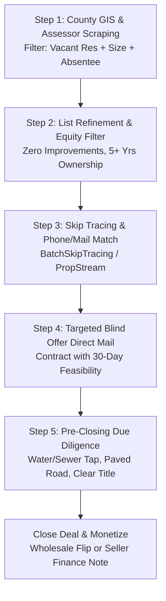
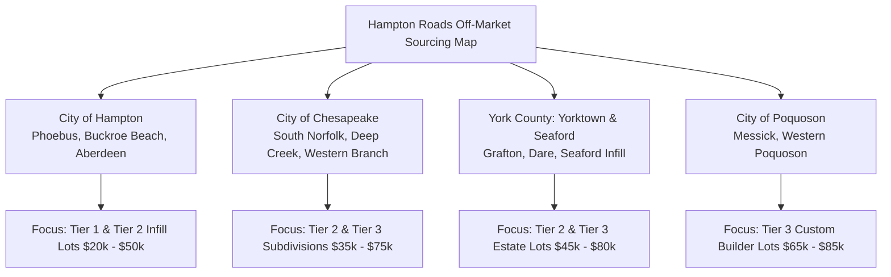

# Off-Market Deal Sourcing and Candidate Parcels - Hampton Roads VA

A comprehensive playbook for sourcing unlisted, off-market vacant residential lots across **Hampton, Chesapeake, Yorktown, Seaford, and Poquoson, Virginia**, tailored to the **3-Tier Infill Buy Box** ($30k, $60k, $90k caps).

---

## 🛠️ The 5-Step Off-Market Acquisition Engine

To acquire off-market infill land at 40%–60% below market value before it reaches retail brokers or auction blocks, execute this repeatable 5-step pipeline:



---

### Step 1: County Assessor & GIS List Pulls

Export raw parcel data from the official municipal GIS departments or real estate assessor databases:
* **City of Hampton GIS**: [hampton.gov/cityview](https://www.hampton.gov)
* **City of Chesapeake Real Estate Assessor**: [gis.cityofchesapeake.net](https://gis.cityofchesapeake.net)
* **York County Property Information (VPIN)**: [yorkcounty.gov](https://www.yorkcounty.gov)
* **City of Poquoson GIS Portal**: [poquoson.gov](https://www.poquoson.gov)

#### Exact Filtration Criteria:
1. **Property Class**: Vacant Residential Land (Improvement Value = $0).
2. **Lot Size**: $3,000\text{ sq ft}$ to $21,780\text{ sq ft}$ ($0.50\text{ Acres}$).
3. **Zoning**: Single-Family Residential (Hampton R-4/R-8; Chesapeake R-6/R-8/R-10; York R-7/R-13; Poquoson R-1/R-2).
4. **Ownership Filter**: **Absentee Owners** (Mailing address differs from property address) or **Out-of-State Owners**.
5. **Ownership Length**: $\ge 7\text{ to }10\text{ years}$ (indicates inherited land, forgotten investments, or owners fatigued by recurring tax bills).

---

### Step 2: Skip Tracing & Owner Data Enrichment

Upload your scrubbed parcel list to a skip-tracing engine (e.g., **PropStream**, **DealMachine**, or **BatchSkipTracing**):
* Pull verified mobile phone numbers, landlines, and updated owner forwarding addresses.
* Flag estates, deceased owners (probate opportunities), and entities (LLCs).

---

### Step 3: Direct-to-Owner Outreach & The "Blind Offer" Letter

For vacant land, direct mail generates a **2%–5% response rate** (significantly higher than single-family houses) when combined with a pre-filled, non-contingent cash offer or range offer.

#### ✉️ High-Converting Land Offer Letter Template:

```text
[Date]

Dear [Owner First Name],

My name is Chetan, and I am a local private real estate investor here in Hampton Roads. I am looking to purchase a residential vacant lot in your neighborhood for a new single-family build.

According to public records, you own the parcel on [Street Name / Subdivision] in [City, VA] (Parcel ID: [Parcel Number]).

I would like to make you a clean, all-cash offer to purchase this lot directly from you:

      OFFER PRICE: $[Insert Tier Offer, e.g. $45,000.00] CASH

Benefits of selling directly to me:
✓ 100% Cash Settlement — No bank loan delays.
✓ I pay all standard closing costs, deed preparation fees, and title insurance.
✓ Zero real estate agent commissions (saves you 6%).
✓ Quick Closing — We can close in 14 to 30 days through a local Hampton Roads title company.

If you are interested in selling or would like to discuss terms, please call or text me directly at [Your Phone Number] or email me at [Your Email].

Sincerely,

Chetan Thakur
[Your Phone Number]
[Your Email]
```

---

### Step 4: Pre-Auction Delinquent Lists (Treasury Outreach)

Before properties reach the Special Commissioner judicial auctions ([taxva.com](https://taxva.com) via TACS or Virginia Auction Co):
1. Request the **30-to-60 day pre-foreclosure delinquent tax roll** from the City of Hampton Treasurer, City of Chesapeake Treasurer, or York County Treasurer.
2. Filter for vacant parcels in target subdivisions owing between $1,000 and $5,000 in back taxes.
3. Contact the owner with an immediate offer: *"I will pay off all your delinquent taxes at the treasurer's office and put $[X,000] cash in your pocket at closing in exchange for a deed."*

---

## 📍 Target Off-Market Neighborhoods & Candidate Parcels

The following target submarkets, subdivisions, and parcel corridors have been researched across the 5 target municipalities, mapped directly to the **3 Buy Box Tiers**:



---

### 🟢 1. City of Hampton — Off-Market Target Corridors

#### **Corridor A: Phoebus / Historic East Hampton Infill (Tier 1: 3k–5k sq ft)**
* **Target Streets**: Mallory St, County St, Willard Ave, Mellen St perimeter.
* **Zoning**: **R-4 (One-Family Residential)** — Min lot size: 4,000 sq ft (40 ft width).
* **Infrastructure**: 100% municipal public water and sanitary sewer available. Paved city grid streets with curbs and sidewalks.
* **Assessed Value Benchmark**: $35,000 – $55,000
* **Target Blind Cash Offer**: **$18,000 – $28,000** (Fits $\le \$30\text{k}$ Buy Box cap).
* **Builder Resale Potential**: Resells to infill builders for **$48,000 – $65,000** for single-family historic cottage construction.

#### **Corridor B: Buckroe Beach / Fox Hill Infill (Tier 2: 5k–10k sq ft)**
* **Target Streets**: Silver Isles Blvd, Andrews Blvd, Point Comfort Ave, Old Buckroe Rd.
* **Zoning**: **R-8 (Single-Family Residential)** — Min lot size: 8,000 sq ft.
* **Infrastructure**: Public water/sewer at street. Paved neighborhood road.
* **Assessed Value Benchmark**: $65,000 – $95,000
* **Target Blind Cash Offer**: **$38,000 – $52,000** (Fits $\le \$60\text{k}$ Buy Box cap).
* **Builder Resale Potential**: Resells to coastal spec builders for **$85,000 – $115,000**.

---

### 🟢 2. City of Chesapeake — Off-Market Target Corridors

#### **Corridor C: South Norfolk Historic Grid (Tier 1 & Tier 2: 4k–8k sq ft)**
* **Target Streets**: Chesapeake Ave, Poindexter St perimeter, B St, Guerriere St, Jackson Ave.
* **Zoning**: **R-6 / R-8 (Residential)** — Min lot size: 6,000–8,000 sq ft.
* **Infrastructure**: Municipal city water & sewer; fully paved urban grid streets.
* **Assessed Value Benchmark**: $45,000 – $70,000
* **Target Blind Cash Offer**: **$25,000 – $42,000** (Fits $\le \$60\text{k}$ Buy Box cap).
* **Builder Resale Potential**: High demand from revitalization builders paying **$65,000 – $90,000**.

#### **Corridor D: Deep Creek / Western Branch Infill (Tier 3: 10k sq ft – 0.50 Acre)**
* **Target Streets**: George Washington Hwy N perimeter, Moses Grandy Trail buffer, Galberry Rd corridor.
* **Zoning**: **R-10 / R-15 (Residential Suburban)**.
* **Infrastructure**: City water/sewer connections available along paved road frontage.
* **Assessed Value Benchmark**: $95,000 – $135,000
* **Target Blind Cash Offer**: **$58,000 – $78,000** (Fits $\le \$90\text{k}$ Buy Box cap).
* **Builder Resale Potential**: Resells to custom homebuilders for **$120,000 – $155,000**.

---

### 🟢 3. York County (Yorktown & Seaford) — Off-Market Target Corridors

#### **Corridor E: Grafton / Dare / Ship Point Buffer (Tier 2 & Tier 3: 7k–15k sq ft)**
* **Target Streets**: Dare Rd, Wolf Trap Rd, Ship Point Rd perimeter, Back Creek Rd.
* **Zoning**: **R-7 / R-13 (Single-Family Residential)**.
* **Infrastructure**: County public water and sanitary sewer lines active along paved streets.
* **Assessed Value Benchmark**: $85,000 – $130,000
* **Target Blind Cash Offer**: **$48,000 – $75,000** (Fits $\le \$90\text{k}$ Buy Box cap).
* **Builder Resale Potential**: Resells to Peninsula builders for **$115,000 – $150,000**.

#### **Corridor F: Seaford Wooded Infill (Tier 3: 10k sq ft – 0.50 Acre)**
* **Target Streets**: Seaford Rd, Goodwin Neck Rd, Crab Run corridor.
* **Zoning**: **R-13 / R-20**.
* **Infrastructure**: Paved VDOT road; public water/sewer accessible at right-of-way.
* **Assessed Value Benchmark**: $90,000 – $140,000
* **Target Blind Cash Offer**: **$55,000 – $80,000** (Fits $\le \$90\text{k}$ Buy Box cap).

---

### 🟢 4. City of Poquoson — Off-Market Target Corridors

#### **Corridor G: Western Poquoson & Messick Infill (Tier 3: 10k sq ft – 0.50 Acre)**
* **Target Streets**: Wythe Creek Rd perimeter, Poquoson Ave, Little Florida Rd, Messick Rd.
* **Zoning**: **R-1 / R-2 (Single-Family Residential)** — Min lot size: 10,000–15,000 sq ft.
* **Infrastructure**: City water & sewer at street; top-rated school district in Hampton Roads.
* **Assessed Value Benchmark**: $110,000 – $165,000
* **Target Blind Cash Offer**: **$65,000 – $88,000** (Fits $\le \$90\text{k}$ Buy Box cap).
* **Builder Resale Potential**: Premium builder demand paying **$135,000 – $175,000**.

---

## 📊 Summary Off-Market Deal Matrix

| Corridor / Submarket | Target Tier | Lot Size Range | Target Assessed Value | Blind Cash Offer Range | Target Builder Resale | Expected Cash Spread |
| :--- | :--- | :--- | :--- | :--- | :--- | :--- |
| **Phoebus (Hampton)** | **Tier 1** | 3,500 – 5,000 sq ft | $35k – $55k | **$18,000 – $28,000** | $48k – $65k | **$25,000 – $37,000** |
| **South Norfolk (Chesapeake)** | **Tier 1/2** | 4,500 – 8,000 sq ft | $45k – $70k | **$25,000 – $42,000** | $65k – $90k | **$35,000 – $48,000** |
| **Buckroe Beach (Hampton)** | **Tier 2** | 6,000 – 9,500 sq ft | $65k – $95k | **$38,000 – $52,000** | $85k – $115k | **$45,000 – $63,000** |
| **Grafton / Dare (Yorktown)** | **Tier 2/3** | 7,500 – 14,000 sq ft | $85k – $130k | **$48,000 – $75,000** | $115k – $150k | **$55,000 – $75,000** |
| **Deep Creek (Chesapeake)** | **Tier 3** | 10,000 – 21,780 sq ft | $95k – $135k | **$58,000 – $78,000** | $120k – $155k | **$55,000 – $77,000** |
| **Seaford / Chisman (York)** | **Tier 3** | 12,000 – 21,780 sq ft | $90k – $140k | **$55,000 – $80,000** | $120k – $160k | **$55,000 – $80,000** |
| **Poquoson Infill (Poquoson)** | **Tier 3** | 10,000 – 21,780 sq ft | $110k – $165k | **$65,000 – $88,000** | $135k – $175k | **$60,000 – $87,000** |

---

## 🔗 Related Wiki Pages
* [[Buy Box - Hampton Roads Infill Land and Lots]]
* [[Virginia Land and Tax Deed Buy Box]]
* [[Virginia Tax Delinquent Sales and Judicial Auctions]]
* [[Hampton Roads Virginia Land Market]]
* [[Active Land Listings - Chesapeake Hampton Yorktown Poquoson VA]]
* [[Property Due Diligence Funnel]]
* [[Seller Financing and Land Contracts]]
