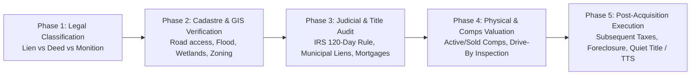

# Regional Mid-Atlantic Tax Sale Master Directory - MD VA NJ DE

A comprehensive cross-border strategic master directory comparing the legal frameworks, operational tools, cadastre GIS systems, and acquisition workflows across the four contiguous Mid-Atlantic jurisdictions: **Maryland, Virginia, New Jersey, and Delaware**.

---

## 🧭 Regional Statutory Matrix & Archetype Comparison

```mermaid
graph TD
    A[Mid-Atlantic Tax Sale Ecosystem] --> B[Maryland<br>County Tax Lien Certificates]
    A --> C[Virginia<br>Judicial / Nonjudicial Tax Deeds]
    A --> D[New Jersey<br>Municipal Tax Sale Certificates]
    A --> E[Delaware<br>Judicial Monition Sheriff Sales]
    
    B --> B_Detail[24 Counties/City | 6-Mo Redemption | 6%-24% Interest<br>SDAT & MD iMAP GIS]
    C --> C_Detail[95 Counties + 38 Independent Cities | Zero Post-Sale Redemption<br>Va Code § 58.1-3965 / 3975 | Special Commissioner Deeds]
    D --> D_Detail[564 Municipalities | 2-Yr Redemption | 8%-18% Interest + Premium<br>NJGIN Property Explorer & Chancery Court Foreclosure]
    E --> E_Detail[3 Counties | 1-Yr Redemption @ 15% Penalty<br>Delaware CourtConnect & FirstMap GIS]
```

| Jurisdiction | Legal Archetype | Administrative Level | Statutory Return / Penalty | Redemption Window | Core Public Cadastre & Legal Tool |
| :--- | :--- | :--- | :--- | :--- | :--- |
| **Maryland** | **Tax Lien Certificate** | 23 Counties + Baltimore City | **6% – 24% Annual** (County statutory rates; e.g., Anne Arundel 12%, Baltimore City 18%) | **6 Months** | [SDAT Real Property](https://sdat.dat.maryland.gov/RealProperty/Pages/default.aspx) · [MD iMAP](https://imap.maryland.gov/) · [MDLandRec](https://mdlandrec.net/) |
| **Virginia** | **Tax Deed (Judicial / Nonjudicial)** | 95 Counties + 38 Independent Cities (133 total) | Real Estate Equity Spread (Purchase at 20%–50% of FMV) | **None** (Deed conveyed upon Circuit Court confirmation) | [Virginia.gov Directory](https://www.virginia.gov/local-government/) · Local County/City GIS · Circuit Court Dockets |
| **New Jersey** | **Tax Sale Certificate** | 564 Municipalities across 21 Counties | **8% – 18% Annual** (+ 2%–6% YEP + Cash Premium) | **2 Years** (or 6 mo for municipal-held) | [NJGIN Property Explorer](https://www.nj.gov/njgin/edata/parcels/) · [NJ Municipal Directory](https://www.nj.gov/nj/gov/direct/municipality.shtml) |
| **Delaware** | **Monition / Sheriff's Sale** | 3 Counties (New Castle, Kent, Sussex) | **15% Flat Penalty** upon redemption | **1 Year** | [Delaware CourtConnect](https://courtconnect.courts.delaware.gov/) · [Delaware FirstMap GIS](https://firstmap.delaware.gov/) |

---

## 🗺️ Cross-Border Geospatial & Cadastre Intelligence Systems

When performing due diligence on tax liens and deeds across state lines, use these official state-level cadastre platforms:

```
┌─────────────────┬─────────────────────────────────────────────────────────────────────────────┐
│ Jurisdiction    │ Official Statewide Parcel & Title Infrastructure                            │
├─────────────────┼─────────────────────────────────────────────────────────────────────────────┤
│ Maryland        │ • SDAT Real Property Search (Valuation & Assessment)                        │
│                 │ • MD iMAP Cadastre MapServer (ArcGIS REST Boundaries & Coordinates)         │
│                 │ • MDLandRec.net (Statewide Recorded Land Records & Deeds)                   │
├─────────────────┼─────────────────────────────────────────────────────────────────────────────┤
│ Virginia        │ • Virginia Local Government Portal (133 Locality Links)                     │
│                 │ • Locality Enterprise GIS (City/County WebGIS Portals)                      │
│                 │ • Circuit Court Case Information System (CCIS - Judicial Dockets)           │
├─────────────────┼─────────────────────────────────────────────────────────────────────────────┤
│ New Jersey      │ • NJGIN Property Explorer (Official Block/Lot & MOD-IV Assessment Database) │
│                 │ • NJ County Board of Taxation Portals (Record Search)                       │
│                 │ • Superior Court of New Jersey - Chancery Division Foreclosure Dockets      │
├─────────────────┼─────────────────────────────────────────────────────────────────────────────┤
│ Delaware        │ • Delaware FirstMap (Statewide Enterprise Parcel GIS)                       │
│                 │ • Delaware CourtConnect (Superior Court Monition Case Records)              │
│                 │ • County Recorder of Deeds (New Castle, Kent, Sussex)                       │
└─────────────────┴─────────────────────────────────────────────────────────────────────────────┘
```

---

## 💼 Strategic Capital Allocation by Investment Strategy

| Capital Allocation Model | Primary Target State | Core Playbook & Operational Advantage |
| :--- | :--- | :--- |
| **Rapid Velocity Yield (12%–18%)** | **Maryland** | Shortest statutory redemption window in the nation (**6 months**). If redeemed, investor earns 12%–18% annual return quickly; if unredeemed, fast track to Circuit Court foreclosure. |
| **High Statutory Compounding & Subs** | **New Jersey** | 18% statutory interest on balances > $1,500. Paying quarterly subsequent taxes ("subs") compounds capital at 18% protected by super-priority status. |
| **Direct Fee-Simple Real Estate Capture** | **Virginia** | Clean judicial foreclosure through Circuit Court with Special Commissioner’s Deed and zero post-sale redemption. Ideal for land flippers, builders, and infill developers. |
| **Single-Asset Monition Purchases** | **Delaware** | Clear judicial monition process via Superior Court Sheriff’s sale with 15% guaranteed redemption penalty or property ownership after 1 year. |

---

## 🔍 Master Due Diligence Funnel for Regional Portfolios



1. **Phase 1: Legal Classification**:
   * Verify whether the target asset is a tax lien certificate (MD, NJ), a judicial tax deed (VA), or a monition deed sale (DE).
2. **Phase 2: Cadastre & GIS Verification**:
   * Query the parcel using **MD iMAP** (MD), **NJGIN Property Explorer** (NJ), **FirstMap** (DE), or local county/city GIS (VA).
   * Confirm legal road frontage (> 30 ft), utility access, zoning classification, and environmental constraints (Chesapeake Bay Critical Area / RPA, FEMA flood zones).
3. **Phase 3: Judicial & Title Audit**:
   * Search state land records and court dockets (**MDLandRec**, **CourtConnect**, **CCIS**, or **NJ County Clerk**).
   * Confirm proper constitutional notice to all interested parties and screen for federal IRS liens (28 U.S.C. § 2410 120-day redemption).
4. **Phase 4: Valuation & Comps**:
   * Review sold comps via MLS/Zillow/Land.com and establish the Maximum Allowable Bid (MAO) or statutory lien basis.
5. **Phase 5: Post-Acquisition Title Clearance**:
   * Clear clouded tax titles via **Tax Title Services (TTS)** (30–60 days, ~$1,800) or judicial **Quiet Title Action** (3–6 months, ~$3,500) prior to retail resale or construction financing.

---

## 🔗 Related Knowledge Base Links
* [[Maryland Tax Lien Investing]]
* [[Delaware Monition and Tax Deed Market]]
* [[New Jersey Municipal Tax Sale Market]]
* [[Virginia Judicial Tax Deed and Independent Cities Market]]
* [[Tax Lien State Directory - 14 Investor Certificate Jurisdictions]]
* [[50-State Statutory Tax Sale Matrix]]
* [[Tax Lien and Deed Market Regimes]]
* [[Accessing County Parcel Databases and GIS Data]]
* [[Property Due Diligence Funnel]]
* [[Best Regional Lots - DC VA MD DE]]
