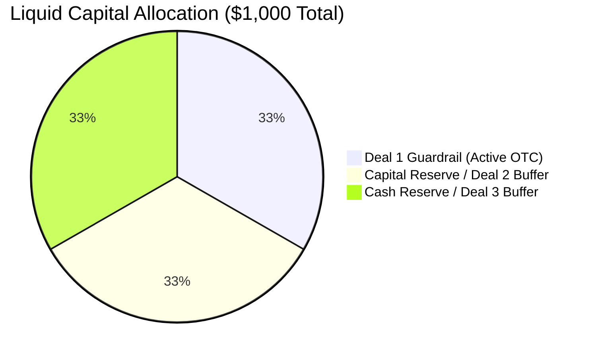
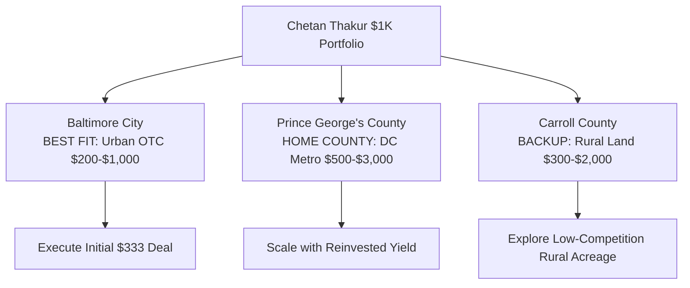
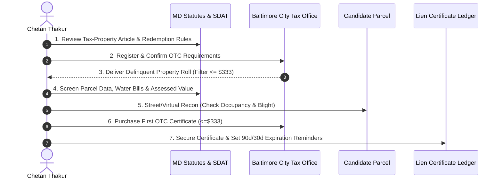

# Summary - Blueprint Chetan Thakur

A complete extraction and synthesis of the **Personalized 90-Day Safe Deed Blueprint** prepared for **Chetan Thakur** by **Tax Lien School (TLS)** on August 24, 2026.

---

## 📋 Executive Profile & Capital Parameters

| Parameter | Specification | Strategic Rationale |
| :--- | :--- | :--- |
| **Investor** | Chetan Thakur | Transitioning from W-2 career/401(k) to secure real estate assets |
| **Advisory Firm** | [[Tax Lien School]] (TLS) | Structured low-risk tax deed & lien education |
| **Date of Plan** | August 24, 2026 | Active execution window: Fall 2026 |
| **Total Capital Earmarked** | **$5,000** | Total multi-year balance for tax deed investing |
| **Immediate Liquid Cash** | **$1,000** | Cash on hand ready to deploy without loans |
| **Capital Guardrail** | **$333 max per deal** | Strict rule: Never risk $> 33.3\%$ of liquid cash on a single property |
| **Primary Goal** | **First Deed in 90 Days** | Acquire one solid property certificate at county auction/OTC this season |
| **Experience Level** | Course / Webinar Graduate | Transitioning from educational theory to active live execution |
| **Target State** | **Maryland** | Strong property values, statutory yields, and insurable foreclosure path |

---

## 🏛️ Maryland Strategic Fundamentals

According to the blueprint, Maryland represents a premier jurisdiction for low-capital investors due to five key attributes:
1. **Tax Lien Certificate System**: Investors buy certificates representing delinquent taxes (earning statutory interest) while owners retain a statutory redemption period (6 months to 2 years).
2. **High Mid-Atlantic Redemption Rates**: Most owners or mortgage holders redeem, providing reliable, high-yield cash flow rather than high-risk speculative forfeiture.
3. **Low Minimum Entry Point**: Rural and urban leftover certificates frequently start well under $1,000 (and under $333).
4. **Clear Judicial Foreclosure Path**: If unredeemed, investors file in Maryland Circuit Court to extinguish the owner's equity of redemption, resulting in an insurable deed.
5. **Predictable Pre-Sale Window**: Counties publish delinquent tax rolls 30 to 60 days in advance, allowing thorough due diligence.

---

## 📍 Three-County Selection Matrix

### 1. Best Fit: [[Baltimore City Tax Sale Market]]
* **Type**: Tax Lien Sale & Over-The-Counter (OTC) Leftover Inventory
* **Price Range**: $200 – $1,000
* **Schedule**: Annual Spring Tax Sale + year-round OTC list
* **Fit**: Maryland's largest catalog of low-face-value liens ($\le \$333$). OTC list eliminates live auction bidding pressure, allowing deliberate analysis.
* **Immediate Move**: Contact Baltimore City Tax Sale Office to request the active OTC delinquent list.

### 2. Home County: [[Prince Georges County Tax Sale Market]]
* **Type**: Competitive Annual Tax Sale Auction
* **Price Range**: $500 – $3,000
* **Schedule**: Annual Tax Sale
* **Fit**: Proximity to Washington D.C. ensures high underlying equity and superior redemption rates. Natural second-stage scaling target after initial Baltimore City acquisition.
* **Immediate Move**: Download delinquent roll and review county registration rules.

### 3. Backup: [[Carroll County Land and Tax Sale Market]]
* **Type**: Tax Lien Sale & Post-Sale Residuals
* **Price Range**: $300 – $2,000
* **Schedule**: Annual County Tax Sale
* **Fit**: Low institutional bidder presence allows acquiring liens at or near face value. Semi-rural and rural vacant lots provide valuable urban vs. rural comparison.
* **Immediate Move**: Contact Carroll County Treasurer's office to confirm sale dates and OTC policies.

---

## 💡 Three-Tier Deal Structures

1. **Tier 1: OTC / Leftover Certificate ($200 – $333) [START HERE]**:
   * *Mechanism*: Direct county purchase of unsold certificates without auction competition.
   * *Target*: Baltimore City residential vacant lot or low-tax parcel.
   * *Outcome*: Earn statutory interest or retain foreclosure rights within $333 guardrail.
2. **Tier 2: Competitive Auction Certificate ($500 – $2,000) [LEVEL UP]**:
   * *Mechanism*: Live or online county bidding (bid-down on interest or bid premium).
   * *Target*: Moderate assessed value single-family homes or buildable lots in Prince George's or Carroll County.
   * *Outcome*: Scaled yield on higher-value collateral.
3. **Tier 3: Circuit Court Foreclosure / Deed Transfer ($5,000 – $15,000) [SCALE LATER]**:
   * *Mechanism*: Retain Maryland real estate attorney after statutory redemption window expires to extinguish owner equity.
   * *Target*: High-spread unredeemed lots or distressed parcels.
   * *Outcome*: Fee-simple title acquisition at a deep discount to assessed value.

---

## 🛠️ 7-Step Action Checklist

1. **Understand Maryland's Tax Lien Statutes**: Master Tax-Property Article sections on redemption periods, statutory interest rates, and Circuit Court foreclosure rules.
2. **Register With Baltimore City's Tax Sale Office**: Confirm OTC leftover availability, accepted payment methods, and registration documentation.
3. **Request and Review Delinquent Property List**: Filter published roll for certificates $\le \$333$ (the liquid capital guardrail). Compile parcel numbers, addresses, and tax amounts into a spreadsheet.
4. **Research Properties Using County Parcel Records**: Verify zoning, ownership history, and assessed value via Maryland SDAT. Filter out condemned shells, environmental citations, or massive water bills.
5. **Drive or Virtually Scout Top 5 Properties**: Conduct street-level checks using GIS/Google Street View to verify structural integrity, occupancy, and neighborhood stability.
6. **Purchase First OTC Lien Certificate**: Execute direct OTC purchase of one vetted certificate $\le \$333$. Secure physical/digital certificate and note redemption deadlines.
7. **Track, Document, and Plan Second Deal**: Log purchase date and required notices in tracking ledger. Begin parallel research on Carroll County OTC availability to compound redeemed capital.

---

## 📅 90-Day Execution Timeline (Aug 25 – Nov 22, 2026)

* **Phase 1: Foundation (Aug 25 – Sep 7, 2026)**:
  * [ ] Read Maryland Tax-Property Article sections on tax sales and foreclosure rights.
  * [ ] Bookmark Baltimore City and Carroll County official tax sale portals.
  * [ ] Set up tracking spreadsheet (Parcel #, Address, Lien Amount, Type, Dates).
  * [ ] Segregate $333 guardrail funds into a dedicated investment account.
* **Phase 2: Research + Recon (Sep 8 – Oct 8, 2026)**:
  * [ ] Contact Baltimore City tax sale office to request current OTC catalog.
  * [ ] Filter list for liens $\le \$333$ and enter candidates into spreadsheet.
  * [ ] Research parcels on Maryland SDAT database (confirm property type & assessed value).
  * [ ] Virtually or physically scout top 5 candidate properties.
* **Phase 3: Execute (Oct 9 – Nov 7, 2026)**:
  * [ ] Select single best OTC candidate (prioritize residential, occupied, low face value).
  * [ ] Complete OTC purchase at Baltimore City tax sale office and receive certificate.
  * [ ] Log statutory redemption deadline and set calendar alerts at 90 days and 30 days prior.
  * [ ] Begin parallel research on Carroll County OTC inventory.
* **Phase 4: Close + Plan Next (Nov 8 – Nov 22, 2026)**:
  * [ ] Confirm certificate is filed securely and documentation is stored.
  * [ ] Review Carroll County delinquent list; identify 3–5 candidate liens for Deal #2.
  * [ ] Calculate invested capital ($333), remaining cash ($667), and projected interest yield.
  * [ ] Set 90-day review reminder to track redemption status and reinvest proceeds.

---

## 🧭 Service Tracks: DIY vs. TLS Coaching

* **Path A — Do It Yourself (DIY)**:
  * Self-directed timeline using free public portals and SDAT searches.
  * Independent bid-setting and solo auction attendance.
  * Cost: Personal time and steep learning curve.
* **Path B — Tax Lien School Guided (Recommended by TLS)**:
  * 1-on-1 coach specializing in Maryland tax lien statutes.
  * Deal-by-deal pre-purchase review and max bid check.
  * Live Zoom research walkthroughs and TLS community deal flow access.

---

## 🔗 Related Wiki Pages
* [[Maryland Tax Lien Investing]]
* [[Maryland Tax Lien Deal Structuring - Budget and Guardrails]]
* [[Tax Lien School]]
* [[Baltimore City Tax Sale Market]]
* [[Prince Georges County Tax Sale Market]]
* [[Carroll County Land and Tax Sale Market]]
* [[Maryland Mind Map]]
