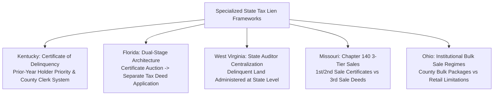

# Tax Lien State Directory - 14 Investor Certificate Jurisdictions

A strategic operational index covering the **14 primary U.S. jurisdictions** that issue **Investor Tax-Lien Certificates, Certificates of Delinquency, or Purchaser Lien Assignments**. 

Unlike tax-deed states, these jurisdictions allow investors to purchase senior debt certificates earning high statutory interest, backed by super-priority collateral.

---

## 📊 The 14-State Statutory Comparison Matrix

| State | Primary Instrument | Statutory Interest / Penalty | Redemption Window | Bidding / Allocation Method | Unique Institutional Quirks |
| :--- | :--- | :--- | :--- | :--- | :--- |
| **Alabama** | Tax Lien Certificate / ADOR Inventory | **12% Annual** (1% per month) | **3 Years** | Premium Bidding or Direct State Assignment | County option to use lien vs. deed auctions; ADOR manages state-held repository inventory. |
| **Arizona** | Tax Lien Certificate | Up to **16% Annual** | **3 Years** | Bid-Down Interest (Down to 0.25% or 0%) | Annual February auctions; statutory judicial foreclosure to secure Treasurer's Deed. |
| **Colorado** | Tax Lien Certificate | Variable (**Fed Discount Rate + 9%**, ~11%–15%) | **3 Years** | Premium Bidding (Premium does not earn interest) | Certificate holder applies directly to County Treasurer for Treasurer's Deed after 3 years. |
| **Florida** | Tax Sale Certificate | Up to **18% Annual** (w/ **5% Mandatory Floor**) | **2 Years** | Bid-Down Interest (Down to 0.25%) | 5% statutory floor guarantees 5% return even if redeemed in month 1; separate Tax Deed Application stage. |
| **Illinois** | Tax Sale Certificate | Up to **18% per 6-Month Period** (36% annualized) | **2 to 2.5 Years** | Bid-Down Penalty % (Down to 0%) | County Trustee manages forfeited/unsold liens; highly lucrative penalty structure. |
| **Indiana** | Tax Sale Certificate | **10% Year 1 / 15% Year 2** | **1 Year** | Premium Bidding | Accelerated 1-year redemption; certified notice requirements strictly enforced. |
| **Iowa** | Tax Sale Certificate | **24% Annual** (2% per month) | **2 Years** (or 9 mo for abandoned) | Bid-Down Undivided Percentage Ownership | High statutory interest (2% flat/mo); bidding drives down % equity interest (e.g., 100% down to 1%). |
| **Kentucky** | **Certificate of Delinquency** | **12% Annual** + 13% Admin Fee + Legal Fees | **1 Year** | County Clerk Sale / Priority Registration | **Prior-year certificate holders have statutory purchase priority** on subsequent year delinquencies. |
| **Mississippi** | Tax Lien Certificate | **18% Annual** (1.5% per month) | **2 Years** | Bid-Down Interest / % Ownership | April/August auctions; Chancery Clerk administers redemption payouts and tax deed issuances. |
| **Missouri** | Certificate of Purchase (Ch. 140) | **10% Annual** (plus penalties) | **1 Year** (1st/2nd sale) / **90 Days** (3rd sale) | Premium Bidding | 3-tier auction system: 1st/2nd sales require 1-yr redemption; 3rd sales convey instant deed or 90-day window. Large cities (St. Louis/KC) use separate Land Tax Collection Law. |
| **Nebraska** | Tax Sale Certificate | **14% Annual** | **3 Years** | Round-Robin / Random Allocation / Premium | Annual March sales; certificate holder can proceed via administrative Treasurer deed or judicial foreclosure. |
| **Ohio** | Tax Lien Certificate | Negotiated / Statutory Rate | **1 to 2 Years** | **Bulk Negotiated Sales** vs. Retail Public Auction | Many counties sell in bulk packages to institutional servicers rather than single retail auctions. Verify Treasurer policy. |
| **West Virginia** | Purchaser Tax Lien | **12% Annual** | **18 Months** | Centralized State Auditor Auction | **State Auditor administers statewide delinquent land program**; comprehensive online inventory + County Assessor maps. |
| **Wyoming** | Tax Sale Certificate | **15% Annual** + 3% Flat Penalty | **4 Years** | Round-Robin / Random Draw | Long 4-year redemption window; high 18% first-year combined return. |

---

## 🏛️ Deep-Dive Analysis of Distinct State Frameworks

### 1. Kentucky — The Certificate of Delinquency & Priority Rights
* In Kentucky, the instrument is legally defined as a **Certificate of Delinquency** (KRS Chapter 134).
* The tax claims are collected and administered by the **County Clerk** rather than the County Sheriff/Treasurer.
* **Statutory Priority Rule**: Registered third-party purchasers who hold a Certificate of Delinquency on a parcel from a prior tax year have **first statutory right of refusal** to purchase current-year delinquent certificates before they are offered to general bidders.
* **Collection Fees**: In addition to 12% statutory interest, purchasers can recover statutory pre-litigation administrative notice fees ($100–$400) and reasonable attorney fees upon legal action.

### 2. Florida — The Dual-Stage Certificate to Deed System
* **Stage 1 (Certificate Auction)**: Conducted annually in May/June across 67 counties on RealAuction. Bidders bid down interest from 18% to 0.25%. The statutory **5% Mandatory Minimum Floor** ensures that any redemption generates at least 5% gross return.
* **Stage 2 (Tax Deed Application - TDA)**: If a certificate remains unredeemed after 2 years, the certificate holder submits a TDA to the Tax Collector, paying all delinquent taxes and fees to bring the property to a public **Tax Deed Auction** conducted by the Clerk of the Court.

### 3. West Virginia — Centralized State Auditor Administration
* Unlike most states where auctions are decentralized at county treasuries, West Virginia tax sales are coordinated centrally through the **West Virginia State Auditor’s Office (Delinquent and Nonentered Lands Division)** (W. Va. Code § 11A-3-1 et seq.).
* Investors can research inventory statewide via the Auditor's online portal and cross-reference county assessor GIS tax maps.

### 4. Missouri — Chapter 140 vs. Municipal Land Tax Laws
* **Chapter 140 Counties (Standard)**:
  * **First & Second Offerings**: Convey a Certificate of Purchase with a 1-year redemption period at 10% statutory interest.
  * **Third Offering**: When a property fails to sell at 1st and 2nd sales, it is offered at a 3rd sale with an accelerated 90-day redemption window or immediate deed.
* **Charter Jurisdictions (St. Louis City, Jackson County / Kansas City)**: Operate under the **Municipal Land Reutilization Law** or **Land Tax Collection Law**, utilizing direct judicial Sheriff’s foreclosure sales that convey immediate deeds without post-sale redemption.

### 5. Ohio — Bulk Servicer Programs vs. Retail Liens
* Under Ohio Revised Code § 5721.30–5721.43, counties may sell tax certificates, but many major urban counties (Cuyahoga, Franklin, Hamilton) bundle delinquent certificates into **multi-million-dollar bulk negotiated sales** sold to institutional Wall Street buyers.
* Retail investors must verify whether a county conducts retail public auctions or maintains OTC struck-off lists before researching individual parcels.

---

## 🔗 Related Wiki Pages
* [[50-State Statutory Tax Sale Matrix]]
* [[Tax Lien and Deed Market Regimes]]
* [[Maryland Tax Lien Investing]]
* [[New Jersey Municipal Tax Sale Market]]
* [[Delaware Monition and Tax Deed Market]]
* [[Virginia Judicial Tax Deed and Independent Cities Market]]
